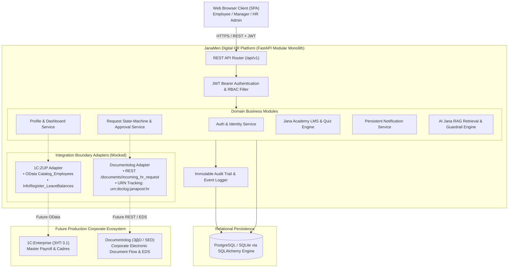
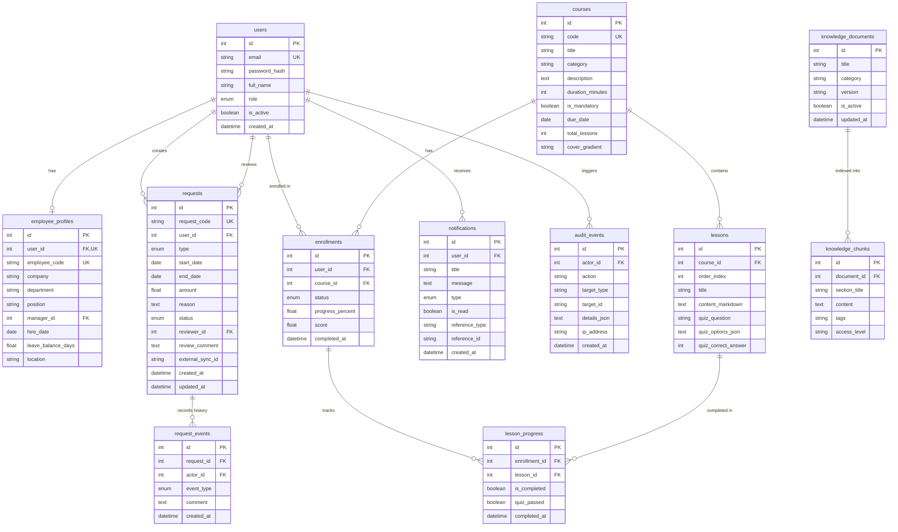
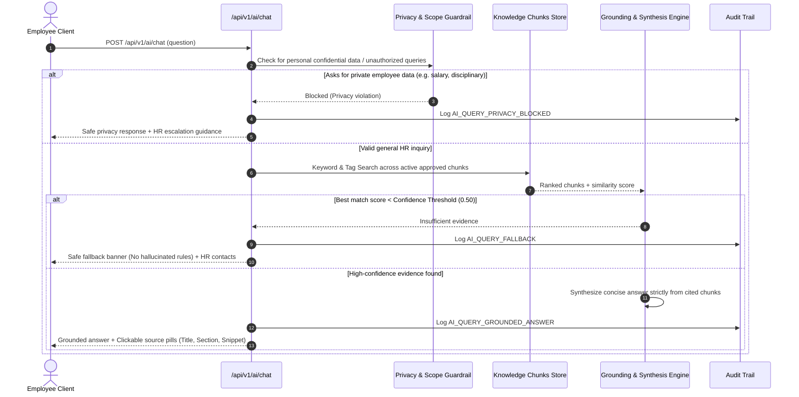

# JanaМен (Janamen) Architecture & Enterprise Design

## 1. Executive Architecture Summary

**JanaМен** is a unified Digital HR self-service platform designed for the **Jana Post × Terricon Valley Hackathon 2026 (Challenge 02: Digital HR)**. 
It replaces fragmented systems and channels with a centralized, responsive web platform that integrates:
- Authoritative, read-only employee profiles and balances (1C:ZUP integration boundary).
- Self-service requests with full audit history (Documentolog integration boundary).
- Role-based approvals strictly enforced on the backend.
- Compliance and mandatory learning with persistent progress tracking (Jana Academy).
- Evidence-grounded corporate policy assistance with strict citations and zero-hallucination safe fallbacks (AI Jana).
- Real-time persistent notifications and immutable system audit logging.

---

## 2. System Context & Component Architecture

---

## 3. Security & Access Control Model (RBAC)

Authorization is strictly enforced **on the server** across all endpoints. The UI visibility toggles serve only as visual ergonomics; any direct or unauthorized API request returns standard HTTP 403 Forbidden or 401 Unauthorized.

| Feature / Action | Employee (`employee`) | Manager (`manager`) | HR Administrator (`hr_admin`) |
| :--- | :---: | :---: | :---: |
| **View Own Profile & Balances** | Allowed (Read-Only) | Allowed (Read-Only) | Allowed (Read-Only) |
| **Submit Requests** | Allowed (Self) | Allowed (Self) | Allowed (Self) |
| **Approve / Reject Requests** | **DENIED (403)** | Allowed (**Direct Reports Only**) | Allowed (Company Scope) |
| **Access Team Approvals Queue** | **DENIED (403)** | Allowed | Allowed |
| **Access HR Admin & Knowledge** | **DENIED (403)** | **DENIED (403)** | Allowed |
| **View System Audit Logs** | **DENIED (403)** | **DENIED (403)** | Allowed |
| **Inspect Integration Telemetry** | **DENIED (403)** | **DENIED (403)** | Allowed |
| **Complete Courses & Quizzes** | Allowed | Allowed | Allowed |
| **Query AI Jana Knowledge** | Allowed (Public Chunks) | Allowed (Public Chunks) | Allowed (All Chunks) |

### IDOR & Scope Prevention
1. **Reporting Hierarchy Check**: When a manager calls `/requests/{id}/approve` or `/requests/{id}/reject`, the system verifies `EmployeeProfile.manager_id == current_user.id`. A manager cannot approve another manager's reports.
2. **Requester Identity Derivation**: When creating a request, `user_id` is extracted strictly from the validated JWT token claims (`sub`), never from client input.
3. **Official HR Data Immutability**: Core employee fields (position, employee code, leave balance) cannot be modified via client update requests.

---

## 4. Relational Database Schema

---

## 5. Enterprise Integration Boundaries

### 1C:ZUP (ЗУП 3.1) Architecture Boundary
- **Role**: Authoritative master source for employee identity, reporting line structure, and annual leave entitlement.
- **Access Pattern**: Read-only via secure OData or JSON HTTP Services.
- **Data Flow**:
  1. On login / session sync, JanaMen queries `Catalog_Employees` and `InformationRegister_LeaveBalances`.
  2. Local `employee_profiles.leave_balance_days` mirrors the external balance.
  3. No employee or manager can manually override the balance in JanaMen.

### Documentolog (ЭДО / SED) Architecture Boundary
- **Role**: Formal document registration, official order generation, and corporate e-signature (EDS / ЭЦП) archival.
- **Access Pattern**: Outbound webhook / REST push on final request approval.
- **Data Flow**:
  1. Employee submits request in JanaMen (`status=PENDING`).
  2. Manager reviews and approves request (`status=APPROVED`).
  3. JanaMen's `DocumentologAdapter` generates a tracking URN (`urn:doclog:janapost:hr:2026:{id}`) and external document ID (`DOCLOG-2026-{id}`).
  4. The external reference is permanently recorded on `requests.external_sync_id` and displayed in the audit history.

---

## 6. AI Jana Retrieval-Grounded Architecture (RAG)

