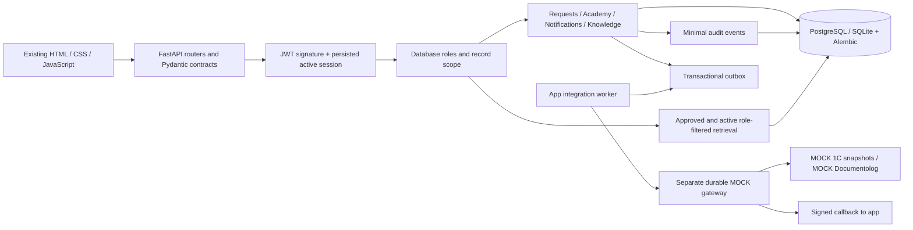

# JanaМен architecture

The original frontend is retained. The core is a modular FastAPI application with Pydantic contracts, domain services, SQLAlchemy2 models and Alembic migrations. PostgreSQL17 is the Compose database; SQLite remains supported locally. An optional separately running FastAPI gateway and app worker implement only the canonical MOCK integration contract.

File-based source bundles under `knowledge/` are schema-validated and imported atomically as drafts by an active HR operator. Source approval remains an explicit existing HR workflow. Optional `AI_RETRIEVAL_MODE=ml` applies a learned linear relevance ranker after database approval/activity/role/language filters and the evidence-coverage gate. Training is offline under `ml/`; runtime loads bounded JSON coefficients and imports no training library. Default lexical retrieval and exact source citations remain the same. See `knowledge/README.md` and `ml/README.md`.

Authentication is bearer-only. Passwords use PBKDF2-SHA256 with a per-hash random salt and 600,000 iterations; legacy 100,000-iteration hashes are verified and upgraded on login. JWTs require subject, session ID, issuance and expiry. Authorization loads the active session and current database user; a client role or JWT role claim grants no authority. Logout revokes only the current session. The browser retains its token only in memory and clears personal screen state on logout/401.

| Table | Key columns and relationships |
|---|---|
| `users` | PK id, unique email, password hash, full name, role, active flag |
| `auth_sessions` | Random session ID PK, user FK, expiry, revocation and creation timestamps |
| `employee_profiles` | Unique user FK and employee code, company, department, position, manager→user FK, hire date, local leave balance, location |
| `requests` | PK id, unique request code, owner FK, type, dates, amount/reason, status, reviewer FK, comment, optional explicitly mocked external reference |
| `request_events` | Request FK, actor FK, submitted/approved/rejected event, comment, timestamp |
| `courses` | Unique course code, description, category, duration, due date, mandatory flag |
| `lessons` | Course FK, order, material, quiz/options and correct answer (never included in lesson GET) |
| `enrollments` | Unique (user FK, course FK), status, progress, percentage of lessons passed, completion timestamp |
| `lesson_progress` | Unique (enrollment FK, lesson FK), completion/pass flags and timestamp |
| `notifications` | Owner FK, title/message/type, reference, read flag and timestamp |
| `knowledge_documents` | Title/version/category, primary language, stored translation metadata (JSON), monotonic revision, active/approved/synthetic flags, approver FK and timestamps |
| `knowledge_chunks` | Document FK, section, exact source text, stored translated sections/content (JSON), tags and allowed role |
| `audit_events` | Actor FK, action, target, minimal structured metadata and timestamp |

Only profile read endpoints exist. Local provisioning is an operator operation. Employees see their own requests and notifications. Managers may read/review direct reports and read their own requests, but cannot review their own request. HR has deployment-wide scope and still cannot self-review. There is one organization per deployment.

Request creation derives ownership from authentication and allocates the public code from the database identity in a separate `REQ-N...` namespace. Approval/rejection performs a conditional update from Pending. An approved vacation also performs a conditional balance debit requiring sufficient balance. History, notifications and audit are committed in that same transaction. Any error rolls the entire transaction back. A repeated or competing review returns 409; insufficient current leave returns 400. Leave uses inclusive calendar days; pending requests reserve available days. New approvals freeze charged days and a provisional balance adjustment. Optional gateway work is asynchronous; no payroll or real external document action occurs.

Catalog reads do not enroll users. Self-enrollment and HR assignment are explicit and unique. Quiz submissions obtain an enrollment write lock before reading/updating progress, validate the answer index, persist pass/completion, calculate progress and result from actual lessons, and issue completion notification once. All assigned enrollments participate in dashboard averages.

Knowledge documents start as drafts. HR edits invalidate approval, and only an explicit HR approval makes active content available. AI filters approval, activity and role in SQL before retrieval. It calculates coverage of unique meaningful query tokens against source text/section/tags and rejects weak matches. Every included passage passes the threshold. Answers contain exact source text and real source IDs/versions; the source endpoint rechecks access. Demo documents are marked synthetic. No user-record search exists. Ranking adds a TF-IDF character n-gram cosine score (app/services/ml_retrieval.py) on top of the coverage gate. A literal numeric-disagreement check covers all eligible current-language passages before citation truncation or model selection; detected conflicts use the existing HR fallback. It is not a general semantic contradiction detector.

Gemini quote selection requires `AI_PROVIDER=gemini`, a key, and the default-false `GEMINI_DATA_SHARING_APPROVED` operator gate. The HTTP boundary rechecks this gate. Only locally retrieved, approved, role-accessible passage IDs/titles/text are sent; the employee's raw question stays local. The server accepts only exact cited quotes, retaining the coverage and revision checks; failures retain extractive answers. Operator approval must cover external transmission of all eligible sources, including HR-restricted knowledge; source approval for internal reading does not establish a data-sharing policy or scrub PII in the source text. Unsupported questions fall back to configured HR escalation. Privacy phrases receive a refusal. Audit stores answer status, source IDs and a question hash, never raw question/answer text.

All API errors use one redacted contract and a generated request ID. Unexpected database failures return 503; uniqueness conflicts return 409. Error logs contain exception class/request ID rather than SQL or payloads. HTTP responses disable caching and add basic security headers. Optional CORS origins must be explicit; there is no cookie authentication.

Migrations are explicit and forward-only. Startup verifies the current revision. Baseline adoption checks complete legacy tables/columns. Upgrades add sessions, approval fields and learning uniqueness without deleting user rows; partial schemas and duplicate records stop for operator review. Legacy documents require approval and legacy bearer tokens require a new login. The source database was only read for migration rehearsal; a SQLite backup copy was migrated and checked separately.

The standalone integration gateway and app worker are now implemented as an optional durable **MOCK-only** Compose profile. The switch remains `INTEGRATION_GATEWAY_URL`. Approval atomically stores a minimal immutable canonical outbox payload; the worker submits `/v1/documents`, validates the asynchronous acknowledgement and reconciles through job status. Gateway jobs, nonces, mock documents and callback retries persist independently. The existing signed callback route updates registration metadata/history/one notification; employee-facing approval remains Approved. A scheduled signed 1C snapshot flow matches existing profiles by employee code, retains stale snapshots on failure and exposes HR mapping review. HR telemetry comes from persisted counts and success timestamps. See [docs/INTEGRATIONS.md](docs/INTEGRATIONS.md) for the current contract, schema0006 and network diagram. The local MOCK network uses HTTP plus HMAC; no live enterprise connectivity or active production mTLS is claimed.

See `docs/API_CONTRACT.md` for HTTP schemas and `docs/IMPLEMENTATION_REPORT.md` for validation and remaining limitations. Alembic’s connection-sharing approach follows its [official cookbook](https://alembic.sqlalchemy.org/en/latest/cookbook.html).

Localization uses one RU/KK presentation catalog shared by the browser and backend. Each API route negotiates `Accept-Language` in a request-local context and translates allowlisted presentation fields; identity, authorization, IDs and enum codes remain stable. AI retrieves stored, approved source text in the requested language and returns its actual language/revision with every citation. Editing source text without replacement translations clears stale translations and invalidates approval. Additive migration `0004_source_translations` creates the columns without translating or changing existing policies. Explicit demo seeding installs only known synthetic translations. See `docs/LOCALIZATION_AND_DEMO.md` for provisioning and verification.
