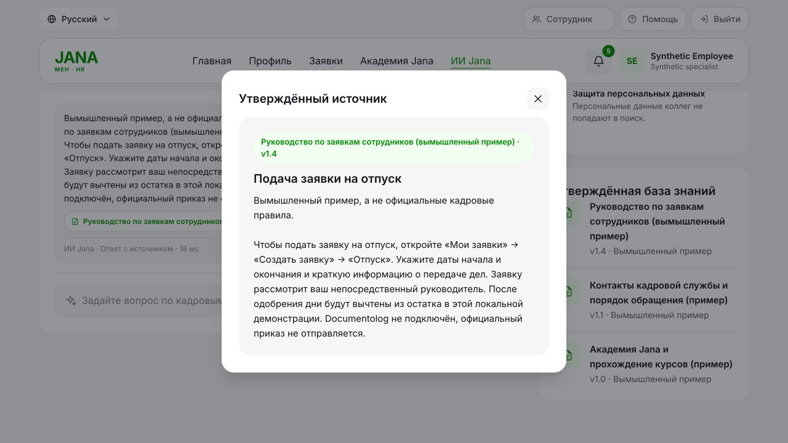

# JanaМен full-project QA report — 17 October 2026

Overall project readiness: **NEEDS WORK**. The local full-stack MVP and MOCK gateway have substantial executed coverage; remaining operational, privacy-governance, duplicate-submission and accessibility gaps prevent a production-readiness claim.

**Checklist counts (162 requirements): PASS: 140 / FAIL: 2 / PARTIAL: 17 / NOT VERIFIED: 2 / BLOCKED: 0 / NOT APPLICABLE: 1.** Findings use separate severity/status labels; their count is not added to requirement totals. All 16 required acceptance scenarios have executed test evidence.

Two P1 defects were reproduced and fixed: conflicting literal numeric policy claims being returned as grounded, and raw employee questions carrying synthetic identifiers into the mocked Gemini HTTP request. No live provider was called. No additional P0/P1 authorization defect was confirmed in the reviewed paths.

The patched review stack runs at `http://127.0.0.1:18766`. The pre-existing stack on port8000 was not rebuilt; it retains its earlier image until an operator explicitly updates it. These findings describe the saved source and the isolated QA environment.

## Executed verification

- Final full SQLite suite: **400 passed**, 1 warning; final full PostgreSQL 17 suite: **400 passed**, 1 warning. Same 400 tests, two database environments; migrations and API end-to-end tests are included.
- **5 frontend locale tests passed**; JavaScript syntax, Ruff check/format, mypy: 76 application sources, pip dependency consistency passed. OSV checked 50 pinned runtime/dev/optional-ML packages and returned 0 advisory matches.
- Actual Docker build/start and stopped-gateway/recovery journey passed. Four services run, three expose configured healthy probes; gateway is internal and has no host port. Approval remains Approved, snapshot loads offline, and recovery yields one MOCK registration/notice.
- Browser inspected employee pages, manager Team and HR card/source/refresh controls. Actual course progress survives process rebuild and HTTP re-login. Keyboard modal defect reproduced; mobile and exhaustive browser coverage remain unverified.

Exact commands, exits, interim failures and environment scope: [QA_TEST_RESULTS.md](QA_TEST_RESULTS.md). Per-item assessment: [QA_CHECKLIST.md](QA_CHECKLIST.md). Prioritized remediation: [FIX_PLAN.md](FIX_PLAN.md).

## Five principal remaining risks

1. **External data governance and enterprise deployment are unverified.** Raw questions now stay local, but approved knowledge can itself contain private material. Operator approval must cover external source transmission. Real 1C/Documentolog, production inbound mTLS, backups and model availability have no verified connection/test here.
2. **Operational recovery is incomplete.** HR can inspect failures/mappings; safe authorized replay/remapping is absent. The gateway uses an initial create_all schema and needs versioned upgrades before future schema changes.
3. **Initial advance submission lacks retry idempotency.** Two identical HTTP submissions create two business requests; current request/document idempotency covers later stages. No payroll payment is implemented or claimed.
4. **AI source consistency remains limited.** The fixed numeric pattern is conservative and literal. Different wording or nonnumeric contradictions require approved policy precedence and further acceptance work.
5. **UX and release confidence have gaps.** Dialog focus escapes, smoke reruns fail on fixed dates, some locale/provenance states are incomplete, and CI/mobile/independent-worker operational coverage is missing.

## Repository map and available commands

| Area | Real paths / entry points | Verification / startup |
|---|---|---|
| Backend | [app/main.py](app/main.py); routers, schemas, services under app/ | `.venv/bin/python -m uvicorn app.main:app --host 127.0.0.1 --port 8000` after explicit migration of the chosen development DB |
| Frontend | [static/index.html](static/index.html), [static/js/app.js](static/js/app.js), [static/js/i18n.js](static/js/i18n.js), [static/css/style.css](static/css/style.css), [static/locales/catalog.json](static/locales/catalog.json) | Static HTML/CSS/JS served by FastAPI; `node --check static/js/app.js`; `node --test tests/frontend_localization.test.cjs`; no bundler/build command |
| Database | [app/database.py](app/database.py), [app/models/__init__.py](app/models/__init__.py), [app/migrate.py](app/migrate.py); Alembic 0001..0006 | PostgreSQL 17 in Compose; SQLite supported. `.venv/bin/python -m app.migrate` only against an explicitly selected development/disposable DB |
| Authentication | [app/services/auth_service.py](app/services/auth_service.py), [app/routers/auth.py](app/routers/auth.py), [app/models/session.py](app/models/session.py) | Revocable DB-backed bearer sessions, DB role authority and active-user check; password hashing/legacy upgrade |
| Requests / notifications | [app/services/request_service.py](app/services/request_service.py), [app/services/notification_service.py](app/services/notification_service.py), [app/services/audit_service.py](app/services/audit_service.py) | Transactional request/balance/event/notification/audit/outbox writes; own/team/HR scopes |
| Gateway and worker | [app/gateway/main.py](app/gateway/main.py), [app/gateway/runtime.py](app/gateway/runtime.py), [app/integrations/outbox.py](app/integrations/outbox.py), [app/integrations/profile_sync.py](app/integrations/profile_sync.py) | Separate `app.gateway.main:app`; `.venv/bin/python -m app.integrations.outbox`; durable jobs, leases, nonces and snapshot interval |
| AI / knowledge | [app/services/ai_service.py](app/services/ai_service.py), [app/services/knowledge_conflicts.py](app/services/knowledge_conflicts.py), [app/integrations/gemini.py](app/integrations/gemini.py), [knowledge/README.md](knowledge/README.md), [ml/README.md](ml/README.md) | Offline lexical/TF-IDF with optional learned reranking; optional approved source-only Gemini quote selection; EN/RU/KK backend, RU/KK UI |
| Tests / tooling | [pyproject.toml](pyproject.toml), [tests/test_api_matrix.py](tests/test_api_matrix.py), [tests/test_e2e_journey.py](tests/test_e2e_journey.py), [tests/test_gateway_service.py](tests/test_gateway_service.py), [tests/test_qa_acceptance.py](tests/test_qa_acceptance.py) | pytest; Ruff; mypy; pip check; [dependency_audit.py](dependency_audit.py); no tracked CI workflow |
| Deployment/config | [Dockerfile](Dockerfile), [docker-compose.yml](docker-compose.yml), [.env.example](.env.example), [docs/INTEGRATIONS.md](docs/INTEGRATIONS.md) | Explicit MOCK profile, internal gateway network, optional URL switch; generated private mode0600 config |

The API operation matrix checks every exported OpenAPI operation for authorized behavior, anonymous/invalid-session denial and administrative role restrictions. It does not imply a complete browser or production penetration test. Discovery used the codebase graph first; stale static-JavaScript snippet ranges were checked against actual source.

## Documentolog flow traced in current source

| Step | Actual implementation | Evidence |
|---|---|---|
| Manager approval / same-transaction business decision | [app/services/request_service.py:review_request](app/services/request_service.py#L385) | Conditional Pending transition, frozen debit, history, persistent employee notification, audit and outbox; 3 injected rollback stages tested. |
| Outbox snapshot | [app/integrations/outbox.py:enqueue](app/integrations/outbox.py#L50) | Immutable canonical payload and stable request:v1 key inserted before approval commit. |
| Worker claim / retries | [app/integrations/outbox.py:dispatch_one](app/integrations/outbox.py#L242) | PostgreSQL SKIP LOCKED; signed POST or status reconciliation, validated acknowledgement, bounded jittered retries and visible terminal failures. |
| Signing / transport | [app/integrations/outbox.py:gateway_request](app/integrations/outbox.py#L94) | Existing X-Key-Id/X-Timestamp/X-Nonce/X-Signature helper; raw-body hash and method/path/query binding; no vendor API guessed. |
| Gateway authentication | [app/gateway/main.py:authenticate](app/gateway/main.py#L66) | Machine signature and durable nonce for every route, independent of frontend bearer roles. |
| Asynchronous durable job | [app/gateway/runtime.py:submit](app/gateway/runtime.py#L92) | POST /v1/documents stores unique idempotent job and returns 202 without synchronous registration. |
| Gateway processing | [app/gateway/runtime.py:process_one](app/gateway/runtime.py#L124) | Atomic lease claim, durable attempts/recovery; connector and terminal result commit together. |
| MOCK connector | [app/gateway/connectors.py:register](app/gateway/connectors.py#L26) | Unique persisted MOCK document; deterministic reference for the same durable job; controlled rejection/temporary failure modes. |
| Callback sender | [app/gateway/runtime.py:callback_one](app/gateway/runtime.py#L219) | Persistent callback retries, fresh signed nonce; application GET reconciliation can recover lost callbacks. |
| Signed callback receiver | [app/routers/internal.py:documentolog_status](app/routers/internal.py#L47) | Signature/body nonce validation, durable replay protection, canonical terminal result validation. |
| Atomic terminal application | [app/integrations/outbox.py:apply_result](app/integrations/outbox.py#L131) | Matching approved request/job/key, conditional idempotent state update, external reference, one history/audit/registration notice. Business Approved stays separate. |

Source snapshot flow is [app/integrations/profile_sync.py](app/integrations/profile_sync.py) → signed MOCK employee-code snapshots → existing profile only → persisted source/as-of/sync metadata; unknown mappings/balance conflicts enter HR review. Profiles/cards read local persisted state and do not synchronously depend on gateway uptime.

## Findings and implemented changes

### QA-F01 — P1 — FAIL → PASS for reproduced case

Conflicting literal numeric policy claims were labelled grounded.

Evidence: All EN/RU/KK regressions failed before fix; all pass after the guard. All eligible authorized current-language passages are checked before the two-source limit and before Gemini. Source: [app/services/knowledge_conflicts.py](app/services/knowledge_conflicts.py) — `has_conflicting_numeric_claims`.

Fix/result: Implemented; 6 conflict regressions plus equivalence/complement/access tests. General semantic contradiction detection remains a separate P2 gap.

### QA-F02 — P1 — FAIL → PASS for reproduced egress

Raw employee free text containing synthetic identifiers reached Gemini HTTP JSON.

Evidence: Three HTTP-boundary regressions failed before fix; they pass after removing raw-question transport and requiring approval both in enabled() and the transport adapter. Source: [app/integrations/gemini.py](app/integrations/gemini.py) — `generate_grounded_answer`.

Fix/result: Implemented; explicit default-off operator approval, source-only quote selection, retained local coverage/quote verification. Does not scrub PII already placed in approved knowledge.

### QA-F03 — P2 — PARTIAL

External knowledge data policy and production connector/TLS verification are missing.

Evidence: Approval flag is an operator assertion, not proof of organizational approval. MOCK-only connectors/internal HTTP are intentional; no live vendor or mTLS handshake test. Source: [app/config.py](app/config.py) — `Settings`.

Fix/result: Not implemented beyond the new safe-default gate. Require partner-approved sources, data-sharing policy, test systems and intended-deployment verification.

### QA-F04 — P2 — PARTIAL

DEAD delivery and unknown-profile queues lack controlled recovery actions.

Evidence: HR can inspect persisted failures/mappings, but there is no authorized replay/remapping endpoint or operator procedure. Source: [app/routers/admin.py](app/routers/admin.py).

Fix/result: Not implemented. Add audited HR-only replay preserving immutable idempotency keys, after reconciling existing gateway state; require explicit mapping decisions.

### QA-F05 — P2 — FAIL

Identical advance submissions can create duplicate business requests.

Evidence: Disposable HTTP probe returns201/201 and 2 distinct records. Vacation overlap and document idempotency do not protect initial advance submission. Source: [app/services/request_service.py](app/services/request_service.py) — `create_request`.

Fix/result: Not implemented. Define a client-generated submission key, employee-scoped unique constraint, immutable-body check and UI key reuse on network retry; test serial/concurrent repeats.

### QA-F06 — P2 — FAIL

Keyboard focus leaves an open modal.

Evidence: Desktop UI: open request dialog and press Tab 12 times; footer Home gains focus while the dialog remains open. Source: [static/js/app.js](static/js/app.js) — `setupModals`.

Fix/result: Not implemented. Trap focus in the top dialog, make the background inert, restore opener focus, and verify keyboard/Escape behavior.

### QA-F07 — P2 — FAIL

Live smoke script is not safely repeatable.

Evidence: First 10-step smoke exits0, immediate rerun exits1 on fixed2026-11-23..25 dates with 409 overlap. Source: [smoke_test.py](smoke_test.py) — `main`.

Fix/result: Not implemented. Use a fresh disposable fixture per smoke run or explicitly reuse the same known synthetic scenario; do not silently delete user requests.

### QA-F08 — P2 — PARTIAL

Database domain constraints do not fully protect direct writes.

Evidence: Disposable SQLite accepts negative leave balance, reversed dates and unknown request status; foreign keys and uniqueness do reject violations. Source: [app/models/request.py](app/models/request.py) — `Request`.

Fix/result: Not implemented. Design additive CHECK/enum/decimal hardening with preflight detection and migration tests; do not silently repair existing rows.

### QA-F09 — P2 — PARTIAL

Broader AI policy conflicts and hostile-source evaluation are incomplete.

Evidence: Numeric guard catches literal statements differing only in numeric values. Reworded or nonnumeric contradictions are not reliably detected; malicious approved-source suite was not executed. Source: [app/services/knowledge_conflicts.py](app/services/knowledge_conflicts.py) — `has_conflicting_numeric_claims`.

Fix/result: Not implemented beyond F01. Establish HR-controlled policy precedence/version/effective-date metadata and adversarial acceptance fixtures; continue safe fallback under ambiguity.

### QA-F10 — P2 — PARTIAL

Operational coverage remains local and incomplete.

Evidence: No CI configuration; no independent app-worker process concurrency run, distributed login limiter, mobile run, production capacity/backup/restore test, or versioned gateway schema upgrades. Source: [app/gateway/runtime.py](app/gateway/runtime.py) — `initialize`.

Fix/result: Not implemented. Add CI checks and operational tests/runbooks before production deployment; keep initial create_all limitation explicit.

### QA-F11 — P3 — PARTIAL

Some UI/localization/provenance behavior remains incomplete.

Evidence: Browser reload clears the in-memory token/navigation; new integration notices retain English text in RU UI; courses rely on global synthetic labeling. Source: [static/js/app.js](static/js/app.js) — `showLogin`.

Fix/result: Not implemented. Agree intended session recovery behavior, translate integration messages and add explicit sample provenance where content is shown.

Implemented source changes are limited to the numeric-conflict helper, the AI call orchestration/provider boundary and default-off approval configuration, corresponding environment/Compose wiring and regression tests. README/architecture documentation now describe the actual data flow; the earlier gateway report now correctly records its committed/pushed state. No schema migration or live connector was added.

After F01:75 focused tests passed. After F02:79 AI/knowledge/QA tests and the explicit transport-log-redaction check passed; both final full400-test suites passed. No implementation changes were made for the remaining P2/P3 findings; acceptance criteria are in FIX_PLAN.md.

## Boundaries and next actions

This review does not establish production readiness, vendor/model availability, official policy approval, legal/data-residency compliance, production mTLS, HA/capacity, backup restoration, mobile accessibility or exhaustive button coverage. Internal HTTP is confined to the local MOCK setup. Existing data and secret environment files were preserved.

1. Approve intended deployment/source-sharing policy and partner test contracts; keep MOCK/offline defaults until independently verified.
2. Add audited recovery/remapping and initial submission idempotency; then exercise separate worker processes and migration/restore operations.
3. Fix dialog focus/repeatable smoke, add CI and run the unverified browser/mobile/production-like checks.

Preview of the inspected source-backed answer:

