# JanaМен — цифровой HR-кабинет Jana Post

[](https://fastapi.tiangolo.com)
[](https://www.python.org/)
[](https://www.postgresql.org/)
[](https://docs.docker.com/compose/)
[](docs/TESTING.md)
[](#)

> **Jana Post × Terricon Valley Hackathon 2026 — кейс 02 «Digital HR».**
> Единое рабочее пространство, где сотрудник, руководитель и HR решают кадровые вопросы без бумаги и переписки: профиль, заявки на отпуск и аванс, уведомления, обучение в Jana Academy и AI-ассистент, который отвечает только по утверждённым документам и всегда показывает источник.

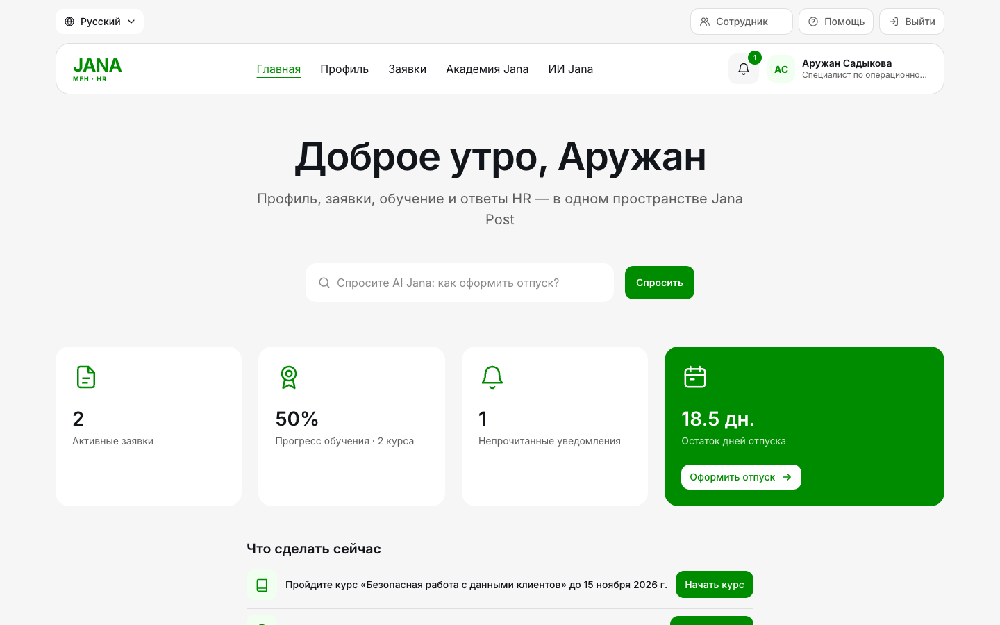

## Содержание

1. [Что мы построили](#1-что-мы-построили)
2. [Соответствие требованиям кейса](#2-соответствие-требованиям-кейса)
3. [Сценарии по ролям](#3-сценарии-по-ролям)
4. [Сценарий показа для жюри](#4-сценарий-показа-для-жюри)
5. [Как это выглядит](#5-как-это-выглядит)
6. [Архитектура](#6-архитектура)
7. [Интеграции с 1С:ЗУП и Documentolog](#7-интеграции-с-1сзуп-и-documentolog)
8. [Роли, права и безопасность](#8-роли-права-и-безопасность)
9. [Запуск](#9-запуск)
10. [Тестирование](#10-тестирование)
11. [Статус реализации](#11-статус-реализации)
12. [Структура репозитория и документация](#12-структура-репозитория-и-документация)

---

## 1. Что мы построили

**Проблема.** Сотрудник Jana Post не видит в одном месте свой остаток отпуска, статус заявки и назначенное обучение; руководитель согласует заявки в переписке; HR тратит время на одинаковые вопросы и ручные напоминания.

**Решение — JanaМен.** Одна платформа с единым входом и тремя ролями:

| Для кого | Что получает |
|---|---|
| **Сотрудник** | Личный кабинет с остатком отпуска и обучением; заявка на отпуск или аванс в несколько полей с календарём дней; статус и история заявки; уведомления с переходом в детали; курсы с прогрессом и сертификатом; ответы AI с источником |
| **Руководитель** | Очередь заявок команды с остатком дней «после одобрения»; одобрение прямо из уведомления; календарь отпусков команды; карточка сотрудника; назначение курсов; оформление отпуска или аванса за сотрудника |
| **HR-администратор** | Всё то же по всей компании; база знаний с утверждением источников; журнал аудита; карточка интеграций 1С и Documentolog с очередями, ошибками и восстановлением |
| **Компания** | Меньше рутины у HR, прозрачные согласования, проверяемая история решений, обучение, связанное с профилем, и архитектура, готовая к подключению 1С и Documentolog |

**Что отличает решение**

- **Сквозной опыт.** На главной странице панель «Что сделать сейчас» собирает курсы с дедлайном, заявки на рассмотрении и непрочитанные уведомления. Любое уведомление открывает заявку или курс целиком.
- **Честный AI.** AI Jana отвечает только по утверждённой HR базе знаний, показывает точный текст источника и прямо говорит, если надёжного ответа нет. О данных коллег не рассказывает; на вопросы «мой отпуск» и «статус моих заявок» отвечает по собственным записям сотрудника.
- **Готовность к интеграциям.** Отдельный MOCK-шлюз уже проходит полный путь «одобрение → регистрация документа → уведомление» с подписью запросов, повторами и восстановлением после сбоя. Для подключения реальных систем нужно заменить MOCK-коннектор.
- **Два языка.** Интерфейс, ошибки API, курсы и источники AI — на русском и казахском.

---

## 2. Соответствие требованиям кейса

| Требование | Как реализовано | Где посмотреть |
|---|---|---|
| **Единый вход и роли** | Вход по e-mail и паролю, три роли: сотрудник, руководитель, HR. Роль берётся из базы на сервере; лишние разделы скрыты, а прямой запрос к чужому API получает 403/404. В демо-режиме — вход одной кнопкой роли | [Вход](docs/images/screens/01-login.png), [матрица прав](#8-роли-права-и-безопасность) |
| **Личный кабинет** | ФИО, компания, должность, подразделение, руководитель, дата приёма, остаток отпуска, назначенное обучение и уведомления. Данные только для чтения: их источник — 1С и Documentolog | [Профиль](docs/images/screens/12-profile-readonly.png) |
| **HR-сервис** | Заявки «Отпуск» и «Аванс» с проверкой на сервере: даты, пересечения, остаток с учётом резерва, лимит аванса. Статус и история событий с авторами и комментариями | [Статус заявки](docs/images/screens/03-request-status.png) |
| **Мои заявки** | Единый список с типом, датой, статусом, фильтрами и карточкой заявки: 4 шага статуса, разбивка отпуска по дням, история | [Карточка заявки](docs/images/screens/03-request-status.png) |
| **Jana Academy** | Каталог и назначенные курсы, шаг записи, уроки строго по порядку, тест к каждому уроку, прогресс и результат в профиле, сертификат за завершение | [Уроки](docs/images/screens/05-course-lessons.png), [сертификат](docs/images/screens/04-certificate.png) |
| **HR-ассистент** | Отвечает только по утверждённой базе знаний, показывает источник с точным текстом, при отсутствии надёжного ответа направляет в HR, соблюдает роль при отборе источников | [Источник](docs/images/screens/06-ai-source.png), [нет ответа](docs/images/screens/07-ai-fallback.png) |
| **Уведомления** | Центр уведомлений: подача, одобрение и отклонение заявки, регистрация документа, назначение и завершение курса. Клик открывает связанную заявку или курс | [Уведомление у руководителя](docs/images/screens/08-manager-notification.png) |
| **Mock API 1С и Documentolog** | Отдельный MOCK-шлюз с подписанными запросами, очередью, повторами и callback; описан способ будущего подключения | [Интеграции](#7-интеграции-с-1сзуп-и-documentolog) |
| **Запуск по инструкции, Docker** | `docker compose up --build` поднимает PostgreSQL и приложение с демо-данными | [Запуск](#9-запуск) |
| **Без реальных данных и секретов** | Все сотрудники и документы синтетические; секреты MOCK-стенда генерируются в неотслеживаемый `.env.gateway` | [Безопасность](docs/integrations/security.md) |
| **Что реализовано, смоделировано, отложено** | Отдельная таблица статуса | [Статус реализации](#11-статус-реализации) |

---

## 3. Сценарии по ролям

### Сотрудник

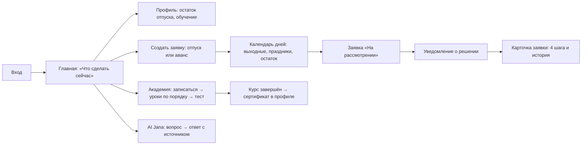

1. Входит и видит на главной, что нужно сделать: пройти курс до срока, проверить заявку, прочитать уведомление.
2. Создаёт заявку на отпуск: календарь сразу показывает выходные (входят в отпуск), праздники РК (не входят) и сколько дней спишется. При нехватке дней или пересечении с другим отпуском отправить заявку нельзя.
3. Получает уведомление о решении, открывает карточку заявки и видит шаги «Подана → Согласование → Регистрация → Уведомление» с датами.
4. В Академии сначала видит обзор курса, записывается, проходит уроки по порядку и получает сертификат.
5. Спрашивает AI Jana, например «Как подать заявку на отпуск?» или «Какой статус у моих заявок?».

### Руководитель

1. Получает уведомление «Новая заявка на рассмотрении», открывает его и видит заявку целиком с кнопками «Одобрить» и «Отклонить».
2. В разделе «Команда» видит очередь заявок с остатком дней до и после одобрения, список сотрудников и **календарь отпусков**: кто и когда отсутствует.
3. В карточке сотрудника назначает курс или оформляет за него отпуск или аванс — такая заявка сразу одобряется, сотрудник получает уведомление.

### HR-администратор

1. Делает всё то же, что руководитель, но по всей компании.
2. Ведёт базу знаний AI: создаёт документ-черновик, проверяет текст и утверждает. Без утверждения AI источник не видит.
3. Следит за интеграциями: режим 1С и Documentolog, задания в ожидании и с ошибкой, последнее успешное действие. Восстанавливает задание и сопоставляет табельные номера, обязательно указывая причину.
4. Просматривает журнал аудита: входы, заявки, решения, вопросы к AI (без текста вопроса — только хеш).

---

## 4. Сценарий показа для жюри

Около 5 минут на запущенном стенде ([запуск](#9-запуск)). На экране входа роли переключаются одной кнопкой.

| Шаг | Роль | Что показать | Критерий |
|---|---|---|---|
| 1 | Сотрудник | Главная: приветствие, остаток отпуска, панель «Что сделать сейчас» | Сквозной сценарий, UX |
| 2 | Сотрудник | Профиль с отметкой «Только чтение» и обучением | Личный кабинет |
| 3 | Сотрудник | «Оформить отпуск»: календарь с выходными и праздниками, отправка | HR-сервис |
| 4 | Руководитель | Колокольчик → уведомление → «Одобрить» в карточке; календарь отпусков команды | Сквозной сценарий, роли |
| 5 | Сотрудник | Уведомление «Заявка одобрена» → карточка с 4 шагами и историей | Статус и история |
| 6 | Сотрудник | Академия: обзор курса → запись → закрытые уроки → тест → сертификат | Jana Academy |
| 7 | Сотрудник | AI Jana: «Как подать заявку на отпуск?» → источник; «Каковы правила страховки домашних животных?» → честное «нет надёжного ответа» | HR-ассистент |
| 8 | Сотрудник | Попытка открыть чужие данные через API → 403 (например, `GET /api/v1/manager/team`) | Роли и права |
| 9 | HR | Карточка интеграций: MOCK 1С и Documentolog, очереди, восстановление; журнал аудита | Готовность к интеграциям |

Для показа интеграций (регистрация документа и сбой шлюза) используйте стенд с MOCK-шлюзом — сценарий в [docs/INTEGRATION_DEMO_RUNBOOK.md](docs/INTEGRATION_DEMO_RUNBOOK.md).

---

## 5. Как это выглядит

| | |
|---|---|
| 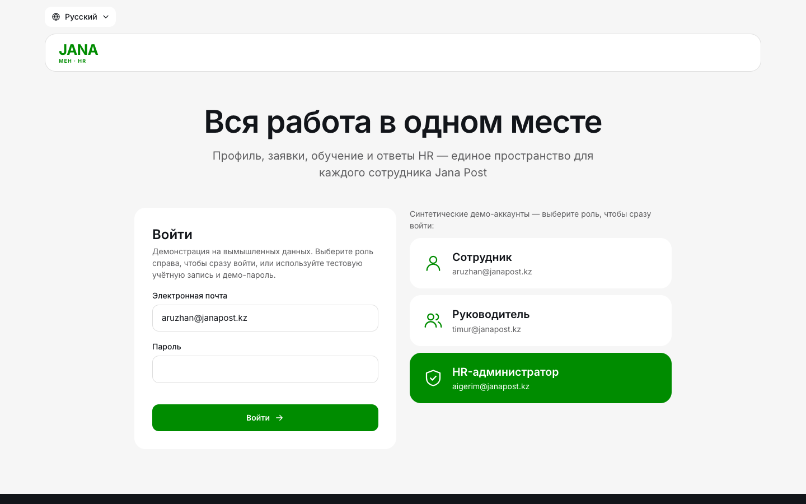 **Вход:** e-mail и пароль или одна кнопка роли в демо-режиме | 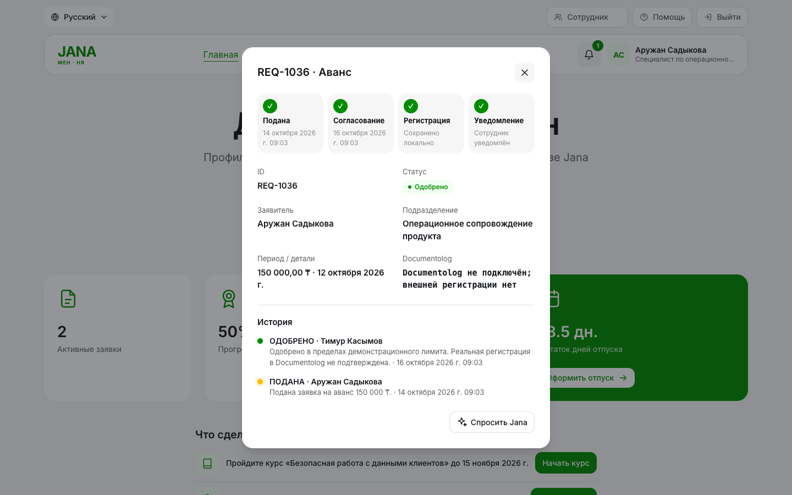 **Заявка:** 4 шага статуса и история решений |
| 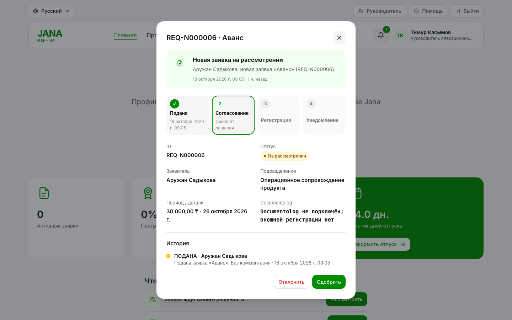 **Руководитель:** уведомление открывает заявку с кнопками решения | 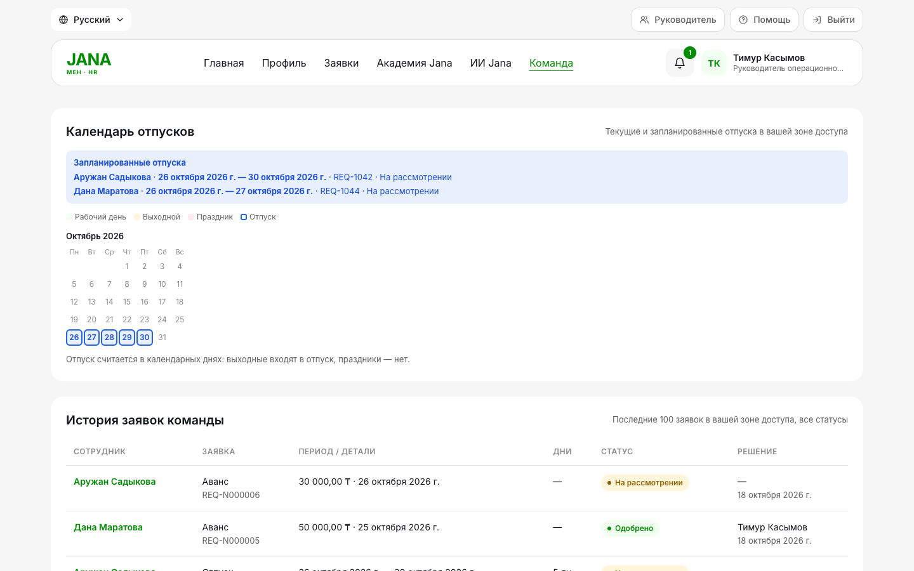 **Календарь отпусков команды** |
| 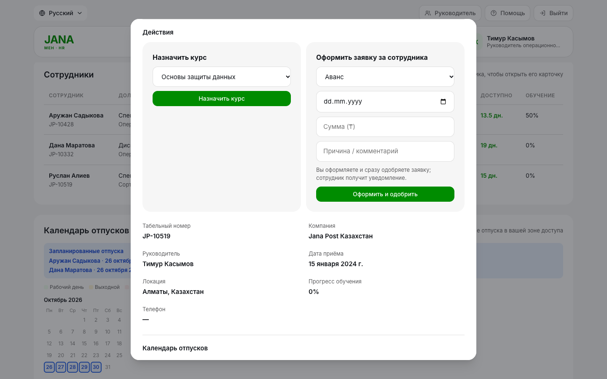 **Карточка сотрудника:** назначить курс, оформить заявку | 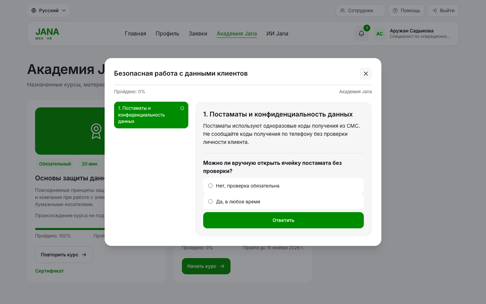 **Академия:** уроки открываются по порядку |
| 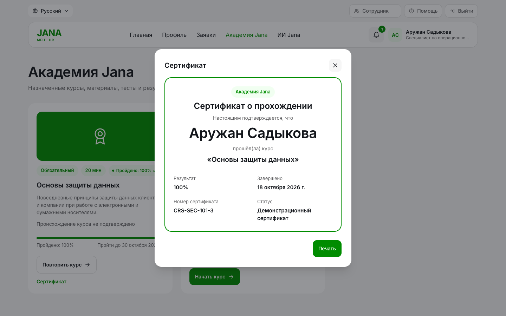 **Сертификат** за пройденный курс | 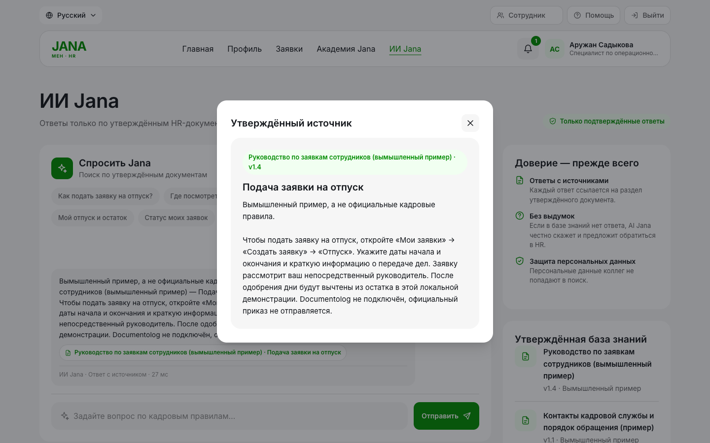 **AI Jana:** точный текст утверждённого источника |
| 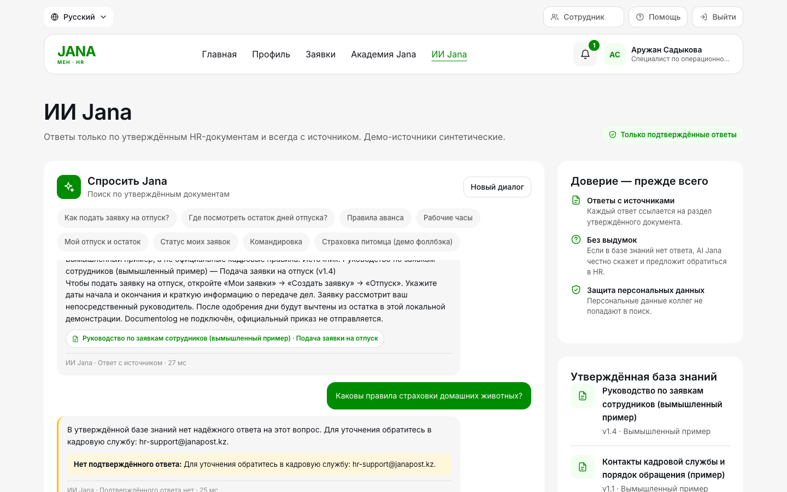 **AI Jana:** честный ответ «нет в базе знаний» | 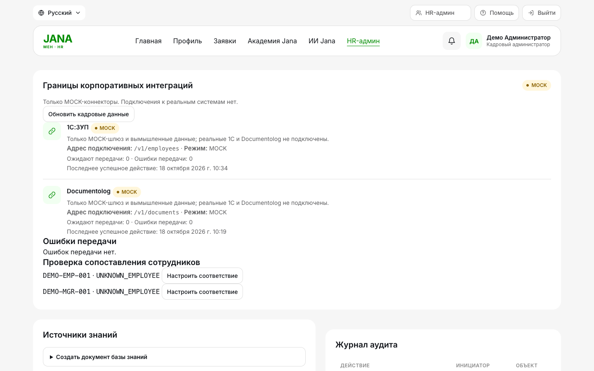 **HR:** состояние MOCK-интеграций и очередь проверки |
| 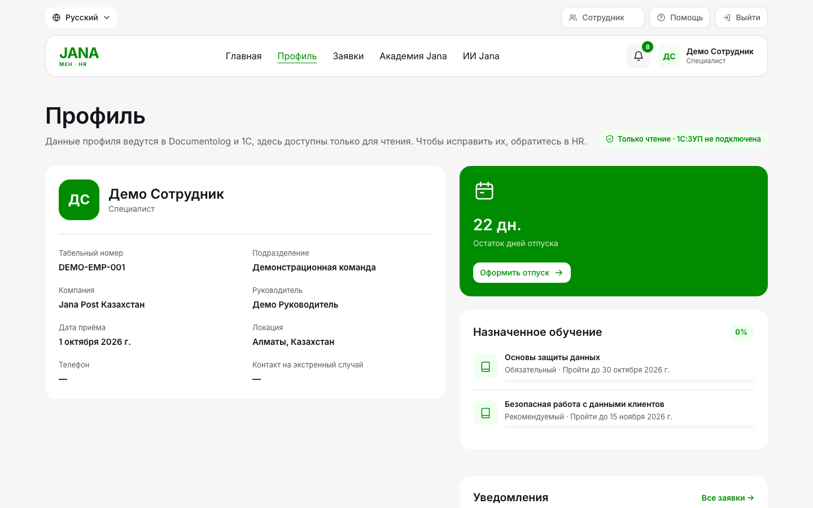 **Профиль:** данные из 1С, только чтение | 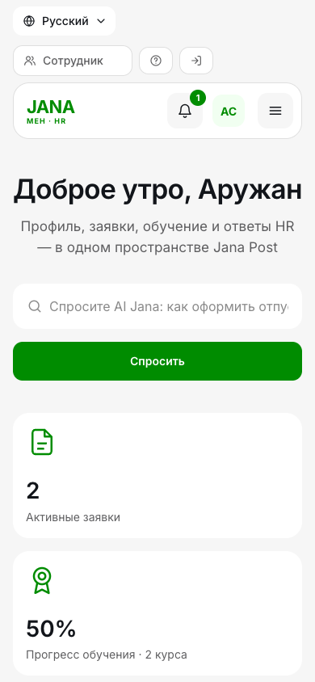 **Мобильная версия** |

---

## 6. Архитектура

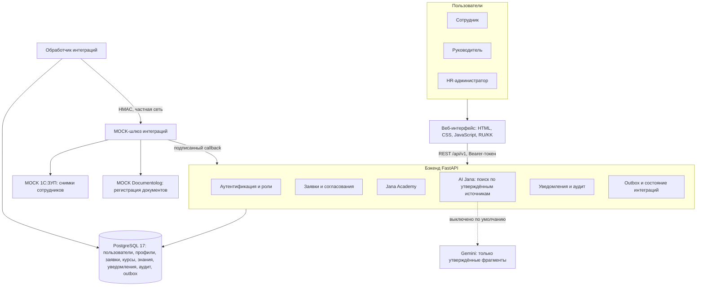

**Бэкенд** — модульный монолит на FastAPI, SQLAlchemy 2 и Alembic:

| Модуль | Назначение |
|---|---|
| `app/routers/` | HTTP API: `auth`, `me`, `requests`, `academy`, `notifications`, `ai`, `manager`, `admin`, `internal` |
| `app/services/` | Бизнес-логика: заявки и календарь отпуска, обучение, AI (поиск, личные ответы, приоритет политик), уведомления, аудит |
| `app/models/`, `app/schemas/` | Таблицы базы данных и контракты API (Pydantic) |
| `app/integrations/` | Outbox, подпись HMAC, синхронизация профилей, восстановление, контракты 1С и Documentolog |
| `app/gateway/` | Отдельный MOCK-шлюз: задания, коннекторы, callback, квоты, резервное копирование |
| `migrations/` | Миграции схемы `0001`–`0011` |

**Фронтенд** — одностраничное приложение без фреймворков, раздаётся тем же сервером: `static/index.html`, `static/css/style.css`, `static/js/` (`app.js` — основная логика, `journey.js` — сквозной опыт, `i18n.js` — переводы, `dialogs.js`, `recovery.js`, `policy_controls.js`), каталог переводов `static/locales/catalog.json`.

**Жизненный цикл заявки** — решение руководителя и регистрация документа хранятся раздельно:

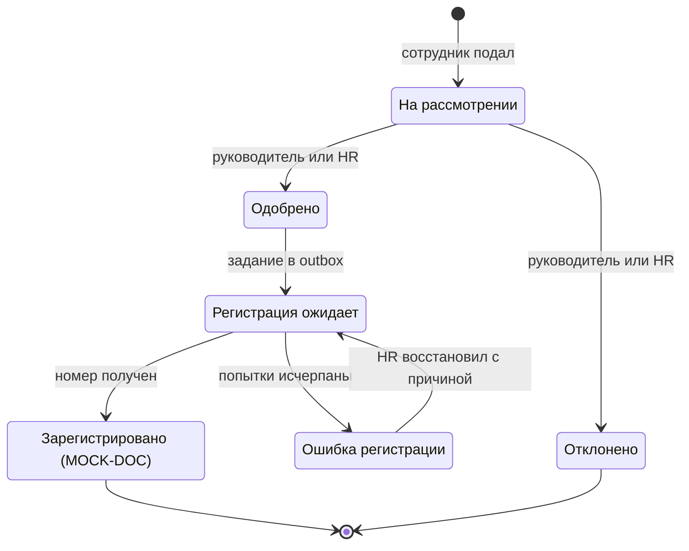

**Основные сущности данных:**

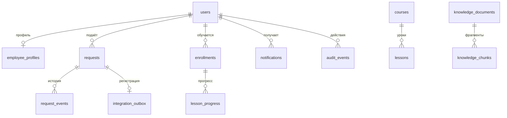


Подробнее: [docs/ARCHITECTURE.md](docs/ARCHITECTURE.md), [docs/API.md](docs/API.md) (48 операций), [OpenAPI](docs/openapi.json).

---

## 7. Интеграции с 1С:ЗУП и Documentolog

Реальные системы не подключены — правила хакатона разрешают mock API. Мы сделали **рабочую MOCK-интеграцию**, которая проходит тот же путь, что и будущая реальная:

- **1С:ЗУП — только чтение.** Шлюз отдаёт синтетические снимки сотрудников; приложение сопоставляет их с профилями **только по табельному номеру** (не по имени), хранит дату снимка и при недоступности 1С показывает последние данные. Неизвестные номера попадают в очередь проверки HR. Запись в 1С не выполняется.
- **Documentolog — регистрация документа.** После одобрения в той же транзакции создаётся неизменяемое задание в outbox. Обработчик отправляет его в шлюз, шлюз «регистрирует» документ и возвращает номер `MOCK-DOC-…` подписанным callback. Решение руководителя от регистрации не зависит: если шлюз упал, заявка остаётся одобренной, а регистрация доходит после восстановления — без дублей и повторного списания дней.
- **Защита обмена:** подпись HMAC-SHA256 с меткой времени и nonce, защита от повторов, квоты, шлюз без открытого порта, секреты генерируются в неотслеживаемый файл.


**Как показать.** Запустите стенд с MOCK-шлюзом, проведите заявку от подачи до одобрения и откройте карточку заявки: шаг «Регистрация» показывает номер `MOCK-DOC-…`. Для демонстрации надёжности остановите шлюз (`docker compose --env-file .env.gateway stop gateway`), одобрите заявку — шаг покажет «Ожидает MOCK-шлюз». Затем запустите шлюз, и регистрация пройдёт сама. Команды — в [docs/INTEGRATION_DEMO_RUNBOOK.md](docs/INTEGRATION_DEMO_RUNBOOK.md).

**Как подключить реальные системы:** заменить MOCK-коннекторы в `app/gateway/connectors.py` на реальные адаптеры по утверждённым контрактам. Формат данных, подписи, очередь и восстановление уже готовы. Спецификации и вопросы к Jana Post:

- [docs/INTEGRATIONS.md](docs/INTEGRATIONS.md) — реализованный контракт шлюза
- [docs/integrations/1c-zup.md](docs/integrations/1c-zup.md) — адаптер 1С:ЗУП
- [docs/integrations/documentolog.md](docs/integrations/documentolog.md) — адаптер Documentolog Business
- [docs/integrations/data-model.md](docs/integrations/data-model.md) — модель данных и сопоставление полей
- [docs/integrations/reliability.md](docs/integrations/reliability.md) — синхронизация, повторы, эксплуатация
- [docs/integrations/security.md](docs/integrations/security.md) — безопасность и персональные данные
- [docs/integrations/open-questions.md](docs/integrations/open-questions.md) — что нужно от Jana Post до запуска

---

## 8. Роли, права и безопасность

| Возможность | Сотрудник | Руководитель | HR |
|---|:---:|:---:|:---:|
| Свой профиль, заявки, уведомления, курсы, AI | ✓ | ✓ | ✓ |
| Заявки и карточки сотрудников | — | прямые подчинённые | вся компания |
| Одобрение и отклонение заявок | — | подчинённых (не свои) | всех (не свои) |
| Календарь отпусков | свой | команды | компании |
| Назначение курса, заявка за сотрудника | — | подчинённым | всем |
| Почта, роль и последний вход сотрудника | — | — | ✓ |
| База знаний, журнал аудита, интеграции | — | — | ✓ |

Права всегда проверяет сервер: интерфейс только прячет недоступные разделы. Для чужой записи сервер возвращает 403 или 404 (не раскрывая, существует ли запись).

**Безопасность:** пароли PBKDF2-HMAC (600 000 итераций), отзываемые сессии, ограничение попыток входа, токен только в памяти браузера, роль из базы, а не из токена, заголовки против встраивания страницы, ограничение размера запроса, единый формат ошибок без утечки данных. Вход одной кнопкой работает только в демо-режиме, а демо-режим запрещён в продакшене настройками. AI не ищет по записям сотрудников и отказывает на вопросы о данных коллег.

---

## 9. Запуск

### Быстрый старт в Docker

```bash
docker compose up --build -d
```

Поднимаются PostgreSQL 17 (`db`) и приложение (`web`). Приложение применяет миграции и в демо-режиме создаёт синтетическую компанию (по умолчанию 150 сотрудников). Откройте **http://127.0.0.1:8000** и войдите одной кнопкой роли: «Сотрудник», «Руководитель» или «HR-администратор». Для входа по паролю используйте значение `DEMO_PASSWORD` из своего `.env` (пример — в `.env.example`).

Проверка: `curl http://127.0.0.1:8000/health`. Порт меняется переменной `WEB_PORT`.

### Стенд с MOCK-интеграциями

```bash
python -m app.gateway.configure_mock --output .env.gateway --web-port 18800 --postgres-port 15450
docker compose --env-file .env.gateway --profile integrations up --build --wait
```

Дополнительно запускаются MOCK-шлюз и обработчик интеграций. Секреты генерируются в `.env.gateway` (не попадает в Git). Сценарии регистрации и сбоя — в [docs/INTEGRATION_DEMO_RUNBOOK.md](docs/INTEGRATION_DEMO_RUNBOOK.md).

### Локально без Docker

```bash
python3 -m venv .venv && source .venv/bin/activate
python -m pip install -r requirements.txt -r requirements-dev.txt
cp .env.example .env                                  # демо-настройки; при необходимости поменяйте DATABASE_URL
export DATABASE_URL=sqlite:///./janamen-demo.db       # или PostgreSQL: docker compose up -d db
python -m app.migrate                                 # миграции схемы
python -m uvicorn app.main:app --host 127.0.0.1 --port 8000 --reload
```

В демо-режиме синтетические данные создаются при запуске. Отдельные демо-аккаунты трёх ролей создаёт `python -m app.provision_demo`.

| Адрес | Что там |
|---|---|
| http://127.0.0.1:8000 | Веб-интерфейс |
| http://127.0.0.1:8000/docs | Swagger UI |
| http://127.0.0.1:8000/redoc | ReDoc |
| http://127.0.0.1:8000/health | Проверка сервиса |

### Демо-аккаунты

| Роль | Основной набор | Отдельные демо-аккаунты |
|---|---|---|
| Сотрудник | `aruzhan@janapost.kz` — Аружан Садыкова | `employee.demo@example.com` |
| Руководитель | `timur@janapost.kz` — Тимур Касымов | `manager.demo@example.com` |
| HR-администратор | `aigerim@janapost.kz` — Айгерим Нурланова | `hr.demo@example.com` |

Все люди, подразделения и документы вымышленные.

### Настройки

| Переменная | Назначение |
|---|---|
| `DATABASE_URL` | PostgreSQL или SQLite |
| `ENVIRONMENT`, `DEMO_MODE`, `DEMO_PASSWORD` | Режим работы; в `production` демо-режим запрещён и нужен сильный `SECRET_KEY` |
| `AI_PROVIDER`, `GEMINI_API_KEY`, `GEMINI_DATA_SHARING_APPROVED` | Необязательный Gemini; по умолчанию выключен |
| `AI_RETRIEVAL_MODE`, `AI_RETRIEVAL_MODEL_PATH` | Необязательное ML-ранжирование ([ml/README.md](ml/README.md)) |
| `MAX_ADVANCE_AMOUNT`, `REQUEST_HORIZON_DAYS`, `LEAVE_EXCLUDED_DATES` | Технические ограничения заявок и нерабочие даты HR |
| `INTEGRATION_GATEWAY_URL` | Включает доставку в шлюз; пусто — интеграции выключены |

Полный список — в [.env.example](.env.example).

---

## 10. Тестирование

| Проверка | Результат |
|---|---|
| Серверные тесты | 520 пройдено, 2 запускаются только с PostgreSQL |
| Тесты локализации фронтенда | 5 из 5 |
| MOCK-интеграция в Docker | регистрация, повтор без дубля, сбой шлюза и восстановление |
| Линтер и форматирование | без замечаний |

```bash
python -m pytest -q
node --test tests/frontend_localization.test.cjs
```

Каждый endpoint API проверяется автотестом на успешный вызов и на отказ без прав. Что покрывает каждый файл тестов — в [docs/TESTING.md](docs/TESTING.md).

---

## 11. Статус реализации

| Модуль | Статус | Что сделано |
|---|---|---|
| Вход, три роли, права | ✅ Реализовано полностью | PBKDF2, отзываемые сессии, роль из базы, проверка доступа к каждой записи |
| Личный кабинет | ✅ Реализовано | Все поля профиля, остаток отпуска, обучение, уведомления; только для чтения |
| Заявки «Отпуск» и «Аванс» | ✅ Реализовано полностью | Проверка дат, пересечений, остатка с резервом, лимита аванса; согласование; история; защита от повторной отправки |
| Календарь отпуска | ✅ Реализовано (локальный календарь) | Выходные списываются, праздники РК — нет; календарь команды для руководителя и HR |
| Мои заявки и карточка заявки | ✅ Реализовано полностью | Список с фильтрами, 4 шага статуса, разбивка по дням, история |
| Уведомления | ✅ Реализовано полностью | Заявки, регистрация, курсы; переход в детали; одобрение из уведомления |
| Jana Academy | ✅ Реализовано полностью | Каталог, запись, уроки по порядку, тесты, прогресс, назначение руководителем и HR |
| Сертификат курса | 🟡 Демонстрация | Печатный сертификат в интерфейсе, без юридической силы |
| AI Jana | ✅ Реализовано полностью | Поиск по утверждённым источникам, точные цитаты, безопасный отказ, роли, ответы по своим данным, RU/KK |
| Gemini для AI Jana | 🟡 Реализовано, выключено | Только утверждённые фрагменты, вопрос остаётся на сервере; нужно решение организации о передаче данных |
| Действия руководителя и HR | ✅ Реализовано | Назначение курсов, заявка за сотрудника, карточка сотрудника |
| База знаний и аудит | ✅ Реализовано полностью | Черновик → проверка → утверждение по ревизии; приоритет политик; журнал аудита |
| Локализация RU/KK | ✅ Реализовано | Интерфейс, ошибки API, курсы, уведомления, источники |
| Интеграция 1С:ЗУП | 🟡 Смоделировано (MOCK) | Снимки сотрудников через шлюз, сопоставление по табельному номеру, очередь HR; реальной 1С нет |
| Интеграция Documentolog | 🟡 Смоделировано (MOCK) | Регистрация `MOCK-DOC-…` через outbox и подписанный callback, повторы, восстановление; реального Documentolog нет |
| Реальные 1С и Documentolog | ⏳ Дальнейшее развитие | Нужны контракты API, тестовый доступ и ответы на [открытые вопросы](docs/integrations/open-questions.md) |
| Электронная подпись (ЭЦП) | ⏳ Дальнейшее развитие | Через Documentolog после подключения |
| Изменение контактов через согласование | ⏳ Выключено | Код рассмотрения сохранён; включится, когда будет доступ на запись в источник данных |
| SSO, сброс пароля, refresh-токены | ⏳ Дальнейшее развитие | — |
| CI в GitHub Actions | ⏳ Шаблон готов | [docs/ci/quality.yml](docs/ci/quality.yml), нужно право `workflow` |
| Мобильное приложение | ⏳ Дальнейшее развитие | Веб-версия адаптивна для телефонов |

**Ограничения прототипа:** одна организация на развёртывание; ограничение попыток входа хранится в памяти одного процесса; суммы аванса не используются для выплат; демо-источники AI синтетические и не являются официальными правилами Jana Post.

---

## 12. Структура репозитория и документация

```text
.
├── app/                      # Бэкенд FastAPI
│   ├── routers/              # HTTP API
│   ├── services/             # Бизнес-логика: заявки, обучение, AI, уведомления, аудит
│   ├── models/  schemas/     # Таблицы БД и контракты API
│   ├── integrations/         # Outbox, подпись HMAC, синхронизация профилей, восстановление
│   └── gateway/              # Отдельный MOCK-шлюз 1С и Documentolog
├── static/                   # Веб-интерфейс: index.html, css/, js/, locales/catalog.json
├── migrations/               # Миграции Alembic 0001–0011
├── knowledge/                # Источники базы знаний AI (RU/KK) и схемы
├── ml/                       # Обучение и оценка ранжирования поиска
├── tests/                    # Автотесты (pytest и Node.js)
├── docs/                     # Документация, схемы, скриншоты, OpenAPI
├── docker-compose.yml        # PostgreSQL, приложение и профиль интеграций
├── Dockerfile
├── smoke_test.py             # Сквозной сценарий на работающем сервере
└── .env.example              # Пример настроек
```

| Документ | О чём |
|---|---|
| [docs/ARCHITECTURE.md](docs/ARCHITECTURE.md) | Архитектура, таблицы, правила заявок, обучения и AI |
| [docs/API.md](docs/API.md) | Все endpoint-ы с правами доступа и общие правила API |
| [docs/INTEGRATIONS.md](docs/INTEGRATIONS.md) | Реализованный контракт MOCK-шлюза |
| [docs/integrations/](docs/integrations/) | Спецификации адаптеров 1С и Documentolog, модель данных, безопасность, открытые вопросы |
| [docs/INTEGRATION_DEMO_RUNBOOK.md](docs/INTEGRATION_DEMO_RUNBOOK.md) | Повторяемое демо интеграций и сбоя шлюза |
| [docs/RECOVERY_AND_OPERATIONS.md](docs/RECOVERY_AND_OPERATIONS.md) | Восстановление, миграции, резервное копирование |
| [docs/TESTING.md](docs/TESTING.md) | Результаты и покрытие тестов |
| [knowledge/README.md](knowledge/README.md) | Как добавлять и утверждать источники AI |
| [ml/README.md](ml/README.md), [ml/MODEL_CARD.md](ml/MODEL_CARD.md) | Обучение ранжирования и метрики модели |

---

Разработано для **Jana Post × Terricon Valley Hackathon 2026, кейс 02 «Digital HR»**. Все данные в репозитории синтетические.
