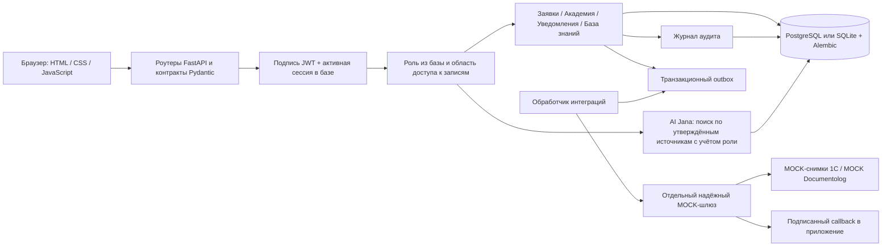

# Архитектура JanaМен

Ядро — модульное приложение на FastAPI: Pydantic-контракты, сервисы предметной области, модели SQLAlchemy 2 и миграции Alembic. В Docker Compose используется PostgreSQL 17; локально поддерживается SQLite. Фронтенд — одностраничное приложение на HTML, CSS и обычном JavaScript без фреймворков, раздаётся тем же сервером. Необязательные отдельные процессы — FastAPI-шлюз и обработчик интеграций — реализуют только канонический MOCK-контракт.

## Фронтенд

| Файл | Назначение |
|---|---|
| `static/index.html` | Разметка всех страниц и модальных окон |
| `static/css/style.css` | Дизайн-система в фирменных цветах Jana Post, адаптивная вёрстка |
| `static/js/i18n.js` | Перевод интерфейса RU/KK по общему каталогу `static/locales/catalog.json` |
| `static/js/app.js` | Основная логика: вход, навигация, профиль, заявки, академия, уведомления, команда, HR-админ, AI |
| `static/js/journey.js` | Сквозной опыт: «Что сделать сейчас», шаги статуса заявки, сертификат, вопрос AI из заявки |
| `static/js/dialogs.js` | Удержание фокуса клавиатуры в диалогах |
| `static/js/recovery.js`, `static/js/policy_controls.js` | Восстановление интеграций и метаданные политик для HR |

Интерфейс только показывает то, что разрешено роли; права всегда проверяет сервер. Токен хранится только в памяти браузера, при выходе или ответе 401 личные данные на экране очищаются.

## Аутентификация и права

Только Bearer-токен. Пароли — PBKDF2-SHA256 со случайной солью и 600 000 итераций; старые хеши на 100 000 итераций проверяются и обновляются при входе. JWT обязан содержать субъекта, ID сессии, время выдачи и срок. При каждом запросе загружаются активная сессия и текущий пользователь из базы; роль из клиента или из токена прав не даёт. Выход отзывает только текущую сессию. В демо-режиме есть вход одной кнопкой роли (`POST /auth/demo-login`); в продакшене демо-режим запрещён настройками.

Сотрудник видит свои заявки и уведомления. Руководитель видит и рассматривает заявки прямых подчинённых и свои заявки, но не может рассмотреть свою. HR видит всю организацию и тоже не может рассмотреть свою заявку. Одна организация на развёртывание.

## Таблицы

| Таблица | Ключевые поля и связи |
|---|---|
| `users` | ID, уникальный e-mail, хеш пароля, ФИО, роль, признак активности |
| `auth_sessions` | Случайный ID сессии, пользователь, срок, отзыв и время создания |
| `employee_profiles` | Пользователь и табельный номер (уникальные), компания, подразделение, должность, руководитель, дата приёма, остаток отпуска, город, источник и свежесть данных |
| `requests` | ID, уникальный код, владелец, тип, даты, сумма и причина, статус, рассмотревший, комментарий, ключ отправки, статус синхронизации и внешняя MOCK-ссылка |
| `request_events` | Заявка, автор, событие (подана, одобрена, отклонена), комментарий, время |
| `courses`, `lessons` | Курс (код, описание, длительность, срок, обязательность); уроки по порядку, материал, вопрос и варианты — правильный ответ никогда не отдаётся в GET урока |
| `enrollments`, `lesson_progress` | Уникальная пара «пользователь — курс», статус, прогресс и результат; прохождение каждого урока |
| `notifications` | Владелец, заголовок, текст, тип, ссылка на заявку или курс, признак прочтения |
| `knowledge_documents`, `knowledge_chunks` | Документ (версия, язык, переводы, ревизия, утверждение, приоритет политики, сроки действия) и его фрагменты с точным текстом, тегами и ролью доступа |
| `audit_events` | Автор, действие, объект, минимальные метаданные, время |
| `integration_outbox`, `integration_nonces` | Задания доставки в шлюз и защита от повторов callback |
| `integration_sync_state`, `integration_reviews` | Состояние синхронизации профилей и очередь проверки HR |
| `gateway_jobs`, `mock_documents`, `gateway_nonces`, `gateway_rate_limits` | Отдельное хранилище шлюза: задания, MOCK-документы, nonce и квоты |

## Заявки

Владелец заявки определяется только по аутентификации, код выделяется из ID базы в пространстве `REQ-N…`. Одобрение и отклонение выполняются условным обновлением из статуса «На рассмотрении»; одобренный отпуск условно списывает дни при достаточном остатке. История, уведомления и аудит фиксируются в той же транзакции, любая ошибка откатывает всё. Повторное или конкурирующее решение — 409, нехватка дней на момент одобрения — 400. Отпуск считается в календарных днях, ожидающие заявки резервируют дни. Новые одобрения замораживают списанные дни и предварительную корректировку остатка. Работа шлюза асинхронна; реальных выплат и внешних документов нет.

Руководитель и HR могут оформить отпуск или аванс за сотрудника — заявка сразу одобряется оформившим, сотрудник получает уведомление о решении. Профиль только для чтения: данные ведутся в 1С и Documentolog, поэтому заявки на изменение профиля сервер отклоняет.

## Jana Academy

Просмотр каталога не записывает на курс. Самостоятельная запись (через шаг обзора курса) и назначение руководителем или HR — явные и уникальные. Отправка ответа берёт блокировку записи на курс до чтения прогресса, проверяет индекс ответа и порядок уроков, сохраняет прохождение, считает прогресс и результат по реальным урокам и один раз отправляет уведомление о завершении. Неверный ответ не раскрывает правильный. За завершённый курс в интерфейсе выдаётся демонстрационный сертификат.

## AI Jana

Документы базы знаний создаются черновиками; правки HR снимают утверждение, и только явное утверждение HR делает текст доступным. AI фильтрует утверждение, активность и роль прямо в SQL до поиска. Считается покрытие значимых слов вопроса текстом, разделом и тегами источника; слабые совпадения отклоняются. Ответ содержит точный текст источника и реальные ID и версии; endpoint источника перепроверяет доступ. Демо-документы помечены как синтетические. Поиска по записям сотрудников нет, а личные вопросы («мой отпуск», «статус моих заявок») отвечаются по собственным данным спрашивающего. Ранжирование добавляет косинусную близость TF-IDF по символьным n-граммам (`app/services/ml_retrieval.py`) поверх порога покрытия. Проверка числовых расхождений охватывает все подходящие фрагменты на текущем языке до выбора цитат; найденный конфликт приводит к безопасному обращению в HR. Это не общий детектор смысловых противоречий.

Выбор цитат через Gemini требует `AI_PROVIDER=gemini`, ключа и выключенного по умолчанию разрешения оператора `GEMINI_DATA_SHARING_APPROVED`. Наружу отправляются только найденные локально утверждённые и доступные роли фрагменты; вопрос сотрудника остаётся на сервере. Сервер принимает только точные цитаты с сохранением порога и ревизий, при сбое остаётся извлекающий ответ. В аудите — статус ответа, ID источников и хеш вопроса, без текста вопроса и ответа.

Файловые пакеты источников в `knowledge/` проверяются по схеме и импортируются черновиками активным HR. Необязательный режим `AI_RETRIEVAL_MODE=ml` применяет обученный линейный ранжировщик после фильтров утверждения, активности, роли и языка и после порога покрытия. Обучение — офлайн в `ml/`; во время работы загружаются ограниченные JSON-коэффициенты без библиотек обучения. Подробнее — [knowledge/README.md](../knowledge/README.md) и [ml/README.md](../ml/README.md).

## Ошибки, миграции, локализация

Все ошибки API используют один очищенный формат и ID запроса. Непредвиденный сбой базы — 503, конфликт уникальности — 409. В логах ошибок — класс исключения и ID запроса, без SQL и тел запросов. Ответы отключают кэширование и добавляют базовые заголовки безопасности; CORS — только для явно указанных адресов, cookie-аутентификации нет.

Миграции явные и только вперёд; при запуске проверяется текущая ревизия. Последняя миграция — `0011_merge_profile_updates`. Обновления добавляют таблицы и колонки без удаления строк пользователей; частичные схемы и дубли останавливают обновление для проверки оператором.

Один каталог переводов RU/KK используется и браузером, и бэкендом. Каждый маршрут согласует `Accept-Language` в контексте запроса и переводит разрешённые поля представления; ID, права и коды не меняются. AI находит утверждённый текст на запрошенном языке и возвращает фактический язык и ревизию в каждой ссылке.

## Интеграции

Отдельный шлюз и обработчик приложения — необязательный профиль Compose, работающий **только в MOCK-режиме**. Переключатель — `INTEGRATION_GATEWAY_URL`. Одобрение атомарно сохраняет минимальный неизменяемый снимок в outbox; обработчик отправляет его в `/v1/documents`, проверяет асинхронное подтверждение и сверяет результат. Задания, nonce, MOCK-документы и повторы callback шлюз хранит независимо. Подписанный callback обновляет данные регистрации, историю и одно уведомление; для сотрудника заявка остаётся «Одобрено». Плановая подписанная синхронизация снимков 1С сопоставляет существующие профили по табельному номеру, при сбое сохраняет последний снимок и показывает HR очередь проверки. Подробности — [docs/INTEGRATIONS.md](INTEGRATIONS.md) и [docs/integrations/](integrations/).
