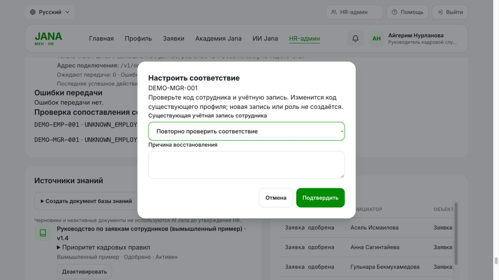
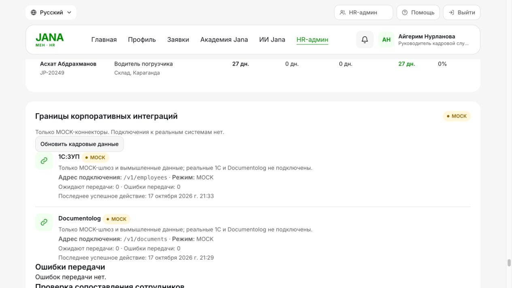

# JanaМен QA fix-plan implementation — 17 October 2026

This follow-up implements the authorized local fix plan on branch `codex/fix-plan`, based on `54321c0`. The original [QA report](../QA_REPORT.md) and its evidence describe the earlier revision and remain historical. Current commands, results and browser evidence are in [evidence/fix-plan-2026-10-17](evidence/fix-plan-2026-10-17/).

## Built

- Employee submission idempotency: optional validated key, employee-scoped database uniqueness, canonical immutable-body hash, serial/concurrent repeat protection, browser key reuse after a failed response. Existing requests and callers without a key remain compatible.
- Controlled HR recovery: audited reason, stale counter/timestamp protection, explicit existing-account mapping after a fresh signed snapshot, stable document payload/key, reconciliation before retry, and recovery generations on the core and gateway. Old callbacks cannot cancel queued recovery or regress an accepted generation. A known accepted job missing from gateway storage stops for investigation instead of being recreated.
- Domain protection: additive preflight migrations through `0010_source_metadata`, database status/date/type/positive amount/nonnegative balance guards, PostgreSQL `NUMERIC(12,2)`. SQLite triggers preserve referenced parent/child rows; fixed-decimal storage is not claimed for SQLite.
- Policy controls: HR policy key/priority/effectivity/known-conflict metadata, revision and reapproval rules, fallback for equal precedence or flagged relevant approved sources, compatible legacy bundle hashes and JSON dates, and adversarial source/privacy/egress fixtures.
- UI: recovery/mapping dialog, policy controls, inert modal background, focus trapping and opener restoration, RU/KK presentation strings including MOCK notifications, synthetic seed-course labels and unverified labels for older unknown provenance. Sessions deliberately remain in memory and require sign-in after reload.
- Operations: a repeatable synthetic smoke scenario, versioned independent gateway v1-to-v2 upgrades, exclusive mode-0600 SQLite backup/restore command, separate-process gateway claim acceptance, isolated SQLite/PostgreSQL CI template, regenerated OpenAPI/schema snapshots and [recovery runbook](RECOVERY_AND_OPERATIONS.md).

## Verification

| Actually executed | Result | Evidence |
|---|---|---|
| Full backend suite, SQLite | **436 passed**, 1 existing deprecation warning | [log](evidence/fix-plan-2026-10-17/final-sqlite.txt), [command](evidence/fix-plan-2026-10-17/final-sqlite.json) |
| Full backend suite, PostgreSQL17 | **436 passed**, 1 existing deprecation warning | [log](evidence/fix-plan-2026-10-17/final-postgresql.txt), [command](evidence/fix-plan-2026-10-17/final-postgresql.json) |
| Focused acceptance/API matrix | **170 passed** | [log](evidence/fix-plan-2026-10-17/targeted-acceptance.txt) |
| Ruff, mypy, pip consistency, JavaScript syntax and frontend locales | **PASS; 5 frontend tests passed** | [log](evidence/fix-plan-2026-10-17/final-quality.txt) |
| Ten-step API smoke against owned Docker demo, first and repeat | **PASS twice**, same request and no second debit | [first](evidence/fix-plan-2026-10-17/smoke-first.txt), [repeat](evidence/fix-plan-2026-10-17/smoke-repeat.txt) |
| Browser keyboard, mapping and telemetry | **PASS for exercised desktop cases** | [record](evidence/fix-plan-2026-10-17/browser-checks.json) |
| GitHub Actions | **NOT RUN; workflow permission blocked** | [record](evidence/fix-plan-2026-10-17/ci-publication.json) |

The initial full PostgreSQL run was **435 passed / 1 failed** because the new invalid-status test expected a constraint exception while PostgreSQL correctly rejected the value through its native enum type. The assertion now accepts the native enum or constraint rejection; the entire PostgreSQL suite was rerun successfully. The [initial log](evidence/fix-plan-2026-10-17/postgresql-initial.txt) is retained. No application change was needed for that failure.

The targeted acceptance run passed **170 tests**. It includes controlled retry before/after callbacks, HR/manager/employee authorization, stale commands, immutable job IDs, registered-job reconciliation from local failure, missing-store refusal, concurrent submission and delivery, explicit mapping without account creation, invalid direct database writes, valid/invalid legacy migration fixtures, gateway v1 upgrade, future-version refusal, backup/restore identity and nonce retention, two separate gateway worker processes, policy precedence/effectivity/ties, hostile source boundaries, bundle compatibility, and every exported core API operation.

The ten-step API smoke ran twice against **`http://127.0.0.1:18766`** in the owned `janamen-qa-check` Compose project. Both runs passed, reusing the same synthetic request; the repeat asserted no additional leave debit. The rebuilt web, PostgreSQL and signed gateway health checks passed. Deployment metadata confirms core head `0010_source_metadata` and PostgreSQL numeric precision 12/scale 2. No changes were made to the original app running on port 8000 or its database.

Browser checks actually exercised the recovery dialog's first focus, reverse/forward focus wrap, background isolation, Escape restoration, a single-control request-details dialog, explicit MOCK manager mapping, sign-in after reload, and visible MOCK mode/pending/last-success telemetry. See [browser-checks.json](evidence/fix-plan-2026-10-17/browser-checks.json) and the screenshots below. Nested-dialog and mobile/device behavior were not exercised in this browser session.

Independent review found and prompted fixes for three recovery transitions and two policy-file compatibility regressions. Acceptance tests cover the corrected cases. Lint, mypy across 80 app source files, `pip check`, JavaScript syntax and five frontend locale tests passed. No dependencies were added. The suite emits the existing Starlette TestClient/httpx deprecation warning; no dependency substitution was made solely to suppress it.

The current-files/reachable-history scan found no unexpected known private values or selected secret patterns. Three historical matches are classified insecure example placeholders, not live credentials; current configuration rejects/replaces that fallback. Checked QA logs had zero known-secret or canonical-payload-marker matches. Raw logs, credentials, runtime databases, backups and private environment files are outside Git. These scoped checks are not a guarantee that every possible secret format is detected.

GitHub refused the first push because its current token lacks `workflow` scope. The reviewed CI YAML is therefore saved as the **inactive** [docs/ci/quality.yml](ci/quality.yml) template. The original active-workflow commit is retained locally on `codex/fix-plan-ci-local`. All other source changes can be pushed without expanding credential permissions. No GitHub Actions execution or result is claimed; activation remains an authentication prerequisite.

## Remaining

- **External prerequisites:** the supplied GitHub URL identifies this repository. No partner-approved live 1C/Documentolog sandbox contract or approved external-AI data-sharing policy was provided/found. Connectors remain **MOCK**, no live connection is claimed, and no real vendor or Gemini request was made. Existing HMAC headers/signing and optional TLS settings were reused; no custom cipher or fabricated vendor endpoint was introduced.
- **Production operations:** intended-deployment TLS/mTLS, HA and sustained load, production key rotation, PostgreSQL backup/restore RPO/RTO, and real partner behavior still require verification. SQLite gateway restoration was exercised only in disposable local fixtures.
- **Policy and UX boundaries:** HR must confirm policy precedence, source translations and course provenance. Explicit metadata plus literal numeric conflict checks are not general semantic contradiction detection. Mobile/device and nested-dialog browser checks remain open. Draft edits invalidate approval; a draft conflict flag does not globally block other approved policy sources.

See [FIX_PLAN.md](../FIX_PLAN.md) for the status of each finding.

## Saved work

Source commits: `9c67f8a` (storage/upgrades), `b2de92c` (recovery), `7ec37da` (policy decisions), `afb7716` (UI/API/CI template). Documentation and evidence are saved in the follow-up commit on [GitHub branch codex/fix-plan](https://github.com/shokkanuly/Posttech/tree/codex/fix-plan). Original active-workflow commit `0176668` is preserved only on the local `codex/fix-plan-ci-local` branch; the identical YAML is available on GitHub as the inactive template. Secrets and runtime stores remain ignored.
