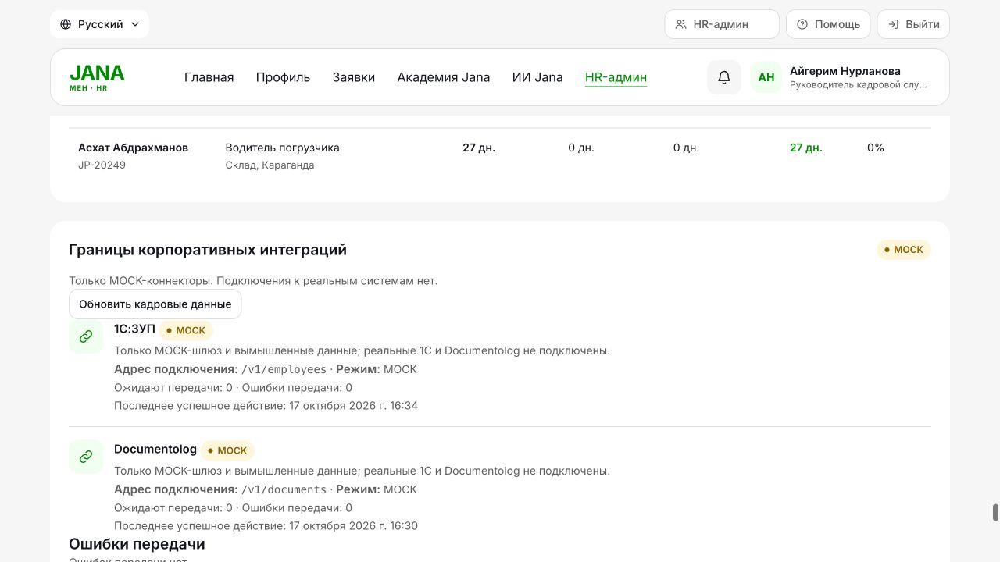

# JanaМен gateway implementation — 17 October 2026

Built on branch **`codex/integration-gateway`**, based on `eed46a6`. The user's supplied integration design sections5–7 and section10 acceptance conditions were used as the specification. **MOCK only: no live 1C:ЗУП or Documentolog connection, official registration, payment or electronic signature.** Other worktrees were inspected but not edited or merged. Existing `.env`, the user's original database and their existing running Compose project were not modified.

## What was built

- A **separate FastAPI service**, `app.gateway.main:app`, with all five canonical endpoints: signed document submission, document status, employee delta list, employee-by-code, health.
- Independent persistent gateway storage for jobs, nonces, retry/lease state and unique MOCK document references. Jobs and replay protection survive restart; a crashed processing lease is reclaimable. Mock connector calls and document creation commit together.
- Existing `app/integrations/signing.py` reused, including the same four HMAC headers and300-second timestamp window. Query strings and raw body hashes are included. A small optional nonce argument binds the callback body nonce to `X-Nonce`; no new cipher was introduced.
- Gateway-wide machine authentication, including health and unknown/docs routes. There is no employee-bearer fallback or anonymous employee snapshot API. Validation responses do not echo input bodies; configuration errors hide secret values.
- Updated app outbox delivery: immutable codes/dates/charged-day snapshot created in the approval transaction; canonical202 acknowledgement validation; job ID persistence; signed callback and GET reconciliation use one atomic idempotent transition. Empty2xx responses never count as successful delivery. Approved stays Approved when integrations fail.
- Distinct sync states **NOT_REQUIRED / PENDING / SENT / REGISTERED / FAILED / DEAD**, explicit API aliases `external_ref`, `sync_status`, `integration_mode`, plus the compatible existing `external_sync_id` field. Registered references are `MOCK-DOC-…` and display a MOCK badge.
- Scheduled MOCK1C snapshot synchronization using the successful cursor. Employee-code matching only, existing-account updates only, unknown employee/manager/conflicting snapshots held for HR review. Source mode/as-of/sync time and stale status are returned on profiles; outages preserve the last snapshot.
- Frozen approved leave debit plus provisional adjustments: source snapshot balance minus local unconfirmed charged days. Only explicit canonical snapshot `confirmed_request_codes` clears an adjustment; a Documentolog registration is not treated as a 1C balance posting. That field and the KZT advance envelope are documented **extensions of our canonical contract**, not invented vendor APIs.
- HR-only, database-rate-limited refresh; persisted pending/failed counts and last-success times on integration cards; paginated FAILED/DEAD delivery queue and unmatched-profile review list. No network request is required merely to render the profile or HR card.
- Optional `integrations` Compose profile with gateway and app worker. Gateway has **no host port** and belongs only to an `internal: true` network. Web startup depends on PostgreSQL, not gateway availability. `INTEGRATION_GATEWAY_URL` remains the activation switch.
- `python -m app.gateway.configure_mock` creates a new mode0600 ignored environment with generated directional keys, without printing secrets or overwriting existing credentials. No new runtime dependency was added.

Full contract, source ownership, failure states and configuration: [INTEGRATIONS.md](INTEGRATIONS.md).

## Source and schema changes

Primary gateway files: `app/gateway/{main,runtime,config,models,connectors,healthcheck,configure_mock}.py` and synthetic `mock_employees.json`.

App wiring: `app/integrations/{contracts,outbox,profile_sync,telemetry}.py`, shared signing helper, internal/admin/profile routes, request service and models/schemas, `docker-compose.yml`, `.env.example`, Git/Docker excludes, UI/localization catalog and exported OpenAPI.

Application migration **`0006_gateway_runtime`** adds immutable outbox payload/job/delivery metadata, request registration/debit fields, profile snapshot metadata, sync state and mapping review tables. It preserves old rows. Old pending jobs with the previous incompatible contract are parked as DEAD/LEGACY_CONTRACT for HR review; the migration never silently sends or reinterprets them. Historical legacy balance confirmations retain existing state; official historical reconciliation needs operator/partner confirmation. Startup still requires an explicit current schema. The gateway's independent initial v1 schema is created by that service; it does not migrate or inspect the core application's database.

Existing signing/header semantics are retained, while the earlier vendor-shaped two-step flow was intentionally replaced by the supplied `/v1/documents` design. The earlier worktree's simulator code was not blindly merged because it used in-memory dictionaries, different routes and non-durable callbacks.

## Tests actually executed

| Check | Observed result | Evidence/scope |
|---|---|---|
| Final full `pytest -q`, SQLite | **384 passed**,1 warning,139.37s | [Raw result](evidence/gateway-2026-10-17/pytest-sqlite.txt); each app test owns a fresh SQLite database |
| Final full `pytest -q`, PostgreSQL17 | **384 passed**,1 warning,203.84s | [Raw result](evidence/gateway-2026-10-17/pytest-postgresql.txt); isolated random schemas in a dedicated disposable development stack; public demo records preserved |
| Targeted gateway + app acceptance + migration suite during development | **26 passed** before3 additional edge tests | Final full suites include all23 gateway/app integration cases and6 migration tests; do not add targeted counts to full-suite totals |
| `node --test tests/frontend_localization.test.cjs` | **5 passed** | Includes the final additional RU/KK gateway labels |
| Ruff check and format check | Passed;104 Python files formatted | Scope: app, tests, migrations, smoke_test.py, dependency_audit.py |
| `mypy app` | Passed;75 source files | Gateway and app wiring included |
| `pip check` | No broken requirements | Existing environment; no dependency changes |
| `node --check static/js/app.js` | Passed | JS syntax check |
| `git diff --check` | Passed | Whitespace check |
| Compose validation | Passed | No gateway published port; integration network internal; key maps validJSON without printing their contents |
| Docker build/start, dedicated project | All4 services started | Separate PostgreSQL, web, gateway and integration-worker; final source rebuilt; original user's stack untouched |
| Actual HTTP outage/recovery | **Passed** | Gateway stopped, approval200/Approved, pending count1, profile200; gateway restart → REGISTERED/MOCK and exactly1 registration notice. [Result](evidence/gateway-2026-10-17/docker-journey.json) |
| Actual browser | **Passed for inspected HR controls** | HR login, MOCK card, pending/failed counts, last-success values and successful snapshot refresh. The browser capture is below; not a claim of a complete automated browser suite |
| Running service log hygiene | No generated secret value or selected payload marker detected | [Scoped scan](evidence/gateway-2026-10-17/log-hygiene.json); no credential/environment file copied to evidence |

The warning on both Python runs is the upstream Starlette/httpx TestClient deprecation warning. It did not fail the tests; dependencies were not changed merely to suppress it. These results are current execution results, not the earlier audit's362-test numbers. Gateway service tests deliberately use its own persistent SQLite store even when the core application suite targets PostgreSQL, matching the MOCK Compose deployment.

### Section10 acceptance mapping

| Required condition | Implemented and executed proof |
|---|---|
| Valid signature accepted; wrong signature, old timestamp and replay rejected | `test_valid_tampered_old_unknown_retired_and_replayed_signatures`; also future timestamp, key overlap/removal, tampering and query-string coverage; nonce replay after gateway restart |
| Same idempotency key twice creates one document | `test_idempotency_persists_and_rejects_changed_body`, `test_concurrent_same_key_creates_one_job_and_document`, restart test: one durable mock document; mismatched body409 |
| Gateway down: approval succeeds, retries, eventually DEAD | `test_approval_survives_gateway_down_retries_then_dead` uses an actual HTTP connection failure substitute and advances due times through8 attempts; actual Docker stop/start additionally proves approval does not wait for the gateway. The live demonstration did not wait through the day-long backoff schedule |
| Callback updates external reference/state and produces exactly one notice | `test_signed_full_journey_notifies_exactly_once`, `test_reconciliation_recovers_lost_callback`; callbacks use actual signing + internal HTTP test clients and the real app DB transaction. Actual Docker workers also delivered one notice |
| Employee token cannot invoke callback/gateway | `test_all_gateway_endpoints_reject_employee_bearer`, callback bearer/replay/tamper tests; HR queue/refresh routes reject employee/manager roles |
| Profile still loads during outage | `test_refresh_is_hr_only_rate_limited_and_stale_snapshot_survives_outage`; actual Docker stopped-gateway profile200. No synchronous profile dependency on gateway |

Additional executed cases cover connector validation failure, temporary connector retry exhaustion, retained pending callbacks without duplicate documents, malformed acknowledgements, canonical input not echoed, configuration errors not echoing keys, provisional-balance confirmation, no overwrite on balance conflict, unknown code mapping and actual telemetry counts/timestamps.



## Run/review locally

```bash
python -m app.gateway.configure_mock
# If local ports are already occupied, pass --web-port / --postgres-port.
docker compose --env-file .env.gateway --profile integrations up --build -d
```

The current isolated verification stack uses `http://127.0.0.1:18765`; its generated private environment is outside the repository. Existing normal app port8000 was not replaced. Use the usual synthetic employee/manager/HR accounts above. The source is uncommitted on `codex/integration-gateway` for review; no push or external deployment occurred.

## What remains / boundaries

- **No real connector is implemented or verified.** Real vendor documentation, test instances, approved employee mappings, balance posting semantics and service accounts must come from Jana Post. No vendor endpoints were guessed.
- The local MOCK profile uses **HTTP on an internal network plus HMAC**. TLS1.3/mTLS client code is reusable, but production inbound mTLS/certificate deployment, VPN and handshake validation are not supplied or claimed.
- HR queues are read-only review views. There is no automatic dead-letter replay button; retries and terminal states must not be reset blindly. Future production runbooks need authorized replay and reconciliation/retention policy.
- The gateway's initial independent schema needs versioned migrations before future schema upgrades; current restart persistence does not itself prove production backup/restore, HA or capacity.
- The canonical source-confirmation extension is exercised with synthetic data only. It is not proof of an official1C accrual/calendar policy or reconciliation of old pre-migration records.
- Other audit findings, including AI source conflict handling and general frontend session/focus behavior, were outside this integration implementation and were not claimed fixed.

All functionality and UI references remain explicitly MOCK. The numeric HR approval decision and approval history persist independently of integration delivery and gateway uptime.
