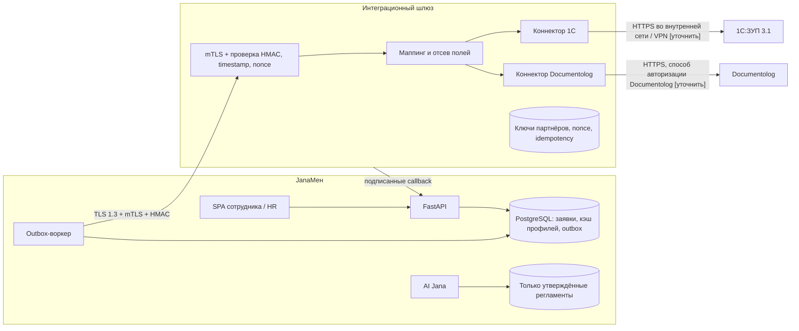
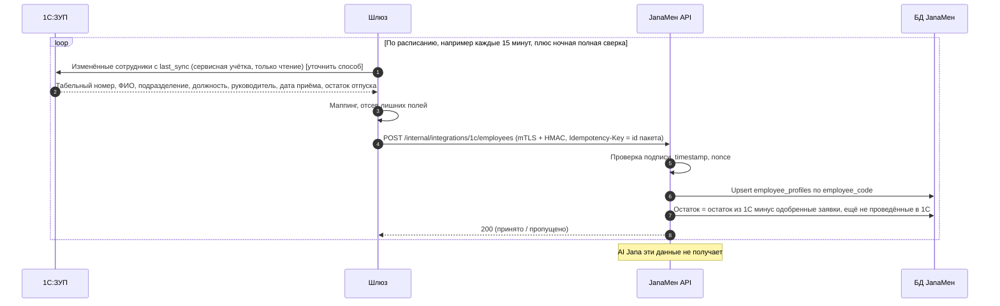
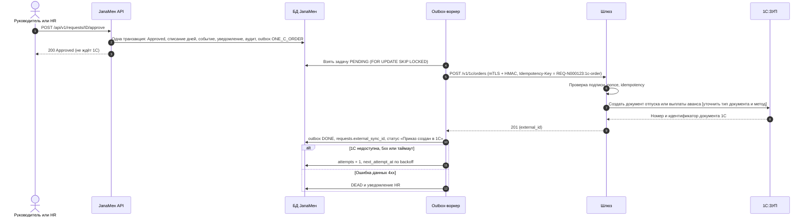
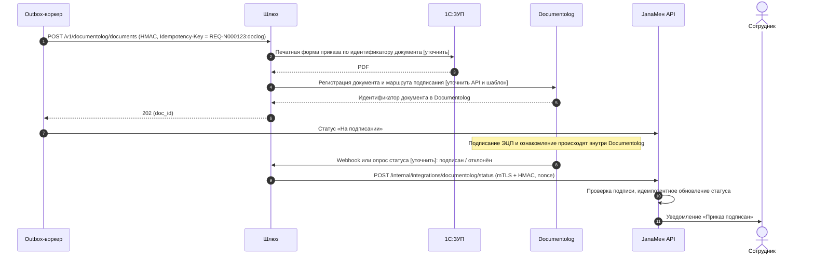
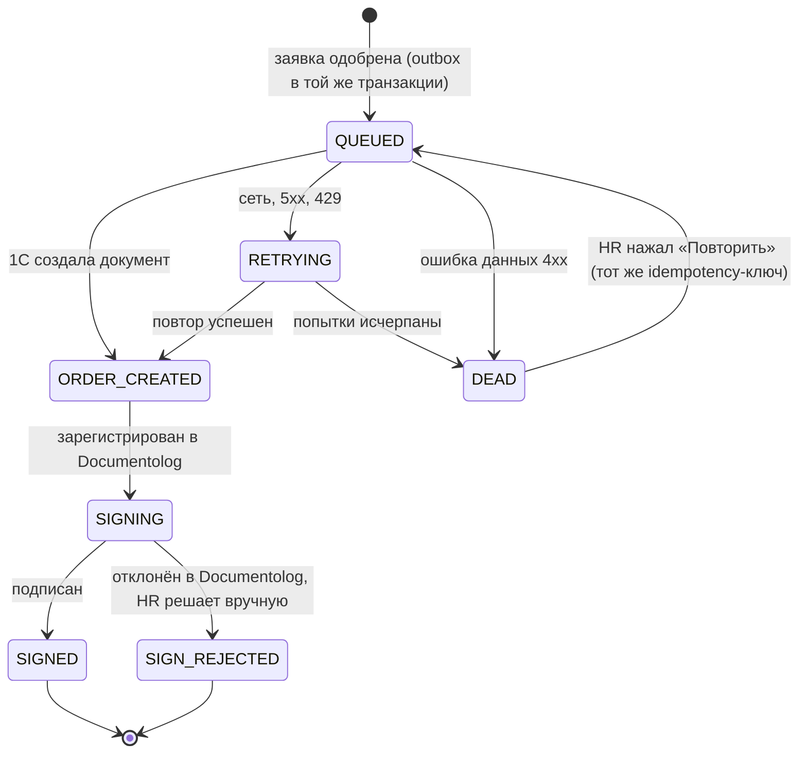

# Интеграция JanaМен с 1С:ЗУП 3.1 и Documentolog (ЭДО)

> **Статус: проект + фундамент на стороне JanaМен.** Подпись HMAC, outbox, воркер доставки и
> приём подписанных callback уже в коде (раздел 5). Сам шлюз и реальные 1С/Documentolog **не
> подключены**. Всё, что помечено **[уточнить]**, — допущение. Его нужно подтвердить с Jana Post:
> точные адреса, методы, названия полей и документов 1С/Documentolog мы не знаем и не выдумываем.

## 1. Топология

JanaМен **никогда не обращается к 1С и Documentolog напрямую**. Между ними стоит отдельный сервис —
**интеграционный шлюз (Integration Gateway)**. Только он знает учётные данные партнёров и их форматы.



| Сторона | Чем владеет | Чего у неё нет |
|---|---|---|
| **JanaМен** | UI, пользователи и роли, заявки и согласование, кэш профиля и остатка отпуска, outbox, статусы, уведомления, база знаний AI | Ключей и адресов 1С/Documentolog, PDF приказов, данных о зарплате |
| **Шлюз** | Учётные данные партнёров, маппинг полей, проверка подписи, хранилище nonce и idempotency-ключей, повторы к партнёрам, технический аудит | UI, бизнес-решений (кто что согласует), постоянного хранения персональных данных |
| **1С:ЗУП** | Мастер-данные: кадры, оргструктура, остатки отпусков, приказы, расчёт выплат | — |
| **Documentolog** | Регистрация документов, маршруты подписания ЭЦП, архив | — |

**AI Jana не получает записей о сотрудниках.** Она ищет только по утверждённым HR-регламентам
(фильтр в SQL до поиска). Поиска по пользователям нет. У шлюза нет связи с AI/Gemini.
Интеграционные данные в базу знаний не попадают.

## 2. Потоки данных

### 2.1. Профиль сотрудника и остаток отпуска: 1С → JanaМен

1С — источник истины для кадровых данных. JanaМен хранит только кэш для экранов и проверок.



- Новый сотрудник в 1С → неактивная учётная запись. HR активирует её явно.
- Увольнение в 1С → учётная запись деактивируется, активные сессии отзываются.
- Расхождение остатка: **побеждает 1С**, HR получает уведомление.

### 2.2. Одобренная заявка (отпуск / аванс) → документ в 1С

Сейчас `RequestService.review_request` в **одной транзакции** переводит заявку из `Pending` в
`Approved`, списывает дни отпуска, пишет событие, уведомление и аудит. В эту же транзакцию
добавляется строка **outbox**. Тогда одобрение и задача на передачу в 1С либо сохраняются обе, либо
не сохраняется ни одна.



В 1С уходят только: табельный номер, тип, даты или сумма, код заявки `REQ-N…`, табельный номер
согласующего. Текст причины не передаётся, если 1С его не требует **[уточнить]**.

### 2.3. Документ на подпись → Documentolog → статус обратно

Печатная форма приказа идёт из 1С в Documentolog **через шлюз**. В JanaМен PDF не хранится.



## 3. Безопасность: только стандартные примитивы

**Почему не собственный шифр.** Идея «ключ знают только JanaМен и партнёр» сохраняется полностью.
Но уникальным мы делаем **ключ, а не алгоритм** (принцип Керкгоффса). Самописный шифр никто не
проверял, его не примут аудит и служба ИБ заказчика, и он почти всегда ломается.
TLS 1.3, HMAC-SHA256 и AES-256-GCM проверены десятилетиями и есть в стандартных библиотеках.

| Уровень | Что защищает | Как |
|---|---|---|
| 1. Канал | Перехват, подмена сервера | TLS 1.3. Между JanaМен и шлюзом — **mTLS**: у каждого сервиса клиентский сертификат от своего внутреннего CA, короткий срок жизни (90 дней) |
| 2. Подпись запроса | Подделка, изменение, повтор | **HMAC-SHA256** на каждом запросе в обе стороны (см. ниже) |
| 3. Идемпотентность | Двойной приказ при повторе | Заголовок `Idempotency-Key`. Шлюз хранит ключ → результат |
| 4. Шифрование тела (опционально) | Чтение тела на промежуточном прокси / балансировщике | **AES-256-GCM** (`AESGCM` из библиотеки `cryptography`) |

**Подпись запроса.** Заголовки: `X-Key-Id`, `X-Timestamp` (Unix, UTC), `X-Nonce` (128 бит
случайных), `X-Signature`. Подписываемая строка:

```text
METHOD \n PATH?QUERY \n TIMESTAMP \n NONCE \n SHA256_HEX(сырое тело)
X-Signature = base64( HMAC-SHA256( key[X-Key-Id], строка ) )
```

Получатель:
1. находит ключ по `X-Key-Id` (неизвестный → 401);
2. отклоняет запрос, если `|now − timestamp| > 300 с` (устаревший);
3. отклоняет `nonce`, уже виденный за окно (хранится с TTL ≥ окна) — **anti-replay**;
4. пересчитывает хэш тела из сырых байтов и сравнивает подпись через `hmac.compare_digest`;
5. при любой ошибке отвечает 401 без подробностей и пишет технический аудит.

Для подписи хватает стандартной библиотеки Python (`hmac`, `hashlib`, `secrets`).

**Идемпотентность.** Ключ строится из кода заявки и операции: `REQ-N000123:1c-order`.
Повтор с тем же ключом возвращает сохранённый результат, второго документа в 1С не будет.
Тот же ключ с другим телом → 409.

**Шифрование тела (если TLS завершается не на шлюзе).** Отдельный 256-битный ключ шифрования
(не тот, что для HMAC). Новый случайный 96-битный nonce на каждое сообщение, повтор nonce с тем же
ключом запрещён. AAD = `key_id + timestamp + path`: шифротекст нельзя переставить в другой запрос.
HMAC считается уже по шифротексту.

**Ключи.**
- Отдельный ключ на каждого партнёра и каждое направление: JanaМен→шлюз, шлюз→JanaМен,
  шлюз→Documentolog и т.д. Минимум 32 случайных байта (`secrets.token_bytes(32)`).
- Ключи хранятся в секрет-хранилище (Docker secrets / Vault / KMS) и попадают в env при запуске.
  В репозиторий не коммитятся, как и сейчас `SECRET_KEY` и `GEMINI_API_KEY`.
- Ротация: у ключа есть версия (`X-Key-Id`). Во время перекрытия (7 дней) принимаются текущая и
  предыдущая версии, затем старая отзывается. Плановая ротация раз в 90 дней, при подозрении —
  немедленно.
- Учётка шлюза в 1С: только чтение кадровых данных и создание нужных документов **[уточнить]**.

**Минимум данных.**

| Направление | Передаётся | Не передаётся |
|---|---|---|
| 1С → JanaМен | Табельный номер, ФИО, подразделение, должность, руководитель, дата приёма, остаток отпуска | ИИН, оклад, начисления, банковские реквизиты, адрес, медданные |
| JanaМен → 1С | Табельный номер, тип, даты / сумма, код заявки, согласующий | Комментарии, история переписки |
| JanaМен ↔ Documentolog | Код заявки, идентификаторы документов, статус | PDF и содержимое приказа (идут 1С → шлюз → Documentolog) |

**Аудит без персональных данных.** Логируются партнёр, операция, код заявки, `key_id`,
idempotency-ключ, SHA-256 тела, HTTP-код, длительность, число попыток. Тела запросов, ФИО и суммы
не логируются. Это тот же принцип, что и у нынешних `audit_events` с минимальными метаданными.

## 4. Надёжность



- **Outbox** (таблица `integration_outbox`): `request_id`, `operation`, уникальный
  `idempotency_key`, `status` (PENDING / DONE / DEAD), `attempts`, `next_attempt_at`,
  `last_error` (только код). Тело запроса собирается в момент отправки, копий персональных данных
  в очереди нет. Воркер берёт по одной задаче через `FOR UPDATE SKIP LOCKED`, поэтому несколько
  воркеров не возьмут одну задачу. RETRYING и DEAD на схеме — это состояние задачи в outbox, а
  `requests.integration_status` хранит только движение вперёд.
- **Повторы**: экспоненциальный backoff с jitter ±20% (30 с, 1, 5, 15 мин, 1, 6, 12 ч), до 8
  попыток (около суток). Повторяются только сетевые ошибки, 5xx и 429. Ошибки данных (4xx,
  например «сотрудник не найден в 1С») сразу уходят в DEAD.
- **Dead-letter**: при DEAD все активные HR получают уведомление. План: список DEAD в карточке
  «Границы корпоративных интеграций» с кнопкой «Повторить». Повтор безопасен благодаря тому же
  idempotency-ключу.
- **Сверка (reconciliation)**, ночью. Шлюз сравнивает документы 1С и статусы Documentolog за
  последние N дней с заявками JanaМен:
  - одобрена, но документа нет → снова в очередь;
  - документ в 1С есть, а одобренной заявки нет → тревога HR;
  - потерянный callback → статус подтягивается опросом;
  - расхождение остатка → берётся значение 1С.

**Что видит пользователь.** Одобрение не блокируется недоступностью 1С: сотрудник сразу видит
«Одобрено». Дальше в карточке заявки статус: «Передаётся в 1С» → «Приказ создан в 1С» →
«На подписании» → «Подписано». При DEAD сотрудник видит «Передача задерживается, HR уведомлён»,
без технического текста. HR видит код ошибки и кнопку повтора. Остаток отпуска показывается с
пометкой «по данным 1С на <дата последней синхронизации>».

## 5. Текущее состояние (честно)

| Что | Состояние |
|---|---|
| `app/integrations/one_c_zup.py` | `UNCONNECTED`, 0 записей, без `last_sync`. Профили и остатки — локальные записи. `vacation_days()` считает календарные дни минус даты из `LEAVE_EXCLUDED_DATES`; производственный календарь из 1С не загружается |
| `app/integrations/documentolog.py` | `UNCONNECTED`. При `ENABLE_MOCK_INTEGRATIONS=true` пишет `MOCK-DOCLOG-<код>` в `requests.external_sync_id`. Это **локальная симуляция**, а не регистрация документа |
| `app/schemas/integration.py` | Схемы телеметрии и черновые ответы (`OneCProfileSyncResponse`, `DocumentologSyncResponse`) |
| `GET /api/v1/admin/integrations` | Показывает телеметрию обоих адаптеров |
| `app/integrations/signing.py` | **Есть.** HMAC-SHA256 по схеме раздела 3, окно 300 с, `hmac.compare_digest`, только стандартная библиотека |
| `app/integrations/outbox.py` | **Есть.** Задача пишется в транзакции одобрения (`review_request`), воркер `python -m app.integrations.outbox` подписывает запрос, шлёт по TLS 1.3 / mTLS, ведёт backoff и DEAD. После документа 1С ставит в очередь регистрацию в Documentolog |
| `POST /api/v1/internal/integrations/documentolog/status` | **Есть.** Принимает только подписанные запросы, nonce хранится в `integration_nonces` (повтор → 401). Статус двигается только вперёд, сотрудник получает уведомление. Скрыт из OpenAPI: это не API для браузера |
| Миграция `0005_integration_outbox` | **Есть.** Таблицы `integration_outbox`, `integration_nonces`, колонка `requests.integration_status` |
| Сам шлюз, синхронизация сотрудников из 1С, шифрование тела AES-GCM, экран DEAD для HR | **Не реализованы.** Ждут подтверждения API и полей от Jana Post |

**Как включить** (без `INTEGRATION_GATEWAY_URL` в очередь ничего не пишется):
`INTEGRATION_GATEWAY_URL`, `INTEGRATION_OUTBOUND_KEY_ID` + `INTEGRATION_OUTBOUND_KEY` (JanaМен →
шлюз), `INTEGRATION_INBOUND_KEYS='{"gw-2026-10":"..."}'` (шлюз → JanaМен), `INTEGRATION_TLS_CERT` /
`INTEGRATION_TLS_KEY` / `INTEGRATION_TLS_CA` для mTLS. Ключи — минимум 32 случайных символа. В
production без https и клиентского сертификата приложение не стартует.

**Нужно подтвердить с Jana Post:**
1. Способ доступа к 1С:ЗУП: HTTP-сервис конфигурации, стандартный интерфейс OData или обмен файлами;
   тестовая копия базы.
2. Типы документов 1С для отпуска и аванса, обязательные реквизиты, идентификатор сотрудника
   (табельный номер или GUID).
3. API Documentolog: авторизация, регистрация документа, маршруты и шаблоны, webhook или опрос.
4. Кто подписывает приказ, нужна ли отметка о подписании обратно в 1С.
5. Сетевая схема: где стоят 1С и шлюз, VPN, белые списки IP, требования ИБ к хранению ключей.
