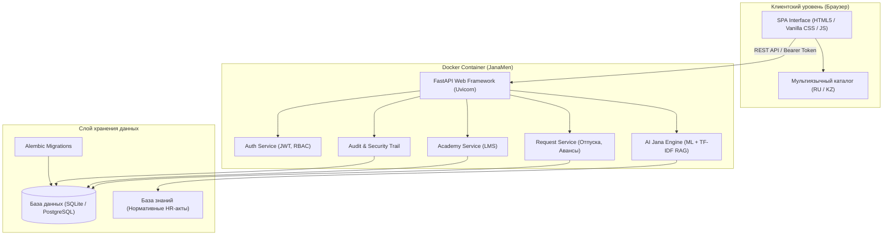

# История развития проекта JanaМен (Jana Post × Terricon Valley Hackathon 2026)

## 1. Введение и контекст хакатона
Проект **JanaМен** разработан в рамках хакатона **Jana Post × Terricon Valley Hackathon 2026** по направлению **Challenge 02: Digital HR (Цифровой HR для сотрудников)**.

### Проблема
Исторически сотрудники распределённой почтово-логистической сети Jana Post сталкивались с фрагментированными процессами:
- Заявки на отпуск и аванс оформлялись через бумажные заявления или разрозненные почтовые цепочки.
- Ответы на типовые HR-вопросы (правила отпусков, декретные, командировочные) требовали ручной консультации кадровиков и ожидания ответа до нескольких дней.
- Обучение и онбординг (LMS) велись в отдельных разрозненных таблицах без наглядного отслеживания прогресса.
- Отсутствовала прозрачная ролевая модель для линейных руководителей, позволяющая видеть структуру команды и остатки отпусков.

---

## 2. Хронология этапов разработки (Фазы проекта)

### Фаза 1: Фундамент и модульный монолит (MVP)
- **Бэкенд**: Реализован на FastAPI с чистой слоистой архитектурой (`app/routers/`, `app/services/`, `app/models/`, `app/schemas/`).
- **Ролевая модель (RBAC)**: Введены 3 роли с жестким разграничением прав на уровне API:
  - **Сотрудник (`EMPLOYEE`)**: личный профиль, баланс отпусков, подача заявок на отпуск и аванс, прохождение курсов Jana Academy, диалог с AI-ассистентом.
  - **Руководитель (`MANAGER`)**: согласование/отклонение заявок подчиненных с фиксацией резолюции и комментария, просмотр команды.
  - **HR-администратор (`HR_ADMIN`)**: финальное утверждение заявок, управление базой знаний, просмотр журнала аудита (Audit Trail).
- **База данных и миграции**: Интеграция SQLAlchemy и Alembic. Начальная схема с поддержкой версионирования без разрушительных изменений (`DROP TABLE/SCHEMA`).
- **Базовый RAG AI Jana**: Сервис поиска по нормативным HR-документам с лексическим ранжированием.

### Фаза 2: Редизайн интерфейса в айдентике Jana Post
- **Фирменный стиль**: Полная адаптация веб-интерфейса под брендбук Jana Post (фирменный изумрудный `#00845B`, золотистый `#FFC72C`, нейтральные графитовые оттенки).
- **Динамический интерфейс (SPA)**: Нативный Vanilla CSS + JavaScript без тяжелых фреймворков для мгновенной загрузки (< 50 мс).
- **Мультиязычность**: Полная поддержка русского (`ru`) и казахского (`kz`) языков интерфейса с мгновенным переключением без перезагрузки.
- **Интерактивные элементы**: Демо-переключатель ролей (Persona switcher), карточки статусов заявок, таймлайн жизненного цикла заявки.

### Фаза 3: Развитие поискового и языкового ядра AI
- **Казахский и русский морфологический анализ**: Интеграция механизма сопоставления символьных n-грамм (char_wb 3–5-grams) для точной обработки флективных форм казахского (демалыс/демалысқа) и русского (отпуск/отпуска/отпуском) языков.
- **Защита от галлюцинаций (Strict Grounding)**: Введение обязательного правила — отображаемый ответ ассистента формируется исключительно из подтвержденных цитат базы знаний.
- **Поддержка внешнего LLM-адаптера (Google Gemini)**: Реализация адаптера с жестким порогом валидации цитат — если сгенерированный ответ расходится с первоисточником, система безопасно откатывается к выжимке из одобренного регламента.

### Фаза 4: Масштабирование и Enterprise-возможности
- **Справочник сотрудников и профили**: Детализированные карточки сотрудников с историей отпусков, метриками согласования и контактами.
- **Двойная совместимость СУБД (SQLite & PostgreSQL)**: Поддержка как локального легковесного режима на SQLite, так и боевой развертки на PostgreSQL 17 с пулом соединений.
- **Модуль машинного обучения (ML Retraining & Search)**:
  - Модуль `ml/` для обучения и оценки качества реранкера поисковой выдачи на основе разметки запросов.
  - Метрики точности MRR и Coverage зафиксированы в отчетах.
- **Синтетический генератор масштабируемых данных**: Модуль `app/seed_scale.py` для тестирования производительности на выборках до сотен сотрудников и тысяч заявок без утечки персональных данных.

### Фаза 5: Харденинг, регрессионное тестирование и слияние веток
- **Изоляция параллельных заявок**: Предотвращение гонок (Race Conditions) при одновременной подаче заявок на один и тот же период через блокировку строк профиля до валидации остатка.
- **Валидация горизонтов дат**: Защита от перегрузки календаря нереалистичными датами (до 365 дней вперед).
- **Мобильная адаптивность**: Тестирование и гарантия корректного отображения на экранах шириной от 319 px.
- **Комплексный тестовый пакет**: Рост тестового покрытия до **339 автотестов** (100% прохождение на SQLite и PostgreSQL).
- **Контейнеризация Docker**: Полная сборка проекта (FastAPI бэкенд + нативный фронтенд) в оптимизированный Docker-образ с автоматическим применением миграций и инициализацией демонстрационных данных одной командой.

---

### Фаза 6: Проверка после локального слияния
- **PostgreSQL по умолчанию**: `docker compose up --build` поднимает PostgreSQL 17 и приложение; отдельный `docker-compose.postgres.yml` больше не нужен. Полный набор тестов проходит и на SQLite, и на PostgreSQL.
- **Демо без настройки**: в демо-режиме контейнер сам создаёт синтетические данные масштаба компании (7 отделов, 157 сотрудников, 434 заявки с историей решений, обучение, уведомления).
- **Отпуск по ст. 90 ТК РК**: конфигурация по умолчанию исключает фиксированные государственные праздники 2026–2027 из дней отпуска; список по-прежнему настраивает HR (`LEAVE_EXCLUDED_DATES`).
- **Чистота кода**: удалён неиспользуемый импорт, отформатированы 4 файла, добавлен перевод нового сообщения о доступе.
- **Скорость в Docker**: 400 запросов в 16 потоков — 173.0 запросов/с без ошибок ([benchmark-docker.json](evidence/benchmark-docker.json)).

---

## 3. Архитектурная диаграмма



---

## 4. Демонстрационные учетные записи

Для проверки полного жизненного цикла в системе предустановлены тестовые сотрудники:

| Роль | Email | Пароль | Описание |
|---|---|---|---|
| **Сотрудник** | `aruzhan@janapost.kz` | `Password123!` | Подача заявок, просмотр баланса отпусков, курсы |
| **Руководитель** | `timur@janapost.kz` | `Password123!` | Согласование заявок подчиненных, аналитика команды |
| **HR-Админ** | `aigerim@janapost.kz` | `Password123!` | Утверждение выплат и отпусков, управление базой знаний |

---

## 5. Запуск в одну команду через Docker

```bash
# PostgreSQL 17 + приложение, демо-данные компании создаются автоматически:
docker compose up --build -d

# Проверка статуса:
docker compose ps

# Открытие в браузере:
# http://127.0.0.1:8000
```
