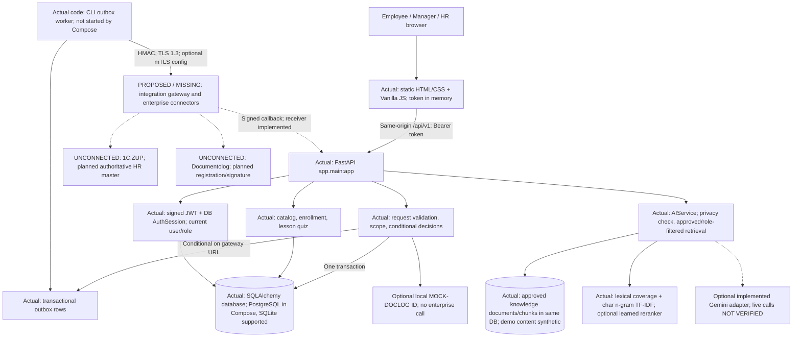

# JanaМен MVP — Strict Technical Audit and Hackathon Readiness Review

Audit date: **17 October 2026, Asia/Almaty**. Reviewed commit: **`eed46a63133d6b6f52cd5d6b7f089dd3bedbff06`**, branch `main`.

Scope: the primary checkout at `/Users/aibek/post tech `, including tracked application code, migrations, frontend, tests, build configuration, knowledge assets and documentation. Nested, ignored worktrees were not treated as the submitted application. The initial working tree was clean. **No application source, existing documentation, `.env`, user database, deployment or enterprise service was changed.** This audit adds only this report and its evidence directory. Runtime mutations used a newly created synthetic SQLite database and a separate disposable PostgreSQL container. Gemini and outbound enterprise integrations were explicitly disabled.

Evidence vocabulary: **VERIFIED** = implementation and/or observed test; **PARTIALLY VERIFIED** = incomplete proof or capability; **MOCKED** = intentional synthetic content/simulation; **MISSING** = absent in the inspected implementation; **NOT VERIFIED** = unavailable runtime/evidence. A static finding is identified as static; it is not described as a successful runtime test. PASS/FAIL below apply to gates, not to the existence of code.

The supplied weights agree with the local organizer brief, [Jana_Post_Terricon_Hackathon_2026 1.pdf](</Users/aibek/post tech /Jana_Post_Terricon_Hackathon_2026 1.pdf>), Digital HR requirements and evaluation sections. That brief permits mock enterprise boundaries and does not require enterprise connectivity, electronic signature or a native mobile application. Their absence alone does not lose implementation points.

## 1. Executive verdict

**Classification: functioning full-stack hackathon MVP, with material readiness defects. Score: 81.5/100. Strict judge-ready verdict: NO-GO until the P0 items below are closed.** This is an engineering assessment, not an official competition score or a production certification.

The vacation workflow is real. HTTP requests reach FastAPI; SQLAlchemy persists requests, decisions, history, notifications and balances. Role and team restrictions are enforced on the server. An employee → manager → employee browser journey succeeded, and a separate HTTP journey retained request and Academy state after restarting the backend. All **362 tests passed on SQLite and PostgreSQL separately**. These results earn substantial credit; attractive screens and old report claims do not.

The readiness blockers are concrete:

- AI Jana labels two mutually contradictory approved passages as `grounded`, without flagging the conflict. Exact citation is implemented; consistent policy interpretation is incomplete.
- The main README mixes two demo account families and promises a Documentolog registration that does not occur. The provided smoke test succeeds once and fails on immediate rerun because it reuses fixed vacation dates.
- Changing calendar exclusions retroactively changes historical displayed days without changing the stored leave balance. Identical advance submissions also create separate requests.

No employee authorization bypass was demonstrated. Enterprise systems are **unconnected**, with functioning local integration scaffolding and tests against substitutes. All reviewed demo knowledge and profiles are represented as synthetic. Live Gemini, real enterprise APIs, provenance of any real HR policy, deployment hardening and a finished presentation were not verified.

## 2. Weighted score out of 100

Scores below allocate the official category maxima directly; they are not extra weights. Evidence identifiers refer to sections 4, 7–11 and the observed execution record in section 7. No live integration credit is awarded.

| Category | Awarded | Maximum | Main deduction |
|---|---:|---:|---|
| A. End-to-end HR scenario | 26 | 30 | Retry duplication, calendar/history drift, fragile repeat demo |
| B. Functionality and UX | 17 | 20 | Modal focus, session/navigation friction, documentation honesty |
| C. Architecture and engineering | 15.5 | 20 | DB invariants, incomplete gateway acknowledgements/operations, setup drift |
| D. HR assistant | 11 | 15 | Conflicting sources accepted, limited evidence of retrieval generalization |
| E. Jana Academy | 8.5 | 10 | Course-wide deadlines and limited assignment/result semantics |
| F. Presentation and demo | 3.5 | 5 | No verified pitch asset; documented walkthrough is inconsistent |
| **Total** | **81.5** | **100** | **26 + 17 + 15.5 + 11 + 8.5 + 3.5 = 81.5** |

**A. End-to-end HR scenario — 26/30**

| Subcriterion | Points | Evidence and deduction |
|---|---:|---|
| Employee submits valid request | 5/5 | `POST /api/v1/requests` returned 201; request ID 5 was queried independently in SQLite. Browser created ID 9. |
| Backend validation/transitions | 4/5 | Invalid dates/fields rejected; conditional Pending transition and repeat-decision 409 work. No frozen charged-day/calendar record (R4). |
| Manager permitted scope | 6/6 | Own team visible; foreign decision 403; foreign profile 404; employee decision 403. Concurrency and scope tests pass. |
| Persisted request/history | 4.5/5 | Two events, reviewer and status persist across backend restart. Historical day calculation remains mutable through configuration. |
| Employee result/notification | 4/4 | Approval notification and debit persisted; employee saw both after a new browser login. |
| Edge/error handling | 1.5/3 | Date, amount, balance, duplicate vacation and repeated decisions covered; identical advances accepted twice (R5). |
| Reproducible complete demonstration | 1/2 | Fresh isolated journey and first smoke run succeed. Immediate second smoke fails; README account families conflict (R2). |

**B. Functionality and UX — 17/20**

| Subcriterion | Points | Evidence and deduction |
|---|---:|---|
| Profile and HR information | 4/4 | Own profile includes name, company, position, department, manager, hire date, balance, courses and notifications; marked local/read-only. |
| Request creation/list/filter/details | 4.5/5 | Forms, enum filters, detail/history APIs and UI exist and were exercised. No reliable transport-retry semantics for advances; client restrictions do not exactly mirror configurable API rules. |
| Notifications/status updates | 2.5/3 | Persistent assignment/completion/request notices and read ownership work. Refresh/navigation is used; no tested push delivery or periodic refresh. Push is not a requirement, but stale open screens reduce UX quality. |
| Consistent/responsive/accessible UX | 2.5/4 | Browser journey works at observed 319-pixel width; review dialog leaves focus on background action (R10). Broader viewport/screen-reader coverage not performed. |
| Kazakh/Russian readiness | 2/2 | RU default, KK selection persists across reload, supported RU/KK AI queries, five frontend localization tests and server suite pass. |
| Real/sample/unavailable distinction | 1.5/2 | UI and adapter telemetry are explicit. README still claims real external registration (R3). |

**C. Architecture and engineering — 15.5/20**

| Subcriterion | Points | Evidence and deduction |
|---|---:|---|
| Backend/database/validation/integrity | 3.5/5 | Transactions, FKs, uniqueness, revocable sessions and migrations work. Date/balance CHECKs absent; historical debits recalculated; money stored as Float. |
| Authentication/authorization/record access | 4.5/5 | Password hashing, signed JWT + DB session, current DB role and direct-report filters pass negative tests. Process-local throttling and ephemeral development signing key need operating constraints (R9). |
| Maintainable modules | 2.5/3 | Routers/services/models/schemas/adapters are understandable; frontend controller is about 1,000 lines and AI rules/logic remain concentrated. Targeted changes are feasible. |
| Integration adapters/contracts | 2/3 | Real HMAC/outbox/retry/callback foundation, documented ownership and mock boundaries. A successful status alone can falsely advance integration state; worker is not in Compose (R6). No deduction merely for absent live enterprise access. |
| Tests/errors/reliability | 2.5/3 | 362 × two database suites; rollback/race tests; structured redacted errors. Discovered adversarial/retry cases are outside existing coverage; no automated full browser journey or checked-in CI workflow found. |
| README/reproducible setup | 0.5/1 | New isolated CLI setup and built container work. Current README and historical reports contradict the actual default topology and walkthrough. |

**D. HR assistant — 11/15**

| Subcriterion | Points | Evidence and deduction |
|---|---:|---|
| Approved-source grounding | 3/4 | SQL filters active + approved + role before ranking; exact excerpts. Approval does not establish policy currency or resolve competing policies. |
| Traceable references | 3/3 | Real chunk/document IDs, version, revision, language and synthetic flag; source route resolved successfully; stale revision tests pass. |
| Safe unsupported fallback | 1/3 | Unsupported topics and unsupported 90-day vacation question declined; injected role instruction did not obtain private information. Conflicting approved policies return a normal grounded answer (R1). |
| Permissions/private HR data | 2/2 | Scoped source query and local privacy guard precede model call; employee-private question blocked. No employee salary dataset is exposed to retrieval. |
| Tests/limitations | 2/3 | Locale, privacy, restricted sources and stubbed Gemini failures are tested; model card is candid. No independent live-provider or broad conflict/injection corpus verification. |

**E. Jana Academy — 8.5/10**

| Subcriterion | Points | Evidence and deduction |
|---|---:|---|
| Catalog/material flow | 3/3 | Catalog, course detail, Markdown lesson and quiz APIs, enrollment flow and player exist; content is demonstrative. |
| Persisted progress/completion | 3/3 | New employee went from 0 to 100%; enrollment rows and completed timestamp survive backend restart; duplicate completion creates no extra notice. |
| Accurate assignment/deadline representation | 1/2 | Enrollment and assignment notice exist. `due_date` is on Course, not Enrollment; no per-assignment deadline/assignee policy. |
| Testable completion/result | 1.5/2 | Server verifies answers; result reflects lessons passed. It is a formative completion metric with unlimited retries, not a proctored assessment; independent read completion is not measured. |

**F. Presentation and demo — 3.5/5**

| Subcriterion | Points | Evidence and deduction |
|---|---:|---|
| Problem/value clarity | 1/1 | README and UI describe employee self-service, approvals, learning and policy lookup clearly. |
| Reliable live core scenario | 1.5/2 | Real browser and HTTP approval succeeded; supplied script is one-shot with fixed dates. |
| Implemented/mock/future distinction | 0.5/1 | UI/integration document are honest; README has a contradictory registration claim. |
| Architecture/evidence communication | 0.5/1 | Architecture and contracts exist; no finished team pitch deck or recording was identified. Organizer PDF and preparation DOCX are not evidence of a delivered team presentation. |

## 3. Critical gates

| Gate | Verdict | Finding status and direct evidence | Consequence |
|---|---|---|---|
| 1. Employee request validated and persisted | **PASS** | VERIFIED — runtime request 5, DB row PENDING, invalid inputs 422, `RequestService.create_request` | Real core backend workflow. |
| 2. Manager decisions restricted to scope | **PASS** | VERIFIED — manager scope and negative calls; `get_request_by_id`, `scoped_profiles`; foreign decision 403 | No observed cross-team approval. |
| 3. Employee cannot decide/read another record/escalate | **PASS** | VERIFIED — own decision 403; other employee record 403; admin/manager API 403; unknown role fields 422; role mutation method 405; JWT role test passes | No observed employee privilege bypass. No general penetration-test guarantee. |
| 4. Status/history/notification after refresh/new login | **PASS** | VERIFIED — HTTP logout/login + process restart; same request Approved; history and notices retained; browser reload required login and then showed retained data | PASS with unchanged calendar and configured stable test key. R4 is a separate configuration-change defect. |
| 5. Approved evidence + safe uncertainty handling | **FAIL** | PARTIALLY VERIFIED — sources and ordinary fallback work, but approved 24-day and 40-day passages both returned as `grounded`, without conflict warning | AI safety gate blocks unconditional judge-ready approval. |
| 6. No credentials/real PII/unsafe configuration committed | **NOT VERIFIED** | PARTIALLY VERIFIED — 173 tracked files inspected; pattern scan of 418 blob versions across 37 reachable commits found only classified test/example placeholders; `.env` and DB ignored. Synthetic provenance of every name cannot be independently certified; no comprehensive deployment/configuration security assessment | No real secret or real employee record was identified. Do not mislabel a scoped negative scan as proof of absolute absence. |
| 7. Enterprise status honestly labeled | **FAIL** | PARTIALLY VERIFIED — code, UI and `docs/INTEGRATIONS.md`: UNCONNECTED; README line 172 promises `DOCLOG-2026-1045` | Correct submitted walkthrough before presenting. No enterprise call was made. |
| 8. New judge can reproduce documented scenario | **FAIL** | PARTIALLY VERIFIED — documented CLI setup and fresh first smoke work, but provisioned selector points to `manager.demo`, while walkthrough starts `aruzhan` under `timur`; immediate smoke rerun fails at step 3 with 409 | Provide one consistent account family and a repeatable isolated scenario. |

The numerical score does **not** override gates 5, 7 or 8. Gate 6 remains an explicitly limited assurance result, not evidence of a known leak.

## 4. Verified functionality, with exact evidence

The following positive findings include the required requirement, status, evidence, impact, severity, recommendation, acceptance criterion and proof. These recommendations preserve working behavior rather than requesting a rewrite.

**V1 — Persistent employee request lifecycle.** Requirement: valid submission → manager decision → employee status/history/notification. **VERIFIED.** Evidence: [RequestService](</Users/aibek/post tech /app/services/request_service.py:133>) `create_request` and [review_request](</Users/aibek/post tech /app/services/request_service.py:374>); [Request/RequestEvent](</Users/aibek/post tech /app/models/request.py:15>); `POST /api/v1/requests`, `POST /api/v1/requests/{id}/approve`, `GET /api/v1/requests/{id}`; [runtime observations](</Users/aibek/post tech /docs/audits/2026-10-17/evidence/results.json>). Importance: this is the highest-weighted product capability. Severity: **Low** for the verified control; edge defects are R4/R5. Recommendation: preserve the one-transaction pattern. Acceptance: one decision, one debit, one new decision event and one decision notification. Proof: `test_full_hackathon_demo_journey`, `test_failed_notification_rolls_back_entire_approval`, `test_concurrent_duplicate_approval` pass on both databases; independent HTTP/DB and browser journeys succeeded.

**V2 — Real authentication and record scope.** Requirement: employee, manager and HR server permissions. **VERIFIED.** Evidence: [AuthService/get_current_user](</Users/aibek/post tech /app/services/auth_service.py:71>), [require_role](</Users/aibek/post tech /app/services/auth_service.py:171>), [manager router](</Users/aibek/post tech /app/routers/manager.py>), [auth router](</Users/aibek/post tech /app/routers/auth.py:38>). Importance: hiding navigation is insufficient; these checks protect direct API access. Severity: **Low** for verified controls. Recommendation: retain DB-derived current role and ownership tests. Acceptance: tampered role claims never authorize; deactivated/revoked sessions fail; foreign records fail. Proof: `test_jwt_role_is_never_authority`, `test_deactivated_user_is_denied`, `test_logout_revokes_current_session_only`, `test_scope_and_hr_queue`, plus actual 403/404 observations. A 404 for a foreign team profile is a legitimate non-disclosing denial.

**V3 — Profile and persisted notifications.** Requirement: complete profile, unread notices, read ownership and assignment/decision notices. **VERIFIED.** Evidence: [profile router](</Users/aibek/post tech /app/routers/me.py>), [EmployeeProfile](</Users/aibek/post tech /app/models/profile.py:12>), [NotificationService](</Users/aibek/post tech /app/services/notification_service.py>), [notifications router](</Users/aibek/post tech /app/routers/notifications.py>). Importance: closes the employee feedback loop. Severity: **Low** for verified controls. Recommendation: keep local/synthetic flags visible and preserve references to the correct request/course. Acceptance: reload/relogin retains the same notices; read actions only affect the owner. Proof: independent restart test, `test_notification_ownership_and_unread`, `test_knowledge_summary_and_notification_counts`; screenshot below.

**V4 — Persisted Academy progress.** Requirement: assigned course, material, quiz, progress and completion. **VERIFIED.** Evidence: [AcademyService.submit_lesson_quiz](</Users/aibek/post tech /app/services/academy_service.py:159>), [Enrollment/LessonProgress](</Users/aibek/post tech /app/models/academy.py:75>), `POST /api/v1/courses/lessons/{id}/quiz`. Importance: learning is tied to the actual employee record. Severity: **Low** for persistence; assignment limitations R8. Recommendation: keep uniqueness and completion-notification idempotence. Acceptance: progress only advances on accepted completion, a repeated submission does not duplicate completion, restart retains 100%. Proof: new demo employee started at 0%; row became COMPLETED/100 with timestamp; remained after restart; `test_course_completion_notifies_once` passes. The audit used the known synthetic answer fixture, not a claim that a human learned the material.

**V5 — Source access, traceability and ordinary AI refusal.** Requirement: approved accessible source, real citation, unsupported fallback and privacy protection. **PARTIALLY VERIFIED.** Evidence: [accessible_chunks](</Users/aibek/post tech /app/services/ai_service.py:604>), [source](</Users/aibek/post tech /app/services/ai_service.py:782>), [process_chat_query](</Users/aibek/post tech /app/services/ai_service.py:810>), [KnowledgeService](</Users/aibek/post tech /app/services/knowledge_service.py>). Importance: demonstrates evidence-based HR lookup. Severity: **High** because of R1. Recommendation: preserve SQL filters/revision checks and add the conflict behavior in section 14. Acceptance: approved current-language source resolves; stale revision 409; unsupported/private requests return no source; conflicts do not count as a normal grounded answer. Proof: RU/KK supported queries resolve chunk 1 revision 3; unsupported helicopter policy and unsupported 90-day leave policy return fallback; colleague salary query unauthorized; R1 fails the conflict criterion.

**V6 — RU/KK and working web workflow.** Requirement: usable localized web app. **PARTIALLY VERIFIED.** Evidence: [app.js](</Users/aibek/post tech /static/js/app.js>), [i18n.js](</Users/aibek/post tech /static/js/i18n.js>), [catalog](</Users/aibek/post tech /static/locales/catalog.json>), [frontend tests](</Users/aibek/post tech /tests/frontend_localization.test.cjs>). Importance: employees and judges can use the same flow in both languages. Severity: **Medium** because accessibility coverage is incomplete and R10 is reproduced. Recommendation: fix modal focus and retain locale tests. Acceptance: language survives reload; forms/notifications remain readable; modal keyboard focus is contained. Proof: five tests pass; RU employee/manager flow succeeded at observed width 319; KK preference survives browser reload. Focus containment fails.

## 5. Mocked, missing and unverified functionality

| Requirement / finding | Status | Exact evidence | Why it matters; severity | Recommended fix / boundary | Acceptance and proving test |
|---|---|---|---|---|---|
| M1. Authentic employee/HR master records | **MOCKED** | [seed.py](</Users/aibek/post tech /app/seed.py>), [seed_scale.py](</Users/aibek/post tech /app/seed_scale.py>), own-profile local/synthetic flags | Valid permitted demo content; **Low** if disclosed | Keep synthetic flag; future 1C authoritative sync is planned | Fresh seed contains only declared synthetic accounts; profile says not official; existing boundary tests pass |
| M2. Employer-approved real policy corpus | **MOCKED** for seeded examples; **NOT VERIFIED** for real HR approval | [knowledge/documents](</Users/aibek/post tech /knowledge/documents>), source API `is_synthetic=true`, [knowledge README](</Users/aibek/post tech /knowledge/README.md>) | App approval is not employer endorsement; **Medium** | Keep synthetic disclaimer; import real policy only with authorized provenance | Each approved demo citation displays synthetic status; real import records owner/version/approval; test draft exclusion |
| M3. Live 1C/Documentolog | **MISSING**; optional local Documentolog IDs **MOCKED** | [OneCZupAdapter](</Users/aibek/post tech /app/integrations/one_c_zup.py>), [DocumentologAdapter](</Users/aibek/post tech /app/integrations/documentolog.py>), runtime UNCONNECTED telemetry | Permitted hackathon boundary; false registration claim is **High**, R3 | Do not add live calls for the pitch; correct labels and test contracts | Default telemetry UNCONNECTED with zero sync; optional ID has MOCK prefix and makes no network call |
| M4. Complete integration gateway/profile sync/dead-letter UI | **MISSING** | [integration design current-state table](</Users/aibek/post tech /docs/INTEGRATIONS.md>); existing code only has outbox/signing/callback | Future integration cannot be called operational; **Medium**, R6 | Keep proposed boundary explicit; complete acknowledgement validation before enabling worker | Local fake gateway tests exercise failure/retry; no claim that a real order was created |
| M5. Live Gemini and deployed learned reranker | **NOT VERIFIED** | [gemini.py](</Users/aibek/post tech /app/integrations/gemini.py>), [config](</Users/aibek/post tech /app/config.py>), [MODEL_CARD](</Users/aibek/post tech /ml/MODEL_CARD.md>) | Optional provider results/stub tests do not prove live service or retrieval accuracy; **Medium** | Keep offline mode for the demo; evaluate independently before enabling optional modes | Provider behavior explicitly labeled; independent evaluation and redacted failure test required; no new model connection needed for P0 |
| M6. Delivered team presentation | **NOT VERIFIED** | Tracked files contain organizer brief, preparation DOCX and technical docs; no identified finished team pitch/recording | Limits presentation credit; **Medium** | Produce short pitch tied to measured flow, section 15 | 3–5 minute timed rehearsal and a small slide deck; actual recording/rehearsal proof |
| M7. Production identity/operations | SSO/password reset **MISSING**; public deployment, backup/restore and multi-worker behavior **NOT VERIFIED** | [auth router](</Users/aibek/post tech /app/routers/auth.py>), [config](</Users/aibek/post tech /app/config.py>), [Compose](</Users/aibek/post tech /docker-compose.yml>) | Outside minimum demo scope; **Medium** if exposed as production | State single-instance/local-demo boundary; R9 before shared use | Stable secret, explicit secure deployment settings and documented restoration rehearsal |

Mocked data is acceptable here. Mocked behavior is not counted as a verified enterprise integration, real employer policy or a completed external business transaction.

## 6. Architecture diagram — actual implementation and proposed components

This is a modular monolith, not a collection of microservices. The static app and API share an origin. Models/schemas/services/routers are separate. Integration gateway diagrams describe a future system beyond the implemented outbox/receiver. No frontend-only status or localStorage ledger substitutes for the database. The language preference uses localStorage; bearer tokens are held in memory.

## 7. Backend/database audit and actual executions

**Stack and entry points.** Python 3.14.0 in the existing `.venv`; FastAPI 0.136.1, SQLAlchemy 2.0.49, Pydantic 2.12.5, Alembic 1.20.0, Uvicorn 0.47.0, psycopg 3.3.6; exact pins in [requirements.txt](</Users/aibek/post tech /requirements.txt>) and development/optional ML requirement files. Entry points: [app.main:app](</Users/aibek/post tech /app/main.py>), `python -m app.migrate`, `python -m app.seed`, `python -m app.provision_demo`, optional `python -m app.integrations.outbox`. Frontend: [static/index.html](</Users/aibek/post tech /static/index.html>), one main controller and locale module. Dockerfile uses Python 3.14, non-root user and health check; Compose uses PostgreSQL 17 and loopback-only published ports. There is no Node build pipeline to run; Node checks JS syntax and locale tests.

**Storage.** Real tables include users, employee profiles, requests, request events, notifications, sessions, course/lesson/enrollment/progress, knowledge documents/chunks, audit events and integration outbox/nonces. Five migration files end at `0005_integration_outbox`. Startup checks schema readiness rather than silently creating a schema. [database.py](</Users/aibek/post tech /app/database.py>) enables SQLite foreign keys/busy timeout, sessions and rollback on exceptions. Requests and profile ownership have foreign keys; request code and employee code are unique; enrollment and lesson-progress pairs have unique indexes. PostgreSQL uses enum types; SQLite text enums do not enforce unknown values in the tested schema.

**Lifecycle.** `create_request` locks the profile row via UPDATE, reloads it, validates manager/profile/date horizon/amount, rejects overlapping active vacations and reserves pending vacation days. It creates the request, SUBMITTED event, requester/reviewer notifications and audit record before commit. `review_request` checks server access and self-review, performs conditional `WHERE status=Pending` update, debits balance conditionally, creates history/notice/audit and optionally outbox in the same transaction. Conditional failure gives 409; failed debit/notification rolls back. There is no cancellation/reversal workflow; do not invent one for the presentation.

**Observed integrity limitations.** There are no CHECK constraints on requests, employee_profiles or enrollments in the isolated SQLite schema. Transaction-rolled-back direct SQL could set negative leave balance, unknown request status and an end date before start. This is a DB defense gap, not a demonstrated API bypass: API calls rejected invalid input. Requests store no charged-day/calendar snapshot. Amounts are validated as Decimal in Pydantic but converted to Float in SQLAlchemy. Exact duplicated advances produce different IDs (7 and 8). See R4/R5/R7.

**Actual execution record.** These are current results, independent of pre-existing `docs/evidence` claims. The [verification summary](</Users/aibek/post tech /docs/audits/2026-10-17/evidence/verification-summary.json>) records output scope, including the SQLite result transcribed from streamed tool output.

| Command/check | Actual result | Scope/limit |
|---|---|---|
| `env -u TEST_DATABASE_URL .venv/bin/python -m pytest -q` | **362 passed**, 1 warning, 118.84 s | Per-test fresh SQLite, frozen business date 2026-10-15 in fixture |
| `TEST_DATABASE_URL=postgresql+psycopg://… .venv/bin/python -m pytest -q` | **362 passed**, 1 warning, 185.38 s | Separate disposable PostgreSQL 17 container; unique schema per test; [raw output](</Users/aibek/post tech /docs/audits/2026-10-17/evidence/pytest-postgresql.txt>) |
| `.venv/bin/python -m ruff check app tests migrations smoke_test.py dependency_audit.py` | Passed | Application/test lint scope |
| `.venv/bin/python -m ruff format --check app tests migrations smoke_test.py dependency_audit.py` | Passed, 91 files already formatted | Formatting only |
| `.venv/bin/python -m mypy app` | Passed, 64 source files | Optional ML training code not included in this invocation |
| `.venv/bin/python -m pip check` | No broken requirements | Existing local venv, not a clean Python install |
| `node --test tests/frontend_localization.test.cjs` | **5 passed** | Translation/DOM mocks, not full browser automation |
| `node --check static/js/app.js` and `node --check static/js/i18n.js` | Passed | Syntax only |
| `git diff --check` | Passed | Original source unchanged |
| `python dependency_audit.py --output …` | 43 exact runtime/dev pins; 0 advisory matches | Current OSV lookup, not exploitability proof |
| `python dependency_audit.py --requirements requirements-dev.txt --requirements requirements-ml.txt --output …` | **50 pins, 0 advisory matches** | Includes optional ML pins; [result](</Users/aibek/post tech /docs/audits/2026-10-17/evidence/dependency-audit-all.json>) |
| `docker build -t janamen-strict-audit:local .` | Exit 0 | [Build log](</Users/aibek/post tech /docs/audits/2026-10-17/evidence/docker-build.log>); cached layers permitted |
| Fresh disposable container from built image | `/`, `/health`, test login all 200 | Fresh container SQLite; [result](</Users/aibek/post tech /docs/audits/2026-10-17/evidence/container-smoke.json>); full fresh Compose topology not rerun |
| `JANAMEN_BASE_URL=http://127.0.0.1:8767 python smoke_test.py` | First exit **0**, all ten steps; immediate second exit **1** | Second run 409 overlap at step 3; [first](</Users/aibek/post tech /docs/audits/2026-10-17/evidence/smoke-first.txt>), [second](</Users/aibek/post tech /docs/audits/2026-10-17/evidence/smoke-second.txt>) |
| Served OpenAPI vs `docs/openapi.json` | Identical; 36 documented paths | Internal callback intentionally hidden; [comparison](</Users/aibek/post tech /docs/audits/2026-10-17/evidence/openapi-drift.json>) |
| Browser via actual UI | Employee submission → manager approval → employee notice; KK reload/login retained data | Observed narrow viewport 319; review-modal keyboard defect reproduced; no full accessibility/desktop device matrix |
| Available-ref secret scan | 37 commits, 418 blob versions; four matches classified synthetic test/example placeholders | No values copied to report; pattern-based, not exhaustive secret/provenance certification |

Both Python suites emit a `StarletteDeprecationWarning` concerning httpx/TestClient. It is not a test failure. No install/upgrade was performed to silence it. Existing old benchmark and model metrics were read as historical evidence only; load testing and learned-model training were not rerun.

**Mandatory 15-step scenario actually created and executed.** Setup followed documented migration/seed/provision commands against a new database. An isolated audit runner and adversarial probes were created in `/tmp/janamen-strict-audit-bRJUmb`; they are not modifications to application/test source. Raw [38 observations](</Users/aibek/post tech /docs/audits/2026-10-17/evidence/results.json>) and [probe outputs](</Users/aibek/post tech /docs/audits/2026-10-17/evidence/extra-probes.json>) are preserved.

| Step | Status | Observed result |
|---:|---|---|
| 1. Documented employee login | VERIFIED | `employee.demo@example.com` / documented synthetic password; employee ID 8; manager ID 7, HR ID 6 |
| 2. Submit valid vacation | VERIFIED | 2026-11-26 through 2026-11-27; 201, `REQ-N000005` |
| 3. Validate and inspect DB record | VERIFIED | Independent SQLite SELECT found user 8/status PENDING; bad/missing/backward dates and extra ownership/role fields rejected |
| 4. Employee sees Pending | VERIFIED | GET own request returns Pending; browser later submitted separate ID 9 and saw Pending |
| 5. Appropriate manager login | VERIFIED | `manager.demo@example.com`, real server login |
| 6. Manager permitted scope | VERIFIED | Request 5 visible; foreign Aruzhan request not in scope |
| 7. Decide | VERIFIED | Approval 200/Approved; browser also approved request 9 |
| 8. DB transition/history/notice | VERIFIED | SUBMITTED actor 8 + APPROVED actor 7; requester submit and decision notices; balance 24→22 for API test |
| 9. Employee signs in again | VERIFIED | Logout invalidated old token; new login succeeded |
| 10. Final status and notice | VERIFIED | Approved and matching notice visible; browser ID 9 notice visible after role switch/new login |
| 11. Refresh/backend restart | VERIFIED | Backend process terminated/restarted with same DB + stable synthetic secret; Approved/history/notices retained. Browser reload discarded in-memory token, then new login retained data/language |
| 12. Unauthorized attempts | VERIFIED | Employee decision 403; foreign employee request 403; cross-team manager decision 403; foreign team profile 404; admin/manager APIs blocked for employee |
| 13. Supported AI + source | VERIFIED | RU vacation question grounded; real chunk 1 revision 3 resolves 200; KK question has KK evidence |
| 14. Unsupported AI | VERIFIED for tested cases | Helicopter policy and 90-day/no-approval policy fallback; colleague salary unauthorized; role-injection prompt fallback. Conflict case separately fails |
| 15. Academy update/reload/persistence | VERIFIED | Newly provisioned course 0→100; completed timestamp persisted, repeat notice count unchanged, backend restart retains completion. New login dashboard reflected learning change |

Additional tests: real `Advance payment` negative amount and string `NaN` →422; end year 9999 →422; duplicate vacation →409; repeated decision →409; forged ownership/role fields →422; unavailable role mutation method →405. Wrong quiz answers, enrollment prerequisites, notification ownership, race/rollback, invalid/expired/revoked tokens and structured server errors are covered by the passing suite. Empty request/course-assignment states were visible on the manager dashboard; exhaustive browser network-failure states were **NOT VERIFIED**.

One runner assertion initially expected 403 specifically for a cross-team profile; the server returned 404. The unedited raw observation therefore has `passed:false` for that one assertion. It is **not a security failure**: 404 correctly conceals the foreign record. No raw evidence was silently rewritten. Likewise `advance_duplicate_probe.passed=true` means the probe reproduced *two creations*, not that retry idempotency passed.

## 8. Authentication and authorization audit

Identity is established by email/password against [User](</Users/aibek/post tech /app/models/user.py>). PBKDF2-HMAC-SHA256 uses 600,000 iterations and random salt; legacy 100,000-round hashes upgrade on successful login. JWT uses HS256 and validated `sub`, `jti`, `exp`, `iat`. A valid signature alone is insufficient: the corresponding unrevoked, unexpired AuthSession and active User must exist. Role comes from the DB user; a forged JWT role field is not authority.

Employee lists are filtered by `user_id`; manager records are filtered by profile `manager_id`; HR can see the company. Managers cannot review their own request; employees cannot review even their own. Team-scoped profile lookup returns 404 for foreign employee records. The allowed HR-wide scope is intentional. No HTTP endpoint allowing a user to change their own role was identified; direct role/owner submission fields are forbidden.

Login throttling is process-local and IP-oriented. It does not constitute distributed brute-force protection; multiple workers/restarts have separate limiter state. With empty/weak development SECRET_KEY, each process generates its own signing key. Single-process local demo works; independent workers would disagree about tokens. Production rejects weak keys, DEMO_MODE and the published demo password at login. Compose remains a local development deployment; it is not evidence of production hardening.

Frontend token storage is memory only. Reload requiring login is expected behavior, not lost database state. It avoids a localStorage bearer token, while reducing demo convenience. Do not change to persistent browser tokens just for convenience without a deliberate session design. Same-origin API calls, explicit optional CORS origins, output escaping and parameterized ORM use are present. No successful SQL injection, XSS or CSRF exploit was demonstrated; this review is not a comprehensive penetration test. API errors carry request IDs and redact unexpected failures; raw AI questions are hashed in the audit log. DB administrators can alter application audit tables; there is no tamper-proof audit claim to award.

Secret hygiene: `.env`, database files, caches and nested worktrees are ignored; `.env.example` contains declared local demo credentials/placeholders. Available history matches were synthetic fixtures and an old example placeholder, not identified live provider tokens. See [scan evidence](</Users/aibek/post tech /docs/audits/2026-10-17/evidence/history-secret-scan.json>). No credentials were rotated or external accounts queried.

## 9. AI Jana safety and evidence audit

**Actual mechanism.** This is an offline evidence-retrieval/extractive assistant by default, with character n-gram TF-IDF ranking and lexical query-coverage threshold. Optional learned JSON reranking further restricts/reorders matching passages. It is not verified as a deployed generative HR agent. `accessible_chunks` filters active approved documents and access levels in SQL before ranking. The privacy guard runs first and consults local employee names for sensitive named-person questions; it does not retrieve employee salary/medical records. Therefore documentation claiming literally no employee-name query in the assistant is too broad, although no such names are sent as retrieved private records to the model in this flow.

**Citations.** Returned sources carry chunk/document IDs, document revision/version, language, synthetic flag and text. Source access is rechecked. Changed revision is rejected with 409; edits invalidate approval until reviewed. Old full document revisions are not archived: traceability detects staleness but does not reconstruct old policy text.

**Optional Gemini.** [generate_grounded_answer](</Users/aibek/post tech /app/integrations/gemini.py:48>) sends question and available approved passages to an external provider only when enabled. `verify_llm_answer` requires returned IDs to be allowed and all displayed model text to equal exact quotes joined by whitespace. Unknown IDs, fabricated appended claims and provider outage use safe extractive/fallback behavior in tests. Actual model availability, latency, compliance of the configured model name and real network responses were **NOT VERIFIED**; no key was used. Input privacy classification remains lexical, not a guarantee that arbitrary user-entered PII is scrubbed before an optional external call.

**Adversarial evidence.** Ordinary supported/unsupported/privacy and query-level role injection cases are listed in section 7. Two deliberately conflicting **synthetic** documents were created through the real HR API in the isolated database, each approved at the current revision. One said 24 days; the other 40. The response included both, marked `grounded`, with valid citations and no conflict warning. This is R1, not a hallucinated citation: source existence and quotation fidelity do not prove a reliable policy answer. Document-content prompt injection against a live provider, obfuscated privacy attacks and a broad independent red-team corpus remain **NOT VERIFIED**. No conclusion of universal prompt-injection resistance is warranted.

The [model card](</Users/aibek/post tech /ml/MODEL_CARD.md>) reports historical synthetic test performance of 8/16 accepted correct first sources for answerable questions and 14/22 correct statuses, with previously used test data. These are limitations of the optional learned experiment; they are neither fresh audit metrics nor measurements of all default lexical queries. The correct hackathon improvement is deterministic ambiguity handling and better evaluation, not attaching another model.

## 10. Jana Academy persistence and workflow audit

[AcademyService](</Users/aibek/post tech /app/services/academy_service.py>) provides catalog, self-enrollment and HR assignment, lesson contents and quiz submission. `get_lesson_detail` exposes options but not the stored correct answer before submission. Assignment creates one enrollment and a persistent course notice. Quiz submission locks enrollment, inserts/updates unique lesson progress, recomputes percentage from actual lesson count and records completed timestamp. A first transition to completed sends a notice once. Data is not kept solely in the client.

The isolated employee started at 0% in the security course, completed its lessons and retained `COMPLETED`, `progress_percent=100`, `score=100` and `completed_at` after backend restart. The repeat quiz did not add a second completion notice. The two total notices seen for the course were assignment + completion, not duplicate completions. The suite verifies failed answers, explicit enrollment, concurrency and notification idempotence.

Limitations: the deadline and mandatory flag belong to Course, not an individual assigned Enrollment. An HR assignment cannot represent a different deadline for a particular employee. `score` is the percent of lessons completed/passed, not first-attempt accuracy. Failed submissions reveal `correct_index` and retries are unlimited. This is suitable for formative onboarding if labeled correctly. It does not prove reading time, mandatory lesson order, free-form assignment grading or credentialed examination; those were not implemented requirements to invent. Materials are available as seeded Markdown and quiz content; a broader media/file-assignment system is not demonstrated.

## 11. 1C:ЗУП and Documentolog integration audit

**Verified local code:** [one_c_zup.py](</Users/aibek/post tech /app/integrations/one_c_zup.py>) returns UNCONNECTED and locally computes leave days; [documentolog.py](</Users/aibek/post tech /app/integrations/documentolog.py>) returns UNCONNECTED or explicitly generates a local MOCK identifier; [signing.py](</Users/aibek/post tech /app/integrations/signing.py>) implements timestamp/nonce-bound HMAC; [outbox.py](</Users/aibek/post tech /app/integrations/outbox.py>) adds transactional tasks, retries network/429/5xx with backoff and parks failures as DEAD with HR notification. [internal router](</Users/aibek/post tech /app/routers/internal.py>) authenticates callback signatures and persisted nonces; stale/tampered/replayed callbacks are rejected in tests. Migration [0005](</Users/aibek/post tech /migrations/versions/0005_integration_outbox.py>) supplies the storage.

**Partial contract defect, R6:** a local substitute returning HTTP 200 with `{}` causes an outbox task to become DONE, the request to become ORDER_CREATED, and a Documentolog task to be queued with `external_sync_id=null`. [Probe evidence](</Users/aibek/post tech /docs/audits/2026-10-17/evidence/integration-probe.json>). This was tested against a copy of the isolated audit DB with an injected send function; no external service received anything. HTTP success must not substitute for the expected business acknowledgement.

The CLI worker is not configured as a Compose service. The Compose environment also does not forward all gateway configuration variables. Setting them in host `.env` alone is insufficient to demonstrate an operational containerized gateway worker. TLS 1.3 client code exists; actual client certificates, inbound proxy mTLS enforcement and the real partner handshakes were **NOT VERIFIED**. SQLite does not provide PostgreSQL's `FOR UPDATE SKIP LOCKED` guarantee; parallel worker safety was not verified there. Keep future delivery on PostgreSQL and explicitly test multi-worker claims.

**Smallest credible future boundary:** keep this monolith and its outbox; add one gateway adapter service only when partner contracts are available. 1C should be authoritative for employee identity/org hierarchy and official balance/order records; JanaМен should own local requests/decisions/notification history and reconcile a versioned balance snapshot plus pending local adjustments. Documentolog should own official registration/signature/archive. JanaМен is currently authoritative for its own synthetic local balance because no import exists. It must not call it a 1C cache that has actually synchronized. Use one stable request-derived idempotency key per operation, explicit acknowledgement schemas, retry/dead-letter visibility, and replay tests. Reconciliation/profile sync, gateway service and enterprise methods remain proposed, not delivered.

[docs/INTEGRATIONS.md](</Users/aibek/post tech /docs/INTEGRATIONS.md>) appropriately labels unknown partner fields and methods. Correct the contradictory README claim rather than trying to implement an unauthenticated enterprise demo. No legal signature, payment or official HR order was created.

## 12. Top 10 risks ranked by severity and judging impact

Full fixes/acceptance/tests and affected files for these same finding IDs are in section 14. VERIFIED below means the defect was observed, not that the requirement passes.

| Rank / ID | Requirement and status | Severity | Exact evidence / observation | Why it matters and judging impact |
|---|---|---|---|---|
| 1 / R1 | Reliable answer under conflicting approved policies — **PARTIALLY VERIFIED**; conflict handling **MISSING** | **High** | `AIService.strict_matches`/`process_chat_query`; `extra-probes.json`: 24 and 40 days both grounded | Gate 5; D safe-fallback points. The assistant cannot distinguish quoted evidence from a consistent answer. |
| 2 / R2 | Reproducible documented demonstration — **PARTIALLY VERIFIED** | **High** | `smoke_test.py:70` fixed dates; second run exit 1/409; README starts Aruzhan after provisioning selector prefers `*.demo`; `app.main.public_config` | Gate 8; A/F. A judge following instructions can see an empty manager queue or fail on the second rehearsal. |
| 3 / R3 | Honest enterprise claims/submission narrative — **PARTIALLY VERIFIED** | **High** | `README.md:172` promises DOCLOG ID; `:254` references absent alternate Compose file; actual telemetry UNCONNECTED | Gate 7; B/C/F. False integration claim costs credibility despite otherwise honest UI. |
| 4 / R4 | Consistent historical leave accounting — **PARTIALLY VERIFIED** | **High** | `RequestService.leave_summary`/`to_response`/`review_request`, Request lacks charged-day snapshot; probe used-days 2→1 while balance stays22 | A/C and data integrity. Changing calendar configuration rewrites history numerically. |
| 5 / R5 | Safe submission retries — **PARTIALLY VERIFIED**; transport idempotency **MISSING** | **High** | `RequestService.create_request`; identical advances both 201, IDs7/8 | A/C. A timeout/retry can duplicate a financial request even though no payment execution exists. |
| 6 / R6 | Truthful integration acknowledgement and deployable delivery — **PARTIALLY VERIFIED** | **Medium** for unconnected MVP; High before enabling gateway | `outbox.dispatch_one`; empty200 → DONE/ORDER_CREATED/null ID; Compose has no worker | C and future integrity. Could display external success before a business record exists. |
| 7 / R7 | Database invariants/exact monetary storage — **PARTIALLY VERIFIED** | **Medium** | Request.amount Float; no CHECK constraints on tested SQLite tables; rolled-back direct invalid UPDATEs accepted | C. Future imports/scripts can corrupt invariants that API validation currently protects. |
| 8 / R8 | Accurate assignment due dates and learning result — **PARTIALLY VERIFIED** | **Medium** | `Course.due_date`, Enrollment lacks assignment deadline; `submit_lesson_quiz` score=completion percentage | E. Same course cannot express employee-specific deadline; result could be overinterpreted. |
| 9 / R9 | Predictable deployment/session operations — **PARTIALLY VERIFIED** | **Medium** | `Settings.validate_security` ephemeral dev key; `LoginLimiter` memory-only; no checked-in CI/restore rehearsal | C/F. Reload/auth behavior and multi-process operation need explicit limits; no production readiness evidence. |
| 10 / R10 | Accessible dialogs and consistent form constraints — **PARTIALLY VERIFIED** | **Medium** | `reviewRequestPrompt`, `setupModals`; opening approve dialog then Tab focused background Reject; frontend uses365-day horizon and amount5000 step while server config differs | B. Keyboard users cannot reliably operate a modal; client/backend acceptance rules diverge. |

No Critical authorization vulnerability or real-data disclosure was confirmed. Raising every item to Critical would misrepresent the evidence. R1/R2/R3 are readiness blockers because they fail the defined gates.

## 13. Prioritized improvement roadmap

Estimates are focused engineering time for someone familiar with this code, including relevant regression checks; they are not commitments or guaranteed score gains. Do not sum overlapping judging gains mechanically.

| Priority | Changes | Cost | Expected contribution | Existing work improved/replaced |
|---|---|---:|---|---|
| **P0** | R1 conservative ambiguity/conflict fallback; R2 one repeatable account/demo path; R3 remove false claims and align submission | **4–7 hours** combined | Close gates5/7/8; likely highest near-term D/A/F gain, approximately3–5 points if demonstrated | Improve current retrieval and current README/smoke; replace one-shot walkthrough and unconditional multi-source grounded status; no new model |
| **P1** | R4 persist calculated/debited days with calendar version; R5 request idempotency; R7 narrow DB constraints/Numeric migration | **6–10 hours** | Protect core30-point workflow and engineering; approximately2–4 additional points | Replace recalculated historical days and retry-prone creation; retain current transaction/service design |
| **P1** | R8 assignment metadata; R10 modal keyboard behavior/API-aligned form rules | **3–5 hours** | Academy and UX quality, approximately1–3 points | Improve existing Enrollment/player/dialogs; no LMS replacement or new UI framework |
| **P1 before shared use** | R9 explicit runtime profile, stable secret checks and CI; rehearsal checklist | **2–4 hours** | Reproducible setup and reliable evidence; operational confidence | Replace ambiguous deployment assumptions and manual-only verification |
| **P2** | R6 strict fake-gateway contract and malformed acknowledgement tests; optional worker profile and queue status | **2–4 hours** | Strengthen C without enterprise access; approximately0.5–1 point | Improve implemented outbox rather than building unknown partner connectors |
| **P2** | Independent RU/KK question corpus, ambiguity cases, tested refusal precision; bind real approved sources only if supplied | **2–4 hours plus HR input** | More credible AI evidence; closes evaluation uncertainty | Replace repeated use of the same synthetic test set; preserve offline deterministic behavior |
| **P3** | Optional desktop visual refinements, notification polling, catalog polish | **1–3 hours** | Small UX gains after blockers | Improve existing screens only; decorative dashboards/new service count are not priorities |

If fewer than eight hours remain, complete P0, rehearse one vacation case and fix modal focus if feasible. Freeze calendar configuration for the pitch while clearly disclosing R4. Do not divert the remaining time to live Gemini, real enterprise access, a microservice rewrite, another dashboard or speculative AI features. A real ledger fix remains necessary before shared HR use; freezing configuration is a demo constraint, not a fix.

## 14. Recommended changes: affected files, behavior, acceptance criteria and tests

All work below is **proposed, not implemented by this audit**. Existing file paths are real; a new migration or CI workflow is explicitly a proposed addition with its filename to be selected during implementation. Tests described as “add” do not yet exist and are not claimed to pass. These cards complete the fix/acceptance/test fields for findings R1–R10.

**R1 — Conservative AI uncertainty.** Requirement: conflicting applicable policies must not produce a normal reliable-policy answer. Status: **PARTIALLY VERIFIED**, conflict behavior **MISSING**. Severity: **High / P0**. Evidence: [strict_matches](</Users/aibek/post tech /app/services/ai_service.py:662>), [process_chat_query](</Users/aibek/post tech /app/services/ai_service.py:810>), [conflict probe](</Users/aibek/post tech /docs/audits/2026-10-17/evidence/extra-probes.json>). Affected files: those AI methods, [knowledge service](</Users/aibek/post tech /app/services/knowledge_service.py>), [assistant_rules.json](</Users/aibek/post tech /knowledge/assistant_rules.json>), [test_ai.py](</Users/aibek/post tech /tests/test_ai.py>), [test_ai_gemini.py](</Users/aibek/post tech /tests/test_ai_gemini.py>). Smallest fix: for the demo, abstain/escalate on competing top-ranked documents unless an explicit approved canonical source selection resolves the topic. Clearly say evidence is ambiguous; retain sources as evidence if useful, but never `grounded` as though resolved. This is conservative ambiguity handling, not a universal semantic contradiction detector. Later, add explicit topic/scope/effective-version fields in knowledge models/schemas and a migration. Acceptance: the exact24/40 probe returns safe fallback/ambiguity and HR escalation in RU/KK; one authoritative source still answers; permissions and exact citations remain. Tests to add: same-policy conflicting sources; same topic different scopes; mixed approved/unapproved sources; equivalent harmless duplicate; a provider quote cannot bypass the conflict gate. Expected gain: D safe-fallback2 points and improved gate5 confidence; cost2–4 hours for conservative MVP behavior, more for a full versioned policy model. Improves existing retrieval; no provider integration required.

**R2 — One repeatable scenario.** Requirement: documented main path and repeated rehearsals succeed. Status: **PARTIALLY VERIFIED**. Severity: **High / P0**. Evidence: [smoke_test.py](</Users/aibek/post tech /smoke_test.py:70>), [second-run failure](</Users/aibek/post tech /docs/audits/2026-10-17/evidence/smoke-second.txt>), [public_config](</Users/aibek/post tech /app/main.py:67>), [provision_demo](</Users/aibek/post tech /app/provision_demo.py>). Affected files: [README](</Users/aibek/post tech /README.md>), smoke script, [LOCALIZATION_AND_DEMO](</Users/aibek/post tech /docs/LOCALIZATION_AND_DEMO.md>), [test_e2e_journey](</Users/aibek/post tech /tests/test_e2e_journey.py>). Fix: choose the provisioned `employee.demo`→`manager.demo`→`hr.demo` family throughout; have smoke accept explicit account/date/base-url parameters and run against a fresh dedicated demo DB, or allocate non-overlapping available dates without resetting existing user data. Add deterministic rehearsal instructions. Acceptance: judge starts from clean documented setup, follows exact emails/roles, completes path; second rehearsal passes safely; calendar date changes do not expire the script. Tests to add: two full invocations in isolated fixtures; account-manager relation assertion; date parameter/horizon validation. Gain: A repeatability + F reliability; cost1–2 hours; replaces fixed-dated one-shot recipe, preserves user data.

**R3 — Truthful submission package.** Requirement: implemented/mock/planned claims are consistent. Status: **PARTIALLY VERIFIED**. Severity: **High / P0**. Evidence: [README line172](</Users/aibek/post tech /README.md:172>), [line254](</Users/aibek/post tech /README.md:254>), current adapters/Compose and integration document. Affected files: README, [ARCHITECTURE](</Users/aibek/post tech /ARCHITECTURE.md>), [INTEGRATIONS](</Users/aibek/post tech /docs/INTEGRATIONS.md>), older reports as clearly dated history; new pitch asset **proposed**, not present. Fix: remove claimed real DOCLOG ID; explain null/default or MOCK prefix; document current PostgreSQL Compose vs optional SQLite local mode, migration0005 and manual worker boundary; separate historical test counts from current evidence. Acceptance: every demo claim matches a visible operation; no reference to an absent alternate Compose file as current setup. Tests/review: fresh setup rehearsal, check links/files, compare current OpenAPI, human claim-to-evidence checklist; no redundant unit tests for prose. Gain: closes gate7 and B/C/F deductions; cost0.5–1 hour plus pitch rehearsal; replaces contradictory prose, not application architecture.

**R4 — Immutable leave calculation/debit.** Requirement: historical leave days agree with actual debit after configuration changes. Status: **PARTIALLY VERIFIED**. Severity: **High / P1**. Evidence: [leave_summary](</Users/aibek/post tech /app/services/request_service.py:48>), [Request](</Users/aibek/post tech /app/models/request.py:15>), calendar probe2→1 with balance22 unchanged. Affected files: request model/schema/service, [one_c_zup](</Users/aibek/post tech /app/integrations/one_c_zup.py>), [test_request_rules](</Users/aibek/post tech /tests/test_request_rules.py>), [test_reliability](</Users/aibek/post tech /tests/test_reliability.py>), **new proposed migration** under `migrations/versions/`. Fix: save requested/reserved days, actual debit and a calendar revision/snapshot; use frozen actual debit for approved history, with explicit revalidation/recalculation policy for pending requests. Do not silently infer accurate old debits when no audit evidence exists; migration must flag uncertain historical rows. Acceptance: calendar edits cannot rewrite completed accounting, total history reconciles to initial balance and adjustments, pending policy is documented. Tests to add: submit/approve with calendarA, switch toB, restart, verify unchanged approved debit/history; concurrent reservations still pass; migration preserves existing balances. Gain: A/C integrity; cost2–4 hours; replaces dynamic historical recomputation.

**R5 — Submission idempotency.** Requirement: network retry must not create duplicate advances. Status: **PARTIALLY VERIFIED**, idempotency **MISSING**. Severity: **High / P1**. Evidence: [create_request](</Users/aibek/post tech /app/services/request_service.py:133>), IDs7/8 both201 in runtime evidence. Affected files: [requests router](</Users/aibek/post tech /app/routers/requests.py>), request service/model or dedicated idempotency model **proposed**, app.js request submit, request/reliability tests, **new proposed migration**. Fix: caller-generated stable per-submission `Idempotency-Key`, bound server-side to authenticated user and payload digest; persist original result atomically. Same content submitted with a genuinely new key may be a distinct legitimate request. Acceptance: same key+payload always returns same request; changed payload with reused key conflicts; concurrent retries create one record and one set of notifications. Tests to add: timeout-after-commit replay, concurrent identical keys, cross-user key isolation, reused-key mismatch; preserve vacation-overlap validation. Gain: A edge cases/C reliability; cost2–3 hours; improves current disabled-submit button/overlap logic, does not mistake blanket content deduplication for retry semantics.

**R6 — Validate gateway acknowledgement.** Requirement: external progress means the expected remote business acknowledgement exists. Status: **PARTIALLY VERIFIED**. Severity: **Medium now, High before enabling / P2**. Evidence: [dispatch_one](</Users/aibek/post tech /app/integrations/outbox.py:137>), [integration probe](</Users/aibek/post tech /docs/audits/2026-10-17/evidence/integration-probe.json>). Affected files: outbox, [integration schemas](</Users/aibek/post tech /app/schemas/integration.py>), [test_integration_gateway](</Users/aibek/post tech /tests/test_integration_gateway.py>), optional Compose worker profile and INTEGRATIONS documentation. Fix: operation-specific validated success envelopes; require nonempty external ID for order success; document202/asynchronous behavior; malformed200 must not advance business status or enqueue dependent work. Add optional worker/config wiring only for a local fake gateway demonstration. Acceptance: empty/non-JSON/wrong-type2xx never creates ORDER_CREATED/SIGNING; correct acknowledgement advances once; retry/dead-letter and HR notice remain. Tests to add: malformed2xx variants, timeout/replay, two PostgreSQL workers competing for one task, callback-before-ack ordering. Gain: C contract credibility; cost2–4 hours; improves outbox, does not pretend to implement partner APIs.

**R7 — Narrow database invariants and exact money.** Requirement: durable data remains valid outside one API path. Status: **PARTIALLY VERIFIED**. Severity: **Medium / P1**. Evidence: [request model](</Users/aibek/post tech /app/models/request.py>), [profile model](</Users/aibek/post tech /app/models/profile.py>), [academy model](</Users/aibek/post tech /app/models/academy.py>), rolled-back invalid SQL probes. Affected files: these models, request schemas/service, [test_migrations](</Users/aibek/post tech /tests/test_migrations.py>), request/reliability tests, **new proposed migration**. Fix: nonnegative balance; end>=start; valid type/amount relationship; progress range; Numeric amount with explicit serialization. Add SQLite-compatible enum/domain protection where needed. Review existing data before adding constraints. Acceptance: invalid direct writes fail on both DB engines; migration rejects/flags invalid historical rows rather than truncating them; decimal round trips exactly. Tests to add: actual DB INSERT/UPDATE invariant violations on both engines, representative0.10/0.20 monetary values, migration upgrade/rollback compatibility. Gain: C integrity; cost2–3 hours; replaces Float persistence and app-only invariants without broad schema redesign.

**R8 — Assignment-specific deadline and clear results.** Requirement: assigned due dates and progress/result are represented accurately. Status: **PARTIALLY VERIFIED**. Severity: **Medium / P1**. Evidence: [Course/Enrollment](</Users/aibek/post tech /app/models/academy.py:15>), [enroll](</Users/aibek/post tech /app/services/academy_service.py:32>), quiz result calculation. Affected files: Academy model/schema/service, [admin assignment endpoint](</Users/aibek/post tech /app/routers/admin.py>), player/profile rendering, Academy tests, **new proposed migration**. Fix: put assigned_by/assigned_at/due_date on enrollment, use course deadline only as an explicit default; continue labeling score as percent of lessons passed. Do not build proctoring or an assignment editor for the hackathon. Acceptance: two employees can have distinct dates on same course; correct date follows employee/profile; completing one does not update another; notice remains idempotent. Tests to add: different deadlines, overdue state on pinned dates, duplicate assignment, completion isolation and truthful score label. Gain: E1–1.5 points; cost2–3 hours; improves existing enrollment and avoids implying a knowledge exam.

**R9 — Explicit operational boundary and verification.** Requirement: reproducible safe local/shared runtime. Status: **PARTIALLY VERIFIED**. Severity: **Medium / P1 before shared use**. Evidence: [Settings.validate_security](</Users/aibek/post tech /app/config.py:52>), [LoginLimiter](</Users/aibek/post tech /app/services/auth_service.py:29>), Compose defaults, absent verified CI/restore rehearsal. Affected files: README, config, Docker/Compose, auth tests; **new proposed CI workflow** under `.github/workflows/`. Fix: document and enforce single-process local demo with a stable configured demo secret; keep production settings strict; execute existing lint/types/tests in CI. If multiple workers/shared exposure are needed later, use shared throttling and test identical key/session behavior. Document backup/restore of a disposable database before real HR use. Acceptance: clean setup and repeat run reproduce; configured secret survives process restart; production refuses demo settings; CI exercises real negative scope tests. Tests to add: two processes with same key/session; restart and revoked-session behavior; disposable backup/restore rehearsal. Gain: C/F confidence, not new product features; cost2–4 hours. Do not rotate user credentials or deploy as part of this audit.

**R10 — Dialog focus and form/API consistency.** Requirement: keyboard-operable forms and coherent validation. Status: **PARTIALLY VERIFIED**. Severity: **Medium / P1**. Evidence: [reviewRequestPrompt](</Users/aibek/post tech /static/js/app.js:612>), [setupModals](</Users/aibek/post tech /static/js/app.js:730>), [dialog markup](</Users/aibek/post tech /static/index.html:716>); actual Tab focused background Reject. Affected files: app.js/index.html/style.css, public config schema/route if exposing safe form rules, localization catalog, frontend localization tests. Fix: focus first dialog control, trap Tab/Shift+Tab, make background inert, restore trigger focus on close; preserve Escape. Use backend-provided safe rule bounds, or avoid hardcoded client rules that contradict configured API settings. Acceptance: no keyboard escape into background; close restores focus; non-default horizon and amount limits match server behavior; accessible names describe search inputs. Tests to add: a real browser keyboard sequence for create/review/detail dialogs; RU/KK labels; non-default rule configuration. Gain: B up to1–1.5 points; cost1–2 hours; improves existing modals, requires no UI framework.

## 15. Reproducible 3–5 minute live demo script

**Preflight, outside the timer.** Use a dedicated synthetic database and fixed known calendar configuration. Follow the working migration/seed/provision sequence; use the *same provisioned family for every role*. The audit verified this account family with `Password123!`, a published synthetic local-demo password only. Keep the app loopback-bound. Pick a fresh in-horizon two-day interval that has no existing Pending/Approved vacation for the employee and is not excluded. For the audit fresh interval2026-11-26/27 worked; a second run must select a new free interval or recreate only a disposable demo database. Never reset a user's existing database. Ensure one test course is incomplete. Rehearse twice, including login after reload. P0 fixes are required for an unconditional readiness claim; this script is a proposed consistent walkthrough, not a claim that the existing README already matches it.

| Time | Action | Evidence shown / honest statement |
|---|---|---|
| 0:00–0:25 | Explain fragmented HR services; sign in as `employee.demo@example.com` | Show company/position/manager/leave balance; say “synthetic local profile; 1C not connected.” |
| 0:25–1:05 | Submit two-day vacation with a short synthetic reason | Pending, unique request code, own request details and SUBMITTED event. Briefly show invalid backwards date rejection if time permits. |
| 1:05–1:50 | Log out/switch persona; enter password for `manager.demo@example.com`; open Team and approve | Server-authenticated manager, one direct report, correct request/date/balance impact; decision event. Do not promise a DOCLOG registration. |
| 1:50–2:25 | Switch back/login employee; open notifications and request details | Same request Approved, reviewer/comment, one decision notice and two-day balance debit. Refresh and log in again to show persistence if rehearsed fast enough. |
| 2:25–3:00 | Open assigned incomplete security course, read a lesson and answer its quiz | Lesson/progress record persisted. For a short final-completion demo, prepare three of four lessons honestly beforehand; say it is a prepared starting state. |
| 3:00–3:40 | Ask “Как подать заявку на отпуск?”, open citation; then ask an unsupported policy question | Real source/version/revision and synthetic disclaimer; unsupported answer declines. Say “offline evidence retrieval; optional external model is disabled.” |
| 3:40–4:15 | Briefly show an employee403 or manager cross-team404 from prepared API evidence; show actual architecture and UNCONNECTED adapter telemetry | Server access enforcement, not a hidden menu. Existing outbox/signature code vs missing gateway are labeled distinctly. |
| 4:15–4:40 | Close with outcome and limitations | One real persistent HR flow + learning + cited answers. No real HR policy, enterprise order, payment or signature claimed. Current verification362 tests on each DB +5 locale tests. |

Use a separate prepared test-only fixture for the unauthorized scope example; do not query real employees. Keep raw API evidence ready rather than typing a long command live. A timed rehearsal/recording was not produced by this audit. The exact15-step technical verification is already documented in section7; the short pitch does not replace it.

## 16. README and submission checklist

| Item | Current audit status | Submission action / acceptance |
|---|---|---|
| Web MVP and repository | VERIFIED locally at reviewed commit | Pin demo to that commit plus reviewed fixes; provide repository access to judges |
| Fresh setup | PARTIALLY VERIFIED | CLI migration/seed/provision and built-image fresh startup succeeded; run one clean chosen Compose recipe with explicit settings before submission |
| Test accounts and hierarchy | VERIFIED, but walkthrough inconsistent | Document only one primary family and passwords clearly synthetic; employee.demo reports to manager.demo; say selector signs out and requires password |
| DB default/schema | Documentation inconsistent | Current Compose PostgreSQL17; SQLite supported locally; migration head0005; remove absent alternate Compose instructions |
| Repeatable request scenario | PARTIALLY VERIFIED | Parameterized/free dates or isolated reset procedure; two rehearsals pass; no destructive reset command for shared data |
| Status/history/notification | VERIFIED | Show request code + reviewer + event + notice + balance after login; do not imply push notification infrastructure |
| AI source/fallback/privacy | PARTIALLY VERIFIED | Label synthetic corpus, explain offline engine, close conflict gate; no blanket hallucination-free/prompt-injection-proof claim |
| Academy | VERIFIED persistence, partial assignment semantics | Demonstrate incomplete→complete and reload; label percent of lessons passed; disclose course-level deadline until fixed |
| Integration diagram and contracts | VERIFIED foundation; live connectivity MISSING | Show actual monolith/outbox + proposed gateway, authoritative ownership, UNCONNECTED defaults; replace false DOCLOG assertion |
| Verification evidence | VERIFIED current run | Use this dated evidence bundle; distinguish current362/362+5 from historical reports339/283 and old benchmark results |
| Dependency hygiene | PARTIALLY VERIFIED | Current50 exact pins had zero OSV matches; state scope; keep secrets/DBs excluded; independently review artifact provenance before release |
| Short presentation | NOT VERIFIED | Produce a compact deck and timed live rehearsal/recording; organizer PDF/preparation notes do not substitute for team pitch |
| Deployment/production claims | NOT VERIFIED | Do not market local Compose as production-ready; document stable secret/session/backup constraints and no external integrations |

Evidence bundle: [verification summary](</Users/aibek/post tech /docs/audits/2026-10-17/evidence/verification-summary.json>), [runtime observations](</Users/aibek/post tech /docs/audits/2026-10-17/evidence/results.json>), [adversarial probes](</Users/aibek/post tech /docs/audits/2026-10-17/evidence/extra-probes.json>), [PostgreSQL run](</Users/aibek/post tech /docs/audits/2026-10-17/evidence/pytest-postgresql.txt>), [integration acknowledgement probe](</Users/aibek/post tech /docs/audits/2026-10-17/evidence/integration-probe.json>), [all-pin dependency lookup](</Users/aibek/post tech /docs/audits/2026-10-17/evidence/dependency-audit-all.json>), [available-history scan](</Users/aibek/post tech /docs/audits/2026-10-17/evidence/history-secret-scan.json>). The code-review-and-quality skill guided correctness, security, architecture, readability and reliability review; it did not authorize code changes or external communication.

## 17. Final go/no-go recommendation and three next actions

**NO-GO for an unconditional judge-ready submission today; functioning local hackathon MVP at81.5/100.** The current vacation/auth/persistence implementation merits demonstration, but gates5,7,8 must be closed and gate6's assurance scope documented before the team claims readiness. This is not a recommendation to rewrite. No confirmed critical authorization bypass was found; no production or live-integration readiness is claimed. After P0 and two successful clean rehearsals, the reasonable target is a conditional GO for a clearly labeled synthetic hackathon demonstration.

1. **Close AI gate5:** implement conservative conflict/ambiguity refusal in the existing retrieval path and add the reproduced24/40-day regression plus RU/KK, source-scope and provider-bypass cases.
2. **Close demo gates7/8:** use one account hierarchy, make the smoke scenario repeatable, remove the false Documentolog registration/default-DB claims, and rehearse the4-minute script twice with current evidence.
3. **Stabilize core request integrity:** persist leave-calculation/debit snapshots and add per-user submission idempotency with concurrency/restart tests; preserve the existing atomic request/history/notification workflow.
