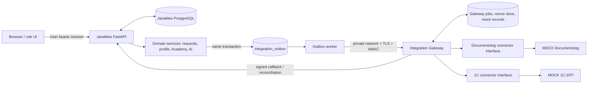

# JanaМен Integration Blueprint

**Architecture · Canonical contracts · Security · Mock demo · Acceptance plan**  
Prepared 18 October 2026. Based on the supplied QA report and prior integration design.

## Executive framing

JanaМен's reported local MOCK vertical slice includes a separate gateway, persistent jobs/nonces, HMAC-signed callbacks, a transactional outbox, mock 1C employee snapshots, mock Documentolog registration, and a Docker outage/recovery journey. The QA report does **not** establish live 1C:ЗУП, live Documentolog, live Gemini, production mTLS, production operations, or backup/restore readiness.

The older design document says the gateway was not yet built; the later QA report describes it as implemented in the reviewed branch. This blueprint treats the later QA report as the latest baseline while requiring the implementation agent to verify the active branch before changing code. Preserve and harden working behavior rather than rebuilding blindly.

## How to use this blueprint

1. Architecture and integration logic
2. Canonical HTTP API contracts and signing
3. Security controls and threat model
4. Synthetic accounts, fixtures and demo runbook
5. Prioritized implementation plan and real-partner prerequisites
6. Thirty integration acceptance scenarios and evidence rules
7. Copy-paste coding-agent prompt

## Release labels

- **MOCK:** all relevant behavior uses synthetic fixtures/local mock connectors. Safe for a controlled demo if all other gates pass.
- **UNCONNECTED:** no verified active connector.
- **CONNECTED:** only after a real approved environment completes an authenticated integration health test. Never set this label from configuration alone.

---

# 1. JanaМен System Architecture and Integration Logic

## 1.1 Goal and scope

Complete a demonstrable, secure-by-default integration vertical slice that connects the existing JanaМен MVP to two **synthetic mock systems** through a separate integration gateway:

- **Mock 1C:ЗУП:** read-only employee and leave-balance snapshots.
- **Mock Documentolog:** asynchronous registration of approved HR documents, persistent job status, and signed callbacks.

Keep the architecture ready for real partner connectors without pretending that real connectors exist. The browser must never connect directly to either mock or real enterprise systems.

## 1.2 Current-state baseline from the QA report

The 17 October 2026 QA report describes these components in the current review branch:

- FastAPI application, static HTML/CSS/JavaScript frontend, SQLAlchemy models and Alembic migrations.
- Database-backed bearer sessions, database-owned roles, request workflow, history, audit, in-app notifications, Academy progress, and AI knowledge services.
- `integration_outbox`, a signed client worker, a separate gateway service, persisted gateway jobs/nonces, a mock Documentolog connector, a mock employee snapshot connector, and a signed callback route.
- PostgreSQL `FOR UPDATE SKIP LOCKED` for outbox claim, plus durable gateway job leases.
- A local Docker journey where approval succeeds while the gateway is stopped, the profile remains available offline, and recovery results in one MOCK registration/notice.

This is source-reported QA evidence, not independent confirmation of the repository currently open in the coding agent. Before editing, compare the current Git commit, Compose services, migration head, and test output with the QA report. Preserve proven working code.

## 1.3 Target architecture



**Trust boundaries:**

1. Browser to application: user session and role-based authorization.
2. Application to gateway: service-to-service authentication, canonical message signing, replay prevention, network restriction, and TLS in a production-like deployment.
3. Gateway to connector: allowlisted, configured connector only. No user-controlled URL or arbitrary host.
4. Gateway to mock systems: synthetic fixture stores. The mock connector must not call external networks.
5. AI provider boundary: integration payloads and employee records are not sent to AI Jana. Any optional model call has a separate data-governance gate.

## 1.4 Components and responsibilities

| Component | Owns | Must not do |
|---|---|---|
| Browser | Presentation, form input, accessible interaction | Decide a role, authorize an action, call 1C/Documentolog, store authoritative HR facts |
| JanaМен API | User authentication, role/scope checks, request workflow, audit, notifications, Academy, KB/AI rules | Call vendor APIs inside request/approval database transactions |
| JanaМен database | Business state, profiles/snapshots, requests, history, outbox, audit, notifications | Silently accept impossible state transitions or duplicate logical submissions |
| Outbox worker | Delivery attempts, retry timing, reconciliation | Change a request's business approval decision because a vendor is down |
| Integration gateway | Service authentication, canonical contracts, connector routing, durable job state, idempotency | Trust a browser role selector or accept a user's arbitrary connector destination |
| Mock 1C connector | Synthetic employee-code-keyed snapshots and change cursor | Become the source of truth for production HR data |
| Mock Documentolog connector | Deterministic mock document references, controllable transient/terminal failures | Call a real vendor or present a mock reference as a real registered document |
| HR integration admin UI | Mode, freshness, queue counts, failure reason, safe recovery actions | Expose secrets, raw signed payloads, or unrestricted replay controls |

## 1.5 Data ownership rules

| Data | Authoritative owner | JanaМен behavior | Integration direction |
|---|---|---|---|
| Employee name, employee code, department, job title, manager, hire date | 1C:ЗУП in production | Local read-only snapshot with `source`, `as_of`, `synced_at`, freshness | 1C → gateway → JanaМен |
| Official leave balance | 1C:ЗУП, subject to partner confirmation of balance semantics | Display last-known balance; separately account for approved days not yet confirmed by 1C | 1C → gateway → JanaМен |
| Request, status, comments, decision history | JanaМен | Own the workflow and audit | Internal |
| Registered document ID/number | Documentolog in production | Store `external_ref` separately from business status | JanaМен → gateway → Documentolog; result back |
| Academy catalogue/progress, approved HR KB and AI audit metadata | JanaМен | Persist locally and scope by authenticated account | Internal |
| Passwords, sessions, service keys | JanaМен/gateway security configuration | Hash user passwords, revoke sessions, rotate service keys, never expose secrets | Never to UI or vendors |

**Leave balance policy is a decision gate.** The previous design assumes the displayed value is the last successfully synced 1C balance minus approved days not yet confirmed by 1C. Jana Post/HR must confirm exact accrual, holiday-calendar, cancellation, and debit-confirmation semantics before real 1C integration.

## 1.6 Flow A: employee request to approved and registered document

1. Employee authenticates and submits a request. The API validates required fields, date range, role, and any business rules. The API creates a stable request ID and writes the request, history/audit event, notification, and any required accounting effect in one transaction.
2. The frontend receives the request result from JanaМен. It does not call the gateway.
3. An authorized manager reviews the request. The backend checks that the manager's database identity has authority over the employee and the request is still eligible for a decision.
4. Approval is committed together with the history event, audit event, employee notification, and immutable `integration_outbox` snapshot when that request type requires external registration. No network request runs inside this transaction.
5. The business status becomes `Approved` independently from integration status. The integration status begins at `PENDING` (or `NOT_REQUIRED` if the request type needs no document).
6. The outbox worker claims an eligible row safely, signs the canonical request, and sends it to the private gateway. Timeouts or transport errors do not reverse approval.
7. Gateway verifies key ID, timestamp, nonce, signature, schema, caller scope, and idempotency key. It persists a job before returning HTTP `202 Accepted` with a `gateway_job_id`.
8. Gateway worker claims the job with a durable lease. The mock connector creates one persisted synthetic document per idempotency key and produces a reference such as `MOCK-DOC-...`.
9. Gateway sends a signed callback to JanaМен. If callback delivery fails, the gateway retries persistently. JanaМен may also reconcile job status with the gateway.
10. Callback receiver verifies the machine signature, nonce, job/request/key match, payload schema, and allowed state transition. A single transaction updates integration status/reference, writes history/audit, and creates exactly one registration notification.
11. UI shows `Approved` plus a separate integration badge such as `REGISTERED · MOCK-DOC-...`. This must never be represented as real Documentolog registration.

### Request state and integration state are different state machines

**Business status:** `Pending → Approved | Rejected`; only authorized workflow operations can decide it. Once decided, a duplicate/conflicting decision does not create another event. Do not regress business status because an external service fails.

**Integration status:** `NOT_REQUIRED | PENDING | SENT | REGISTERED | FAILED | DEAD`. Define exact transitions in code and tests. Example: `PENDING → SENT → REGISTERED`; transient retries can remain `PENDING` with attempt metadata; validation rejection becomes `FAILED`; exhausted transient retries become `DEAD`. `FAILED` and `DEAD` must expose safe, actionable operational details to HR.

## 1.7 Flow B: scheduled 1C employee/balance synchronization

1. Scheduler requests changes after the last successful `updated_since` cursor.
2. Gateway authenticates the caller and reads mock or real connector through the connector interface.
3. Gateway returns a canonical list of employee snapshots with stable employee codes, source/as-of timestamp, and optional cursor.
4. JanaМен matches records by `employee_code` (табельный номер), never by name/email alone. Do not silently merge an ambiguous employee.
5. A single profile-sync service is the only writer of official profile fields. It updates the snapshot and sync metadata transactionally.
6. Unmatched or ambiguous codes, invalid balances, or manager-code mismatches enter a persisted HR review queue. They must not auto-create an account or silently change a user's role.
7. On failure, keep the last known snapshot; mark it stale based on a configured freshness threshold. Profile/dashboard endpoints continue to work while the gateway is unavailable.
8. HR manual refresh must be role-gated, rate-limited, audited, and display last attempt/result. A refresh cannot overwrite data with an empty or incomplete response unless the contract explicitly defines that behavior.

## 1.8 Failure classification and recovery

| Failure | Expected action | User-visible result |
|---|---|---|
| Gateway timeout, connection refused, 5xx, temporary mock outage | Retry with bounded exponential backoff + jitter; keep same key and body | Request remains Approved; integration shown Pending/retrying |
| Gateway returns accepted `202` | Record gateway job ID and poll/callback asynchronously | Sent/Pending until terminal result |
| Invalid request contract / known business validation rejection | Terminal `FAILED`; do not retry unchanged payload forever | HR queue contains a safe reason; employee approval remains Approved |
| Invalid HMAC, expired timestamp, replayed nonce, unknown key | Reject; security event; do not process business side effect | No state change; sanitized operational alert |
| Max retry attempts reached | Move to `DEAD`; retain event and key; require authorized reconciliation before replay | Visible HR failure requiring action |
| Callback duplicated or replayed | Reject replay when nonce repeats; terminal application also idempotent | Exactly one state change/notification |
| 1C unavailable | Retain last snapshot and cursor; retry next interval | Profile loads with stale indicator |
| Unknown employee code or conflicting mapping | Hold for HR review; no automatic account creation | Mapping queue and count in admin UI |
| Worker or gateway restart | Recover durable outbox/jobs/leases; query status before resubmitting uncertain work | No lost request or duplicate document |

## 1.9 Architecture decisions that should not be reversed casually

- Keep all vendor-specific code inside replaceable connectors behind the gateway.
- Keep approval and external document registration asynchronous and separate.
- Keep stable idempotency keys across all retries and restarts.
- Keep integration state separate from business request state.
- Preserve last-known employee snapshots during outages.
- Never use names as identity keys.
- Never use frontend role preview as authorization.
- Do not invent undocumented partner API routes, field names, electronic-signature formats, or leave-calculation rules.

---

# 2. Canonical Integration API Contracts

## 2.1 Contract ownership

These endpoints and payloads are **JanaМен-owned canonical contracts** for the MOCK gateway. They are not claims about the real Documentolog API or the actual 1C:ЗУП deployment. The vendor connector translates from this canonical contract to a partner-approved contract once Jana Post provides documentation and test access.

Use explicit schemas, bounded payload sizes, UTC timestamps, stable identifiers, and additive versioning. Unknown fields should be rejected or explicitly versioned, not silently mass-assigned to models.

## 2.2 Service authentication and signature

Headers on every machine-to-machine request:

- `X-Key-Id`: identifier of the active signing key; never the key itself.
- `X-Timestamp`: Unix timestamp in seconds, represented as a decimal string.
- `X-Nonce`: cryptographically random, single-use request nonce.
- `X-Signature`: Base64-encoded HMAC-SHA256 digest of the canonical signing message.
- `Content-Type: application/json` for JSON bodies.

**Canonical message:** reuse the exact existing implementation in `app/integrations/signing.py`. The QA report describes the components as method, path plus query string, timestamp, nonce, and SHA-256 digest of the raw request body, joined with newline separators. Before implementing any second signer, add a golden-vector test that pins byte encoding, HTTP method casing, path/query canonicalization, lowercase/uppercase digest, line endings, timestamp representation, and Base64 encoding. Both sender and receiver must use the same helper/contract. Never parse and re-serialize JSON before verifying a signature over the raw bytes.

Validation requirements:

1. Unknown, disabled, or retired key IDs are rejected.
2. Timestamp outside the configured skew window (proposed: ±300 seconds) is rejected.
3. Nonce must be unpredictable, scoped to caller/key, and durably unique until safely expired.
4. Signature comparison uses constant-time comparison, e.g. `hmac.compare_digest`.
5. Request body and query parameters are covered by the signature exactly as documented.
6. HMAC is message authentication, not transport encryption. Production traffic still needs TLS, with mutual TLS if required by the deployment threat model/partner.
7. Rate-limit and size-limit requests even when signed. A compromised service key must not create unbounded jobs.

## 2.3 Endpoint inventory

| Method | Path | Purpose | Expected result |
|---|---|---|---|
| `POST` | `/v1/documents` | Submit an approved request for asynchronous document registration | `202 Accepted`, stable job ID |
| `GET` | `/v1/documents/{idempotency_key}` | Reconcile status after timeout/lost callback | Canonical persisted job state |
| `GET` | `/v1/employees?updated_since={cursor}` | Read changed employee snapshots | Canonical paged/ bounded result |
| `GET` | `/v1/employees/{employee_code}` | Read one synthetic/partner snapshot | One canonical snapshot or `404` |
| `GET` | `/health` | Liveness/readiness status appropriate for the deployment | No secrets or internal stack traces |

Expose only needed endpoints on the internal network. Do not publish the gateway's port to the public host in the demo Compose profile. Separate liveness from readiness if health checks need to distinguish “process up” from “database/connector usable.” Health responses must not disclose credentials, internal connection strings, employee data, or detailed vendor error bodies.

## 2.4 Submit document request

### Request example

```json
{
  "schema_version": "1",
  "idempotency_key": "REQ-000005:v1",
  "kind": "VACATION_REQUEST",
  "request_code": "REQ-000005",
  "employee_code": "JP-10428",
  "period": {
    "start": "2026-11-23",
    "end": "2026-11-25",
    "days": 3
  },
  "approved_by_employee_code": "JP-10311",
  "approved_at": "2026-10-17T10:15:00Z"
}
```

Rules:

- `idempotency_key` is created once and never changes across retries. The key must be unique for the logical external registration event.
- `request_code` points to the JanaМен request. Do not use a mutable display label as a primary key.
- `employee_code` and approver employee code are synthetic/partner stable codes, not names or email addresses.
- Send only fields needed for registration. Do not send free-text reason, medical details, salary, employee name, or other unnecessary personal information by default.
- `period.start` and `period.end` use ISO `YYYY-MM-DD`; validate `start <= end` and the approved request's frozen period.
- `approved_at` must be timezone-aware UTC in RFC 3339 format.
- Gateway must persist a request fingerprint/body hash alongside the idempotency key. Same key + same body returns the existing job; same key + different body returns `409 Conflict` and does not mutate the job.

### Accepted response (`202`)

```json
{
  "schema_version": "1",
  "gateway_job_id": "job_demo_0001",
  "idempotency_key": "REQ-000005:v1",
  "status": "ACCEPTED",
  "accepted_at": "2026-10-17T10:15:01Z"
}
```

`202` means only that the gateway durably accepted the job. It does not mean a document was registered. The UI must not show `REGISTERED` until terminal evidence comes back or status reconciliation confirms it.

## 2.5 Query document job

Example path: `GET /v1/documents/REQ-000005%3Av1` (the exact path-encoding and signing behavior must be covered by a golden-vector test).

Response example:

```json
{
  "schema_version": "1",
  "gateway_job_id": "job_demo_0001",
  "idempotency_key": "REQ-000005:v1",
  "status": "REGISTERED",
  "external_ref": "MOCK-DOC-0001",
  "occurred_at": "2026-10-17T10:15:04Z",
  "mode": "MOCK"
}
```

Canonical terminal statuses are `REGISTERED` and `FAILED`. `ACCEPTED`/`PROCESSING` are nonterminal states. Return `external_ref` only on a successful registration. Use the persisted job record for duplicate requests and after restart; never re-run document creation merely because a response was lost.

## 2.6 Callback into JanaМен

Example callback body:

```json
{
  "schema_version": "1",
  "nonce": "random-single-use-callback-nonce",
  "idempotency_key": "REQ-000005:v1",
  "gateway_job_id": "job_demo_0001",
  "status": "REGISTERED",
  "external_ref": "MOCK-DOC-0001",
  "occurred_at": "2026-10-17T10:15:04Z",
  "mode": "MOCK"
}
```

Requirements:

- Callback authorization is independent of user bearer-token roles. A user JWT/bearer token is never sufficient.
- Verify signature against the raw request body; validate nonce/timestamp/key ID; persist replay protection.
- Verify the callback's job ID and idempotency key match the existing outbox row and expected request.
- Accept only valid terminal transitions. A stale callback cannot overwrite a newer terminal status or alter business approval.
- Process state update, integration history/audit, external reference, and one notification in a single database transaction.
- Duplicate logical callbacks must not repeat side effects. The replay nonce check is one layer; state transition idempotency and database uniqueness are another.
- For `FAILED`, require a bounded, sanitized `error_code`/`reason`; do not store unfiltered secrets or full vendor response bodies.

## 2.7 Employee snapshot contract

```json
{
  "schema_version": "1",
  "employee_code": "JP-10428",
  "full_name": "Demo Employee One",
  "company": "Jana Post Kazakhstan",
  "department": "Product Operations",
  "position": "Operations specialist",
  "manager_employee_code": "JP-10311",
  "hire_date": "2022-03-14",
  "leave_balance_days": 18.5,
  "as_of": "2026-10-17T09:00:00Z",
  "source": "MOCK_1C_ZUP"
}
```

Rules:

- `employee_code` is the match key. Names and emails are attributes, never the identity key.
- Use decimal-safe numeric handling for leave balances. Reject negative or invalid values unless the partner's official domain policy explicitly permits them.
- Store `source`, `as_of`, `synced_at`, and freshness status. Do not overwrite a fresh record with an older snapshot.
- A missing field is not automatically equivalent to a deletion. Explicitly define deletion/inactivation semantics with the partner.
- If a manager code is missing or cannot be resolved, place the mapping in HR review rather than granting or broadening manager scope.
- The response should be bounded/paginated. Include a stable continuation cursor if the actual source can return large datasets.

## 2.8 Idempotency, persistence, and retries

Minimum persistence records (table names may follow existing models rather than these illustrative names):

- Application `integration_outbox`: stable event ID/key, request ID, immutable payload snapshot/body hash, state, attempts, next attempt time, last safe error code, created/updated timestamps.
- Gateway jobs: unique idempotency key, body hash, job state, attempt count, lease metadata, terminal result, external ref, timestamps.
- Gateway document mock records: unique job ID/idempotency key and generated external reference.
- Nonce store: unique caller/key + nonce, timestamp, expiry; reject duplicates durably.
- Callback delivery records or equivalent durable status, so restarts do not drop pending callbacks.

Retry classification:

| Result | Retry? | Notes |
|---|---|---|
| Network timeout/reset/connection error | Yes | Same key and identical payload; reconcile status before resubmitting if outcome may have succeeded |
| `429`, retryable `5xx` | Usually yes | Respect bounded retry policy/`Retry-After` if implemented |
| `400` schema/business validation error | No unchanged retry | Terminal `FAILED`; HR must correct source/mapping and use controlled recovery |
| `401/403` signature/auth error | No automatic retry loop | Emit sanitized security/operations event; investigate config/key rotation |
| Same key, same body | No duplicate work | Return persisted job/receipt |
| Same key, changed body | No | `409 Conflict`; never mutate existing logical job |
| Max transient attempts exhausted | No further automatic retry | `DEAD`; reconciliation and authorized replay process required |

Suggested backoff: bounded exponential delay with jitter. Keep attempt policy configurable. Tests may advance a controlled clock or use a deterministic test policy; do not wait hours in a unit test. Production policy must be based on operational SLOs and partner rate limits.

## 2.9 Versioning and compatibility

- Put `schema_version` in canonical payloads and responses.
- Add fields compatibly where possible; do not repurpose a field with new semantics.
- Reject an unsupported major schema version with a safe error.
- Add contract tests to both sender and receiver, plus golden signing vectors.
- Gateway database schema must have a versioned migration plan before production operation. The QA report notes its initial `create_all` approach as an operational limitation for future upgrades.
- Publish OpenAPI for gateway canonical endpoints and update it whenever contracts change. Avoid publishing internal admin endpoints to public clients.

---

# 3. Security Plan and Threat Model

## 3.1 Security objective

Protect employee data and workflow integrity while ensuring an integration outage cannot corrupt or block the business decision. The design should align its control selection with OWASP API Security Top 10 and ASVS verification practices, and with secure development principles from NIST SSDF. This is an engineering plan, not a certification claim.

## 3.2 Security principles

1. **Default deny:** every route starts restricted; explicitly allow only the authorized action and resource scope.
2. **Server-owned roles:** a role selector or client-side state is presentation only. The backend loads role and active status from trusted database/session state.
3. **Least privilege:** employee, manager, HR admin, app worker, gateway, mock connector, and any real connector have separate permissions.
4. **Minimize data:** transmit only what a recipient needs; no free-text reasons by default in external document requests.
5. **No user-controlled destinations:** connector URLs come from protected configuration and are allowlisted. Prevent SSRF through partner URLs.
6. **Fail closed for trust, fail open for availability only where safe:** invalid auth/signature never runs side effects; vendor outage never rolls back a legitimate approval.
7. **Durability and idempotency:** the database, not in-memory flags, is authoritative for delivery/replay state.
8. **Audit without oversharing:** log actor, action, target ID, result, correlation ID, and safe error code; do not log tokens, keys, full PII, raw employee prompts, signed bodies, or unrestricted vendor responses.
9. **Explicit demo labels:** MOCK and synthetic records are visible in both UI and stored metadata.
10. **No custom cryptography:** use standard libraries and established protocols; HMAC is signing/authentication, not encryption.

## 3.3 Role and service authorization matrix

| Actor | Allowed | Denied by default |
|---|---|---|
| Employee | Own profile snapshot, own requests/history, own notifications, own learning progress, approved public HR KB | Other employees' requests/notifications, manager decision routes, HR admin routes, source approval, connector controls |
| Manager | Employee view in authorized reporting scope; approve/reject eligible requests within that scope; team queue | Out-of-scope employees, user role changes, global HR queue unless separately granted |
| HR admin | HR workflows, mapping/failure queues, approved refresh/recovery operations, knowledge approval if explicitly in role | Arbitrary service-secret access, unrestricted payload dumping, changing audit history, treating mock as live |
| Application worker | Read eligible outbox rows; update delivery metadata; contact configured gateway | Change user roles, access unrelated employee profile data, call arbitrary URLs |
| Gateway service identity | Submit/read canonical integration jobs, read fixture snapshots, send callbacks using machine credentials | User login, general browser access, arbitrary vendor destinations |
| Mock connector | Access synthetic fixture data and its own persistent job/document store | External network calls, production credentials, unsynthetic user records |
| Real 1C service account (future) | Read approved employee fields and agreed balance service only | HR writes, payroll execution, employee creation, generic 1C administration |
| Real Documentolog service account (future) | Create/query only approved document type and required metadata | Broad document search, signing/registration of unrelated document types, admin operations |

Every object endpoint must enforce object-level access as well as role-level access. Never rely on hidden buttons or route names as access controls.

## 3.4 Authentication and session controls

- Use current database-backed session/token design and verify token expiration, revocation, active user state, and database-owned role on every protected operation.
- Store passwords with a maintained password-hashing function and appropriate settings. Never log passwords or return hashes.
- Rate-limit sign-in and sensitive actions. The QA report notes the login throttle is per-process, so production deployment needs a shared/distributed mechanism or a documented rate-limit layer at the edge.
- Use short, bounded session lifetimes appropriate to the threat model, and revoke sessions on logout/credential changes where supported.
- Do not persist bearer tokens in unsafe script-readable storage merely to preserve navigation. Design session restoration deliberately and document XSS implications.
- The frontend's `Preview: Employee/Manager/HR` selector is demo navigation only. A security demo must log in to actual role accounts and demonstrate that an employee token receives denial from manager/HR routes.

## 3.5 Service-to-service security

### HMAC and replay prevention

- Reuse `app/integrations/signing.py`; do not create a second inconsistent signer.
- Sign method, canonical path including query, timestamp, nonce, and SHA-256 of raw body bytes as implemented and pinned by golden-vector tests.
- Reject invalid signature, unknown/retired key, expired timestamp, reused nonce, malformed message, body hash mismatch, and unauthorized route.
- Persist nonce uniqueness durably across restart. Define a retention/expiry policy at least as long as the accepted timestamp skew plus operational margin.
- Compare signatures in constant time.
- Keep machine credentials independent from employee tokens and roles.

### TLS and network

- Local MOCK Compose may use internal HTTP plus HMAC only if network-isolated, bound to a private/internal Docker network, and clearly marked non-production.
- Real or production-like deployment requires TLS; use mTLS where the partner/system boundary calls for workload identity or contractual requirement. Verify certificate chain, hostname, expiry, rotation, and rejection of invalid certificates.
- Keep the gateway off public host ports. Do not add a permissive `0.0.0.0` exposure for convenience.
- Egress rules should allow only configured partner/gateway destinations and required name resolution. Default-deny other outbound traffic from connector containers when practical.

### Key lifecycle

- Read secrets from protected environment/secret manager, not source or images.
- Never store a private key/HMAC secret in JSON fixtures, YAML committed to Git, test snapshots, README, screenshots, or logs.
- Include key ID on every signed request. Support staged rotation with old and new keys overlapping for a limited migration window, then retire the old key.
- Generate sufficiently long random keys. Reject weak/short secrets through configuration validation.
- Have a procedure to revoke a suspected compromised key and reconcile any in-flight event.

## 3.6 Data protection and privacy

- Use synthetic records for demos. Do not seed real employee personal data, salary, bank details, government identifiers, health details, or real HR secrets.
- For document registration, pass only employee code, request code, approved dates/days, approver code, approved timestamp, and fields contractually required. No free text unless an approved legal/operational requirement explicitly justifies it.
- Keep AI Jana separate from the integration pipeline. Integration jobs and personal profiles must not be placed into the model prompt or provider request. Follow the QA report's default-off external-provider approval gate; the flag itself is not proof of organizational approval.
- Approved knowledge sources may themselves contain PII. Add source-owner approval, classification, retention/residency review, and a pre-export scanning/redaction process before enabling an external model.
- Define retention and deletion rules for request bodies, audit metadata, nonces, callbacks, synthetic fixtures, logs, and external references.
- Encrypt database volumes/backups and protected secrets at rest in production. Define restore tests rather than relying on the word “backup.”

## 3.7 Threats and mitigations

| Threat | Impact | Preventive/detective control | Acceptance evidence |
|---|---|---|---|
| Employee changes UI role state | Unauthorized approval or data access | DB-backed role/scope checks on every endpoint | Employee token denied on manager/HR routes even if frontend role selector changes |
| IDOR via request/profile/notification ID | Employee data leak or unauthorized changes | Owner/scope checks for every object lookup/mutation | Cross-user probes return `403` or intentionally non-enumerating `404` and no data |
| Forged callback | Fake registration or data corruption | HMAC, timestamp, nonce, key ID, schema, expected job/request/key match | Invalid signature/body/key/nonce produces no state change |
| Captured request replay | Duplicate registration | Durable nonce uniqueness and idempotency key | Replayed nonce rejected; same idempotency key returns existing job |
| Same key with changed body | Wrong period/document attached to event | Body hash/fingerprint tied to key | `409`; persisted job and document unchanged |
| Gateway outage during approval | Lost or blocked HR decision | Transactional outbox + retries; business status separate | Approval commits with gateway stopped; event survives and recovers |
| Callback lost after registration | Status stuck at SENT/PENDING | Persistent callback retry and GET reconciliation | Gateway job's terminal status reconciles without new document |
| Gateway worker crash | Lost/inconsistent job | Durable jobs, lease expiry, atomic connector/result transaction | Restart resumes job and produces one document |
| Duplicate initial request submission | Duplicate employee advance/vacation records | Request-level client idempotency key + DB unique constraint | Serial and concurrent same-key submission produce one request |
| Malicious connector response | Unsafe state/overwritten fields | Strict schema, enums, bounded strings, safe parsing, no mass assignment | Invalid response rejected and last-known state retained |
| SSRF via connector URL | Access to internal metadata/services | No user-controlled URL; strict configured allowlist | Injection attempts do not change destination or contact unapproved host |
| Secret leaks in logs | Credential compromise | Structured allowlisted logs and regression tests | Test secrets and PII absent from logs/errors |
| Employee PII to AI provider | Privacy exposure | Raw query remains local; source-only quote selection; default-off provider gate | Inspect outbound HTTP body; test synthetic identifiers and raw questions absent |
| HR replays a DEAD job incorrectly | Duplicate external record | Role-gated audited replay and status reconciliation first | Replay requires explicit action, reuses immutable key, documents preflight result |
| Demo mock mistaken for real vendor | Misleading stakeholder claim | Mode field and visible MOCK badges in admin and request UI | Screenshots/runbook visibly say MOCK; no CONNECTED mode without validated health proof |

## 3.8 Database and API hardening relevant to integration

- Additive database constraints for domain invariants where supported: nonnegative leave balance (if business policy permits no negative value), valid date order, known status enum, unique logical idempotency key. Validate existing rows before adding constraints; do not silently mutate existing data.
- Keep migrations explicit and versioned. QA report says gateway initialization currently uses `create_all`; production must have versioned migrations and tested upgrades/rollback strategy.
- Validate pagination bounds, query filters, string lengths, enum values, dates/time zones, decimal precision, and request body size.
- Keep consistent error schemas with correlation IDs and no stack traces/raw connector payloads.
- Use timeouts for every outbound operation, bounded retries, and concurrency limits. A worker should not queue infinite tasks in memory.
- Keep a current API inventory and do not expose debug/diagnostic routes beyond the intended network.

## 3.9 Logging, monitoring, and incident response

Log these fields where appropriate: UTC timestamp, service, environment/mode, correlation ID, request/outbox/job ID, actor/service identity, action, result/status, attempt, duration, safe error category, and key ID (not key value).

Never log: passwords, access tokens, HMAC secrets, raw signed payloads, full HR snapshots, employee free text, sensitive model prompts, or unredacted vendor errors.

Minimum operational metrics/alerts:

- Outbox rows by state and oldest pending age.
- Gateway jobs by state, attempt count, and oldest processing age.
- Callback delivery failures and reconciliation count.
- Last successful employee sync and snapshot age.
- Unknown employee mapping count.
- Signature rejection, nonce replay, unknown key, and malformed contract counts.
- Worker heartbeat and health status.
- Count of MOCK jobs/documents created, clearly separated from real connector metrics.

On suspected compromise: disable/revoke key, isolate gateway, preserve audit evidence, stop automatic replay, reconcile external job status, rotate credentials, and only then resume delivery. Incident runbooks must not require deleting outbox rows or audit events.

## 3.10 Release gates

No claim of production readiness until all applicable gates pass:

- Partner-approved data and external AI policy.
- Real vendor interface docs, test systems, canonical-to-vendor mappings, and correct service accounts.
- TLS/mTLS handshake, certificate ownership/rotation, network controls, and threat model review.
- Role/object/function authorization tests, duplicate submission protection, signature/replay/idempotency tests, and independent-worker concurrency tests.
- Versioned gateway migrations, backup/restore rehearsal, capacity/timeout/retry policy, monitoring, alerting, on-call ownership, and CI security gates.
- HR approval of leave balance, holiday-calendar, request type, signature, and document registration semantics.

---

# 4. Mock Fixtures, Demo Accounts, and Runbook

## 4.1 Demo goal

Make a judge or stakeholder see one concrete, understandable end-to-end effect: an employee submits a request, an authorized manager approves it, the integration gateway asynchronously registers exactly one synthetic document, and the employee/HR UI shows the resulting state. Then prove resilience by taking the MOCK gateway offline and recovering it without losing approval or creating a duplicate document.

The demo is a synthetic integration proof, not real enterprise connectivity.

## 4.2 Demo-account design

Seed accounts through a development-only seed command or fixture loader. The repo currently uses demo-like employees in screenshots/tests; verify and reuse existing test fixtures rather than creating a second incompatible identity set.

| Demo identity | Login label (suggested) | Role | Employee code | Access scope |
|---|---|---|---|---|
| Employee One | `demo.employee@janamen.test` | `employee` | `JP-10428` | Own profile, requests, notifications, Academy |
| Manager One | `demo.manager@janamen.test` | `manager` | `JP-10311` | Only assigned direct reports including `JP-10428` |
| Employee Two | `demo.employee2@janamen.test` | `employee` | `JP-10429` | Own data; may be a second direct report |
| Out-of-scope Employee | `demo.outside@janamen.test` | `employee` | `JP-10999` | Not in Manager One's scope; used in IDOR tests |
| HR Operator | `demo.hr@janamen.test` | `hr` | `JP-HR-0001` or no employee code if schema permits | HR queue, integration state, mapping review, safe refresh/replay if implemented |

These are example fixture labels, not accounts confirmed to exist in the current repo. The implementation agent should map them to the actual user/profile model. Employee codes and all data must be synthetic.

### Password handling

- Do not commit known demo passwords to the repository or docs.
- Seed credentials only when `DEMO_MODE=true` and the environment is explicitly local/disposable.
- Generate temporary passwords and print them once to the local operator or create a private ignored `.env.demo` file with restrictive permissions. Avoid static shared passwords in a public hackathon repo.
- Production mode must refuse development seeding and refuse predictable demo credentials.
- Document a one-command reset for the isolated demo database only. Never point reset commands at an existing user's DB.

## 4.3 Seed data

Use a deterministic small data set with clear labels and stable identifiers:

| Entity | Suggested fixture | Purpose |
|---|---|---|
| Employee `JP-10428` | Department Product Operations, manager `JP-10311`, balance 18.5 days as of a fixed UTC timestamp | Main happy-path employee |
| Employee `JP-10429` | Same manager, different synthetic profile and balance | Team queue and manager scope |
| Employee `JP-10999` | Manager `JP-10998`, not report of `JP-10311` | Object-level authorization denial |
| Vacation request | One Pending request for `JP-10428`, dates generated relative to the demo date | Manager approval and external doc registration |
| Advance request | One independent Pending request with synthetic reason only in JanaМен DB | Business workflow; do not claim it triggers payroll/payment |
| Existing completed request | One Approved + REGISTERED/MOCK request | Show prior integration result without re-triggering it |
| Mock connector error mode | One transient failure profile and one permanent validation failure | Retry/DEAD and FAILED flows |
| HR source | Two known employees plus one unmapped employee code as a separately toggleable fixture | HR mapping queue demonstration |

Never hard-code test dates that become invalid or overlap on rerun. Generate dates based on a fixed test clock or an explicit date offset, and isolate each run in a fresh disposable dataset. If demo records persist between presentations, the seed operation must be idempotent and the runbook must use a unique scenario key or safely reset only the isolated demo DB.

## 4.4 Demo environment rules

- Use a dedicated Compose project name, dedicated demo database/volume, and private demo environment file outside Git.
- Start with `docker compose config` and `docker compose ps`; inspect actual service names before using `stop`/`start` commands.
- Verify the gateway has no public host port and is attached only to the intended internal network.
- Never run destructive `down -v`, database reset, migration downgrade, or seed wipe commands against the developer's primary stack. The runbook must print the selected Compose project and database host before any destructive operation.
- Do not use live production identifiers or copy real HR records into the fixture set.
- Keep logs sanitized and avoid printing `.env` contents.

## 4.5 Happy-path presentation (about 4 minutes)

1. **Login as Employee One using real backend authentication.** Do not rely on the frontend preview-role selector to prove authorization.
2. Open My Profile. Show synthetic employee code, `MOCK_1C_ZUP` source, as-of timestamp, last sync time, and a visible MOCK badge.
3. Submit a vacation request using dates generated by the seeded scenario. Show the persisted request ID and Pending business status.
4. Log in as Manager One in a separate browser profile/session. Show only the authorized team queue; approve the request.
5. Show that request business status is Approved even if the integration state is still Pending/Sent. Explain that approval is not blocked by Documentolog.
6. Wait for the local MOCK job to reach terminal status or use the UI refresh/reconciliation control. Show `REGISTERED · MOCK-DOC-...` and exactly one registration notice/history event.
7. Log in as HR Operator. Show the integration dashboard card: mode `MOCK`, pending/failed/dead counts, last successful registration/sync time, and the synthetic job/reference. No real connection badge should appear.

## 4.6 Resilience presentation (about 2 minutes)

Perform this only against the isolated demo Compose project.

1. Create/identify a new seeded request event with a unique scenario ID.
2. Stop the gateway service using the verified service name for the isolated project.
3. Approve the request. Confirm business status commits as Approved, and outbox row remains pending/retryable. Confirm profile reads continue to work from the last-known snapshot.
4. Restart the gateway. Confirm the same event is delivered/reconciled, and the gateway has exactly one job and one mock document for the key.
5. Confirm one external registration notification, not two.
6. In a separate scripted test, demonstrate a terminal validation error and an exhausted-retries DEAD state. Avoid altering the main happy-path fixture.

## 4.7 Security presentation (about 90 seconds)

- Employee token calls a manager/HR endpoint: denied.
- Manager token attempts to approve an out-of-scope request: denied.
- Replay the same signed request with the same nonce: rejected.
- Change the body while reusing the same idempotency key: conflict/rejection, no duplicate document.
- Send an unsigned/tampered callback: rejected with no state change.
- Show AI Jana's provider boundary separately: raw employee question and synthetic identifiers do not leave the app; external provider use remains disabled unless the organization's data policy explicitly enables it.

Do not demonstrate attacks against a public or partner system. Use local automated tests or controlled requests to the isolated mock environment.

## 4.8 Admin UX requirements

The HR integration card should show data, not hard-coded counters:

- Mode per connector: `UNCONNECTED`, `MOCK`, or `CONNECTED`. `CONNECTED` only when a real connector has authenticated successfully and the mode is configured for a verified environment.
- Last successful employee sync timestamp and data age.
- Pending, retrying, failed, and dead outbox/job counts.
- Last successful document registration time.
- Safely sanitized last error category, retry count, and next retry time.
- Unknown employee mapping count and an explicit review action.
- Safe replay/remap buttons only when authorization, audit, reconciliation, and duplicate protection are implemented. Hide or disable unsafe action if not implemented.

Every mock status/ref in employee-facing UI must be identified as MOCK. The admin mode alone is not enough if employee request cards display an external-looking reference.

## 4.9 Operational command pattern

Use the actual service names from `docker compose ps`; these are patterns, not blindly executable commands:

```bash
# From the repository root, using the dedicated private demo env file:
docker compose --env-file /path/to/private-demo.env -p janamen-demo --profile integrations config
docker compose --env-file /path/to/private-demo.env -p janamen-demo --profile integrations up --build -d
docker compose --env-file /path/to/private-demo.env -p janamen-demo --profile integrations ps
docker compose --env-file /path/to/private-demo.env -p janamen-demo --profile integrations logs --tail=100
```

Stop/restart only after confirming the integration service name and project:

```bash
docker compose --env-file /path/to/private-demo.env -p janamen-demo --profile integrations stop <gateway-service>
docker compose --env-file /path/to/private-demo.env -p janamen-demo --profile integrations start <gateway-service>
```

Use the repository's existing health checks, smoke-test command, migration command, and seed command after verifying their source. Do not guess a destructive command. Keep exact actual commands and test logs in a run artifact, excluding secrets.

## 4.10 Demo readiness checklist

- [ ] Fresh isolated project can be started from instructions.
- [ ] Seed command is safe to repeat; credentials are generated/privately delivered.
- [ ] All accounts log in through backend auth and have expected DB roles/scopes.
- [ ] `MOCK` mode and synthetic data are visible in UI.
- [ ] Employee → manager approval → async registration → callback/reconciliation works.
- [ ] Duplicate request submission and duplicate registration are prevented.
- [ ] Gateway-offline approval and post-restart recovery work with one document/notification.
- [ ] `FAILED` and `DEAD` cases are visible and never reported as registered.
- [ ] AI Jana remains outside the integration data plane and follows its separate source/privacy policy.
- [ ] Smoke test passes twice consecutively with fresh/deterministic fixtures.
- [ ] Full test suite passes on intended database; Docker health state and actual browser path are recorded.
- [ ] Final screenshots and talk track clearly distinguish MOCK from real systems.

---

# 5. Integration Implementation Plan and Release Gates

## 5.1 Delivery posture

Do not rebuild the integration design from zero. The 17 October QA report says a local MOCK gateway and outage/recovery path already exist. First verify the actual repository state and reproduce that result. Change only proven gaps, preserve stable APIs/signing helpers, and keep each change small enough to test independently.

## 5.2 Phase 0: baseline and safety (first)

**Objective:** prove which code exists in the active branch and create a repeatable safe test harness.

Tasks:

1. Record Git branch, commit, dirty files, Python/runtime versions, migration head, Compose project/service names, and config mode without printing secret values.
2. Inspect `app/integrations/signing.py`, `app/integrations/outbox.py`, `app/integrations/profile_sync.py`, `app/routers/internal.py`, `app/gateway/main.py`, `app/gateway/runtime.py`, `app/gateway/connectors.py`, gateway models/config, Compose, migrations, and existing integration tests.
3. Run the exact existing targeted gateway/integration tests first, then the full suite on SQLite and PostgreSQL 17 where configured.
4. Verify the isolated MOCK Compose project. Confirm no public gateway port, and that demo database/volume/env are separate from any existing stack.
5. Save a baseline report with exact command, exit code, test count, commit ID, and limitations.

**Gate:** do not make integration code changes until current behavior and baseline failures are understood.

## 5.3 Phase 1: close core logical correctness gaps

### P1.1 Request submission idempotency (reported QA-F05)

Even if document registration is idempotent, initial request creation is not protected against a browser timeout/retry. Implement a client-generated submission key and employee-scoped unique constraint (or equivalent safe contract). Store a fingerprint of the canonical request body.

Acceptance:
- Same employee + same idempotency key + same body returns the same request/result and creates no extra request/history/notification.
- Same key with a changed body returns `409 Conflict` without mutating the original request.
- Different employee keys do not collide.
- Concurrent simultaneous same-key requests create exactly one request on PostgreSQL.
- UI reuses the key for a retry of the same form submission; it creates a new key only when the user intentionally starts a new request.
- Add migration preflight to find any prior duplicate data before adding constraints. Do not delete/fold existing requests automatically.

### P1.2 Outbox/gateway state transitions

- Pin status enumerations and legal transitions in code/tests.
- `202 Accepted` records acceptance, not registration.
- Timeout after successful gateway acceptance must reconcile by key before creating more work.
- Same key + changed body is rejected.
- `FAILED` is terminal for validation/business errors; `DEAD` is terminal for exhausted retryable failures. They should not be interchangeable.
- Business `Approved` remains approved when integration fails.

### P1.3 Callback and registration atomicity

Verify update/reference/history/audit/one notification are one transaction. Verify duplicate nonce is rejected and even a semantically duplicated callback with a fresh nonce cannot repeat terminal side effects. Ensure matching request ID, gateway job ID, and idempotency key are required.

## 5.4 Phase 2: operational recovery and observability

### P2.1 Authorized recovery controls (reported QA-F04)

Provide HR-only inspection and a safe action to retry/remap only after reconciliation. Before replay:

1. Read current gateway status by original idempotency key.
2. If registered, reconcile the reference and do not create again.
3. If definitively rejected for correctable input, require explicit operator correction/review and create a new documented version/event only if the business contract permits it; do not silently mutate the immutable original payload.
4. If transient attempts exhausted, retry using the original key and original payload unless an explicit versioned correction process applies.
5. Audit actor, timestamp, reason, original state, reconciliation result, and resulting state.
6. Require CSRF-protection if auth uses cookies; with bearer-only API, still require authentication, role and same-origin protections applicable to the UI.

If no safe replay/remapping path can be completed within the hackathon, show failure inspection and document that replay is not implemented. A disabled button is safer than a fake working control.

### P2.2 Observable integration card

Serve counts and last-success timestamps from actual persisted states. Include mode, last 1C snapshot freshness, outbox states, gateway terminal states, last registered document, safe error category, and mapping queue count. Do not calculate important counters from frontend demo state.

### P2.3 Repeatable smoke suite (reported QA-F07)

Replace fixed stale dates with a test clock/fresh fixture or a unique disposable scenario. The smoke suite must be safe to rerun twice. It must not silently delete user requests or reset a non-disposable database. Exit nonzero with actionable diagnostics on a genuine failure, not because yesterday's successful record still exists.

## 5.5 Phase 3: resilience, schema and concurrency hardening

- Exercise two independent app-worker processes against PostgreSQL and prove no unsafe duplicate send/claim.
- Test worker crash before send, after gateway acceptance but before ack is saved, after document creation but before callback, during callback retry, and after restart. Reconcile with stable idempotency key in each uncertain case.
- Add gateway schema versioning/migrations before nontrivial future schema changes; test a fresh install and an upgrade from the previous schema.
- Plan additive DB CHECK/enum/date/decimal constraints with preflight queries and migration tests. Do not silently auto-correct existing data.
- Make all connector/network timeouts explicit; set bounded connection pools, payload limits, concurrency limits, and retry ceilings.
- Add backup/restore rehearsal and operational runbook for any database expected to preserve jobs and nonce state.

## 5.6 Phase 4: security gates

- Test every documented API operation for anonymous, expired, revoked, wrong-role, wrong-scope, cross-object, malformed-input, and abusive-rate behavior.
- Add golden vectors for canonical signing, query-string escaping, raw body bytes, timestamp boundaries, key rotation, old/retired key, and nonce persistence after restart.
- Verify gateway is private/internal and egress is constrained.
- Test provider boundary for AI Jana separately: raw question/PII never included in outbound request; no integration records in model input; explicit approval is default-off and source data governance is a separate requirement.
- Add secret scanning, dependency audit, lint/type checks, tests, Docker build, smoke test, and migration test to CI.
- Fix accessible dialog focus trap and keyboard behavior because the QA report reproduced a focus-escape defect. It is not a gateway defect, but it affects complete demo/release quality.

## 5.7 Phase 5: real partner integration (blocked on partner input)

### 1C:ЗУП

Required from Jana Post/HR/1C team:

- Approved test base and service account, read-only scope, supported protocol/API, firewall/VPN/private-link path, certificates, and responsible operator.
- Authoritative stable employee code and mapping/employee-inactivation policy.
- Field names, data types, time zone, sync cursor semantics, pagination limits, and deletion/changed-since behavior.
- Official leave-balance source/calculation, date boundaries, holiday calendar, correction/cancellation handling, and expected freshness.
- Tests using nonproduction synthetic/test employees.

Only implement the real connector after this is documented. Preserve the same canonical gateway contract and mock connector tests.

### Documentolog

Required from Jana Post/Documentolog:

- Vendor API documentation and approved test environment/base URL.
- Document types, required fields, validation rules, document-number/reference semantics, status polling or callback support, idempotency capability, and error classifications.
- Authentication, service-account scopes, signing requirements, rate limits, and network/certificate requirements.
- Whether a document needs an organization-level signature, who owns/operates that signature, and how test signature/registration is performed.
- Retry/reconciliation semantics, retention/audit requirements, and production support contact.

Do not guess vendor endpoints or signatures. Implement a vendor adapter behind the gateway and map the canonical request through a tested translation layer.

## 5.8 Definition of done by milestone

### Milestone A: working MOCK demo

- All required mock acceptance tests pass.
- A clean isolated Compose stack can be seeded, run, shown, and safely reset.
- Employee → manager approval → gateway 202 → mock registration → callback/reconciliation works.
- Gateway-offline approval and recovery works, with one mock document and one notice.
- 1C profile snapshot/freshness works and survives gateway outage.
- HR integration card reports persisted truth and visibly says MOCK.
- Request-level idempotency and safe repeated smoke are closed.
- No secrets or real employee data in committed files/logs.

### Milestone B: partner test integration

- Partner contracts and test environments are approved.
- Network/TLS/mTLS, credentials, field mappings, error/retry handling, and real system side effects are verified against the partner test systems.
- No production records are touched.

### Milestone C: production readiness

- Security, privacy/legal, monitoring/on-call, migrations, backup/restore, load/capacity, incident response, and business sign-off are complete.
- Real connector health is verified by a trustworthy test, not just an environment variable or UI badge.
- Rollback/reconciliation and duplicate external side-effect risks are understood and tested.

## 5.9 Recommended priority order

1. Phase 0 baseline.
2. Submission idempotency and stable payload/key semantics.
3. Callback/outbox/gateway reconcile correctness.
4. Repeatable demo smoke and seed data.
5. Observable HR integration card + safe failure queue.
6. Independent-worker/restart tests, gateway migrations, DB domain constraints.
7. CI/security gates and accessibility fixes.
8. Partner-specific connectors after external prerequisites are supplied.

---

# 6. Integration Acceptance and Evidence Plan

## 6.1 Test philosophy

A test result must correspond to a test that actually ran. Label every test `PASS`, `FAIL`, `PARTIAL`, `NOT VERIFIED`, `BLOCKED`, or `NOT APPLICABLE`, and record the environment and mode. Mock tests prove only mock behavior. Do not convert “code inspected” or “health endpoint returns 200” into a claim of real vendor connectivity.

Test layers:

- Unit: canonical signing, payload validation, status transition, retry scheduler, idempotency fingerprint.
- Service/integration: database transaction, outbox, gateway job store, nonce persistence, mock connector.
- API security: role/scope, signature, callback, malformed payload, body-size/rate controls.
- Full-stack: browser/auth/request/approval/status/notification.
- Operational: compose start, gateway stop/restart, worker restart, recovery and repeatability.
- Partner sandbox: separate future evidence for real 1C/Documentolog, TLS/mTLS, external side effects.

## 6.2 P0 acceptance matrix for MOCK integration

| ID | Scenario | Setup/action | Required assertion |
|---|---|---|---|
| INT-001 | Valid signed request | Send valid HMAC request with fresh nonce | Gateway accepts and persists one job |
| INT-002 | Invalid signature | Alter signature or body after signing | Reject; no job/document/side effect |
| INT-003 | Expired timestamp | Sign request outside accepted skew | Reject before processing |
| INT-004 | Nonce replay | Resend same nonce | Reject; no second job or side effect |
| INT-005 | Unknown/retired key | Use unknown or retired key ID | Reject; safe operational/security event |
| INT-006 | Same key, same body | Submit identical request twice | Same existing job returned/reconciled; one document |
| INT-007 | Same key, different body | Modify period/body but reuse key | `409`/contractual rejection; original record unchanged |
| INT-008 | Async receipt | Submit valid document | `202` means ACCEPTED, not registered; job ID is persisted |
| INT-009 | Callback success | Process registered mock job | External ref and REGISTERED status update once; one history/audit/notification |
| INT-010 | Callback tampering | Send unsigned/modified callback | Reject with no request state change |
| INT-011 | Callback duplicate | Same logical terminal result delivered again | No second history/audit/notification/registration |
| INT-012 | Gateway unavailable | Stop gateway and approve request | Approval commits; outbox remains durable/retryable; profile still loads |
| INT-013 | Gateway recovery | Restart service | Existing key reconciled; exactly one document and notification |
| INT-014 | Transient failure | Configure mock transient error | Retry with bounded delay; same key and payload |
| INT-015 | Terminal validation failure | Configure mock business rejection | `FAILED`, no infinite retry, reason sanitized and visible to HR |
| INT-016 | Retry exhaustion | Repeated transient failure | `DEAD` after configured limit, visible and persistent |
| INT-017 | Lost callback | Registration succeeds but callback delivery fails | Status reconciliation recovers result without a second document |
| INT-018 | Worker restart | Restart gateway worker with processing job | Lease expires/recovery resumes; one document |
| INT-019 | App worker concurrency | Two independent application worker processes claim events | No unsafe duplicate send/effect on PostgreSQL |
| INT-020 | Fresh 1C snapshot | Sync known employee code | Existing profile updated with source/as-of/synced_at |
| INT-021 | Unknown employee | Sync unknown code | HR review item; no auto-created account/profile authority |
| INT-022 | Stale snapshot | Stop gateway and read profile | Last-known snapshot remains available and marked stale |
| INT-023 | HR refresh throttle | Repeated manual refresh | HR-only, rate-limited, audited; failure retains last snapshot |
| INT-024 | Wrong manager scope | Manager tries out-of-scope request | Denied by backend; no side effects |
| INT-025 | Employee privileged route | Employee token calls manager/HR/callback route | Denied even if frontend role selector changes |
| INT-026 | Duplicate initial submission | Submit the same request idempotency key serially and concurrently | Exactly one business request and one set of initial side effects |
| INT-027 | Transaction rollback | Inject failure at request/notification/audit/outbox stage | No partial business state or orphan outbox row |
| INT-028 | Repeatable smoke | Run smoke suite twice consecutively | Both pass with isolated/generated fixtures; no persistent date-overlap failure |
| INT-029 | Mode truth | Switch between disconnected and mock mode in local configuration | UI reports UNCONNECTED/MOCK accurately; never CONNECTED without verified real probe |
| INT-030 | Log redaction | Cause signature/provider/connector error using synthetic secrets | Logs/errors do not expose keys, bearer tokens, raw payload, PII, or stack internals |

## 6.3 Additional security acceptance cases

- Invalid/missing/expired/revoked user tokens denied.
- Manager cannot see or approve requests outside DB-backed reporting scope.
- Employee cannot read another user's notifications, Academy progress, request details, or profile snapshot through ID enumeration.
- Request body rejects unknown fields/mass assignment; response DTO never exposes password hashes, session data, internal signing material, or unapproved profile fields.
- Oversized body, excessive page size, abusive refresh requests, and malformed timestamps are bounded.
- Callback status values and field lengths are constrained; `REGISTERED` without a valid external reference is rejected.
- Older callback cannot regress terminal integration state.
- Nonce store survives a gateway restart and has a tested expiry boundary.
- Key rotation accepts intended overlap, rejects retired keys after cutover, and does not log key values.
- Mock connectors have no external network access. All target URLs are configuration-owned.
- No integration payload is sent to Gemini/AI Jana; AI tests separately confirm source approval, privacy gate and safe fallback.

## 6.4 Evidence format

For each scenario record:

- Test ID and exact test name.
- Commit hash and working tree state.
- Environment: SQLite/PostgreSQL, Compose project, mode `MOCK`/`UNCONNECTED`/verified connected.
- Command or browser steps actually executed.
- Expected and observed result.
- Exit code/test report/log path.
- Data safety scope (disposable DB, synthetic records, no external vendor contacted).
- Limitation, if the scenario was simulated rather than exercised against a real system.

Do not include raw secrets, live employee data, DSNs, signed request bodies, or credentials in evidence files.

## 6.5 Final release checklist

- [ ] Full test suite passes on the intended DB engine.
- [ ] Integration acceptance matrix INT-001..INT-030 is covered; any non-applicable scenario has a reason.
- [ ] Contract signing vectors and payload schema versions are pinned.
- [ ] Request-level and gateway-level idempotency are each verified.
- [ ] Outbox transaction atomicity and callback atomicity pass fault injection.
- [ ] Separate worker-process concurrency test passes on PostgreSQL.
- [ ] Gateway jobs/nonces/callback queues persist across restart.
- [ ] Repeatable clean demo and outage/recovery script pass twice.
- [ ] HR UI reflects persisted integration state and visible MOCK markers.
- [ ] Unauthorized employee/manager tests pass with real backend tokens.
- [ ] No committed secrets, real employee data, or raw payload logs.
- [ ] Real vendor connectivity is explicitly marked NOT VERIFIED until partner test evidence exists.

---

# 7. Copy-Paste Prompt for the Coding Agent

You are the integration lead for JanaМен. Work inside the existing repository; do not rewrite the architecture or replace working code without evidence.

## Context

JanaМен is a Digital HR MVP with employee, manager, and HR views, a FastAPI backend, a database, an outbox worker, AI Jana, Jana Academy, and a gateway intended to isolate 1C:ЗУП and Documentolog connectors. The final QA report dated 17 October 2026 reports 400 tests passing on SQLite and the same 400 on PostgreSQL 17, a separate MOCK gateway, signed callbacks, persistent gateway jobs/nonces, and a successful local Docker stop/recovery journey. Treat those as claims to verify in the active checkout, not assumptions that license skipping verification.

The same report explicitly says there is no verified live 1C:ЗУП, Documentolog, Gemini, or production mTLS connection. The gateway database bootstrap has a future migration concern. The request-level duplicate submission, safe HR replay/remapping, repeatable smoke, DB CHECK gaps, independent worker concurrency, CI, mobile and accessible modal issues remain open.

## Mission

Make the MOCK integration demonstrably reliable end to end, safe to run repeatedly, secure by default, and straightforward to replace with real partner adapters later. Do not claim “production-ready” or “connected” without evidence.

## Phase 0: inspect, report, do not change yet

1. Report branch, commit, dirty files, migration head, Compose services, current configuration mode, and existing test counts. Never print secret values.
2. Inspect at least: `app/integrations/signing.py`, `app/integrations/outbox.py`, `app/integrations/profile_sync.py`, `app/routers/internal.py`, `app/routers/admin.py`, `app/gateway/main.py`, `app/gateway/runtime.py`, `app/gateway/connectors.py`, gateway and integration models/config, `docker-compose.yml`, migrations, current QA evidence, and integration tests.
3. Run existing targeted gateway/integration tests and then full tests for SQLite and PostgreSQL if the configured disposable environment is available. Save exact commands and exits.
4. Check that the QA environment is isolated from any pre-existing stack or user data. Do not run destructive migrations, volume deletion, data resets, or secret rotations without explicit authorization.
5. Compare current code and outputs with the QA report. Identify stale evidence before making code changes.

## Implementation sequence

### A. Preserve and verify the current vertical slice

- Employee submits request; authorized manager approves; transaction writes decision/history/audit/notification/outbox as applicable.
- Worker signs and submits a minimal request to the gateway.
- Gateway verifies signature/key/timestamp/nonce/body and stores a durable idempotent job before returning `202`.
- Mock Documentolog registers one persisted mock record and returns a deterministic MOCK reference.
- Signed callback or reconciliation updates integration state exactly once.
- Profile snapshots come only from the gateway/mock 1C connector and stay available with a stale marker during outage.
- Business status remains Approved when integration fails.

Do not invent partner API routes or change the existing HMAC canonicalization without golden-vector compatibility tests.

### B. Close idempotency gaps

- Add request-creation idempotency, not just document-job idempotency. Use a client-generated stable submission key and an employee-scoped database uniqueness constraint or equivalent concurrency-safe implementation.
- Same key/body returns the existing result; same key/different body returns conflict; concurrent submissions produce one request.
- Ensure the browser reuses a key on a retry of the same submission.
- Add preflight detection and a migration plan before any new unique constraint. Do not delete, merge, or silently alter existing records.

### C. Harden callback, outbox, and recovery

- Verify approval/outbox same transaction, no network call in the transaction, atomic callback effects, unique external registration, durable retry state, and recovery after worker/gateway restarts.
- Implement safe HR-only replay/remapping only if it can reconcile gateway state first, preserve immutable idempotency keys, record an audit event, and avoid duplicate document registration. If not safe to finish, leave controls disabled and report the gap rather than faking it.
- Add tests with separate app worker processes against PostgreSQL.

### D. Make the demo repeatable

- Add or repair a development-only synthetic demo seeder using the existing models/fixtures.
- Example roles: employee `JP-10428`, manager `JP-10311`, second report `JP-10429`, out-of-scope employee `JP-10999`, and HR operator. Use the repository's actual schema.
- Generate temporary credentials or store them only in an ignored private env file. Production mode must reject demo seeding/predictable passwords. Do not commit passwords.
- Use a fixed test clock or fresh generated dates, not fixed dates that become stale. A smoke suite must pass twice consecutively without deleting any user data.
- Ensure Compose project name, DB/volume, env file and service names are explicit and isolated.

### E. Security and visibility

- Keep gateway internal. Verify HMAC canonical path+query, raw-body hash, timestamp bounds, key ID lifecycle, durable nonce replay prevention, constant-time compare, request size limits, and safe logs.
- Never put employee free text or sensitive HR fields in the document integration payload unless formally approved and strictly required. Never send integration records to AI Jana.
- Add visible mode `UNCONNECTED`/`MOCK`; show `CONNECTED` only after a real connector performs a trustworthy authenticated readiness check.
- HR card counts and last-success times must come from persisted backend state.
- Verify role/object scope with real bearer sessions; the frontend preview selector is not authentication.
- Add CI gates for tests, lint, typing, migration tests, dependency/secret checks, build, and repeatable smoke if the repo supports CI setup.

## Non-negotiable rules

- Do not call live 1C, Documentolog, Gemini, email/push, or production services during local QA.
- Do not guess a vendor contract. Keep all vendor-specific mapping inside a connector.
- Do not invent cryptography, log secrets, bypass signature checks, disable auth, add public gateway ports, or convert an unverified connector to CONNECTED mode.
- Do not run destructive commands or reset an existing database/volume. Use a new isolated Compose project and disposable DB.
- Do not report tests as passed unless they actually ran in this session. State environment and exit code.
- Do not claim that all security is complete because unit tests pass. Identify operational/legal/vendor items still unverified.

## Required deliverables

1. `INTEGRATION_IMPLEMENTATION_REPORT.md`: current architecture, files changed, behavior delivered, exact commands/exit codes, test counts, Compose mode, and remaining gaps.
2. Updated integration docs/OpenAPI/schema examples if contracts changed.
3. `INTEGRATION_ACCEPTANCE_RESULTS.md`: table for INT-001..INT-030 with `PASS/FAIL/PARTIAL/NOT VERIFIED/BLOCKED/NOT APPLICABLE`, test name/command and evidence path.
4. `INTEGRATION_DEMO_RUNBOOK.md`: fresh isolated startup, seeded account labels, happy path, outage/recovery, security proof, reset boundaries.
5. New/updated tests for every behavior changed.
